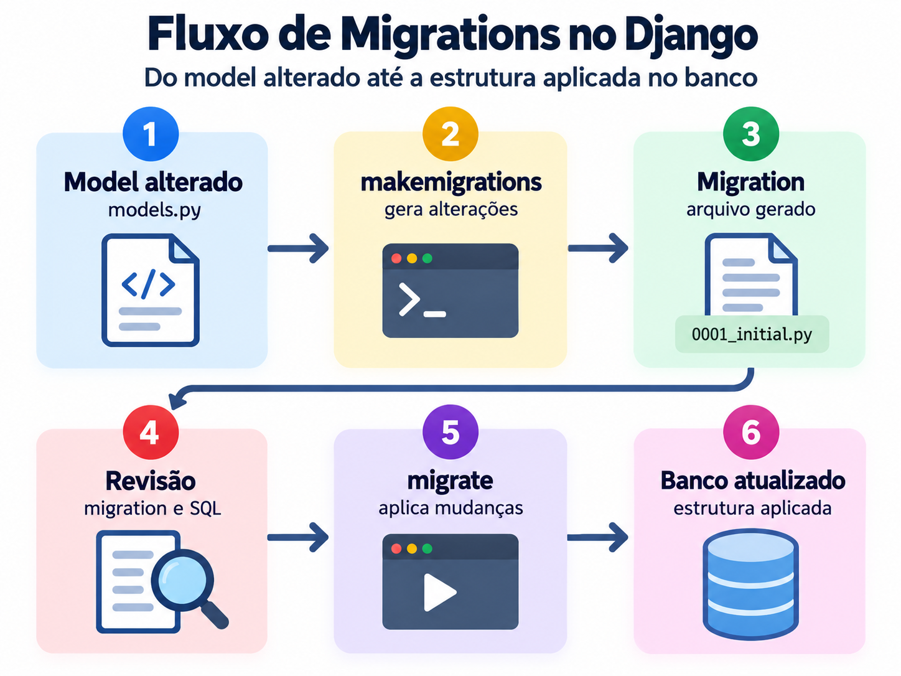
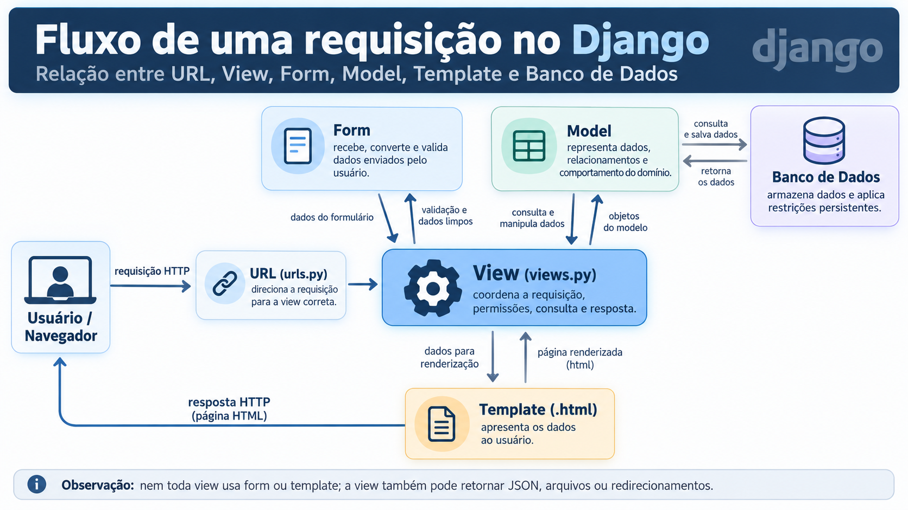

# Encontro - Django Models no SUAP EDU

## A. Introdução

**Título:** Django Models no SUAP: estrutura, persistência, consultas e regras de negócio.

**Carga horária sugerida:** 2 horas.

**Objetivo geral:** capacitar o participante a compreender como os models do
SUAP representam o domínio, criam estruturas no banco, aplicam regras e são
consumidos por forms, views, templates, admins e relatórios.

**Objetivos específicos:**

- compreender o papel do model no padrão MTV do Django;
- diferenciar classe de model, instancia, registro, tabela e `QuerySet`;
- conhecer campos, relacionamentos, opções e metadados do Django;
- entender `ModelPlus`, `LogModel` e os campos `Plus` do SUAP;
- compreender `objects`, `locals`, managers e querysets personalizados;
- executar consultas seguras e eficientes com o ORM;
- compreender `save()`, `delete()`, `clean()` e `full_clean()`;
- criar e revisar migrations;
- relacionar models com forms, views, templates, admins e permissões;
- distinguir `save()` de atualizações diretas com `update()`;
- implementar e testar um model simples integrado ao módulo EDU.

**Pré-requisitos:** Python orientado a objetos, fluxo URL -> view -> template,
forms, permissões e conceitos básicos de banco de dados relacional.

**Aprofundamento opcional:** o arquivo
[`apendice_models.md`](./apendice_models.md) reúne transações, concorrência,
operações em lote, signals, diagnóstico de desempenho e detalhes internos do
`ModelPlus`. Esses assuntos não fazem parte da carga obrigatoria deste encontro.

## B. Fluxo central do encontro

```text
Regra do domínio
        |
Classe de model
        |
makemigrations
        |
Arquivo de migration
        |
sqlmigrate / revisão do SQL
        |
migrate
        |
Tabela, colunas, índices e restrições
        |
Manager / QuerySet / ORM
        |
Form ou View
        |
Template, API, admin ou relatório
```

Fluxo de alteração de dados:

```text
request
-> form.is_valid()
-> cleaned_data
-> instancia do model
-> model.clean() quando full_clean() é executado
-> save()
-> SQL INSERT ou UPDATE
-> auditoria aplicável no SUAP
-> redirect ou resposta
```

Alerta conceitual para reforear desde o inicio:

```text
model.save() não chama full_clean() automaticamente.
```

Um `ModelForm` executa validações do model durante `is_valid()`, mas uma
instancia criada manualmente em uma view, task, shell ou command precisa de
tratamento explícito quando a regra depender de `full_clean()`.

## C. Sequência didática sugerida

| Tempo | Etapa | Conteúdo | Estratégia | Referências principais |
|---|---:|---|---|---|
| 15 min | 1 | Papel do model e organização do EDU | Explicaeeo conceitual e navegacao pelos arquivos | `edu/models/__init__.py`; `edu/models/alunos.py` |
| 15 min | 2 | Campos, opções, relacionamentos e `Meta` | Leitura orientada de models reais | `edu/models/plano_ensino.py:6-34`; `edu/models/historico.py:24-48` |
| 15 min | 3 | Recursos exclusivos do SUAP e managers | Comparar Django com `ModelPlus`, `LogModel`, campos `Plus`, `objects` e `locals` | `djtools/db/models/__init__.py`; `edu/models/logs.py`; `edu/managers.py` |
| 15 min | 4 | Metodos, regras, validacao e ciclo da instancia | Acompanhar criacao, validacao, gravacao e excluseo | `edu/models/plano_ensino.py:25-57`; `edu/models/cursos.py`; `edu/models/historico.py` |
| 10 min | 5 | ORM, consultas e desempenho | Executar consultas de leitura no shell | `edu/models/`; exemplos de `QuerySet`, `select_related` e agregação |
| 10 min | 6 | Integração com forms, views e templates | Seguir um dado do banco até a interface | `edu/forms.py`; `edu/views.py`; templates do EDU |
| 10 min | 7 | Migrations e comandos | Executar os comandos e revisar a migration antes de aplicá-la | `edu/migrations/`; comandos desta seção |
| 25 min | 8 | Prática principal | Ler um model real e executar consultas no shell | Roteiros descritos na Etapa 8 |

**Duração prevista:** 2 horas, incluindo prática e revisão.

### Navegação rápida pelas etapas

1. [Etapa 1 - Papel do model e organização do EDU](#etapa-1)
2. [Etapa 2 - Campos, opções, relacionamentos e Meta](#etapa-2)
3. [Etapa 3 - Recursos exclusivos do SUAP e managers](#etapa-3)
4. [Etapa 4 - Metodos, regras, validacao e ciclo da instancia](#etapa-4)
5. [Etapa 5 - ORM, consultas e desempenho](#etapa-5)
6. [Etapa 6 - Integração com forms, views e templates](#etapa-6)
7. [Etapa 7 - Migrations e comandos](#etapa-7)
8. [Etapa 8 - Práticas integradas](#etapa-8)

<a id="etapa-1"></a>

## Etapa 1 - Papel do model e organização do EDU

Antes de acompanhar uma tela do SUAP, é importante separar quatro conceitos
que aparecem juntos no código:

| Conceito | Função | Exemplo |
| --- | --- | --- |
| Classe de model | Define campos, relações e comportamentos | `class Turma(models.ModelPlus)` |
| Instância | Representa um objeto durante a execução do Python | `turma = Turma.objects.get(pk=10)` |
| Registro | Linha persistida na tabela do banco | a turma cujo `id` é `10` |
| Manager ou `QuerySet` | Localiza e combina consultas | `Turma.objects.filter(ativo=True)` |

O caminho de estudo parte da classe, acompanha uma instancia, observa a
consulta gerada pelo ORM e termina na gravação ou na exibição dos dados.

### 1. O que é um model no Django

Um **model** é uma classe Python que representa uma entidade do domínio da
aplicação e permite consultar e persistir seus dados por meio do ORM do Django.
Em vez de escrever SQL diretamente para cada operação, o desenvolvedor trabalha
com classes, objetos, atributos e métodos Python.

No EDU, entidades como aluno, turma, dierio e plano de ensino seo representadas
por models. Eles descrevem:

- quais dados a entidade possui;
- quais dados são obrigatórios ou opcionais;
- como ela se relaciona com outras entidades;
- quais restrições devem existir;
- como o objeto é apresentado;
- quais comportamentos e regras pertencem ao domínio.

O model não e apenas uma cepia da tabela. Ele e a representacao da entidade no
código e pode reunir estrutura, consultas, validações e comportamentos.

#### 1.1. ORM: ligação entre objetos Python e banco de dados

ORM significa *Object-Relational Mapping*, ou mapeamento objeto-relacional. O
Django traduz operações com objetos e `QuerySets` em comandos SQL executados no
banco.

correspondência inicial:

| No código Python | No banco de dados | Exemplo |
| --- | --- | --- |
| Classe de model | Tabela | `PlanoEnsino` |
| Campo do model | Coluna | `ementa` |
| Instância | Registro ou linha | um plano de ensino específico |
| `pk` | Chave primária | identificador do plano |
| `ForeignKey` | Coluna de chave estrangeira | `dierio_id` |
| `Manager` | Entrada para consultas | `PlanoEnsino.objects` |
| `QuerySet` | Consulta componível | `PlanoEnsino.objects.filter(...)` |

Exemplo de consulta com ORM:

```python
planos = PlanoEnsino.objects.filter(
    data_homologacao__isnull=False,
)
```

Conceitualmente, o Django transforma essa expressão em uma consulta SQL com uma
condição equivalente a `data_homologacao IS NOT NULL`. O desenvolvedor continua
trabalhando com um `QuerySet` de objetos `PlanoEnsino`.

> O ORM reduz a necessidade de SQL manual, mas não elimina a necessidade de
> compreender tabelas, chaves, índices, joins e custo das consultas.

#### 1.2. Herança do model no Django e no SUAP

Um model Django comum herda de `django.db.models.Model`:

```python
from django.db import models

class Exemplo(models.Model):
    nome = models.CharField(max_length=100)
```

No SUAP, a herança costuma ser indireta:

```text
django.db.models.Model
        -> djtools.db.models.ModelPlus
        -> edu.models.logs.LogModel
        -> PlanoEnsino
```

Referências no código:

- `ModelPlus`: `djtools/db/models/__init__.py:462-534`;
- `LogModel`: `edu/models/logs.py:82-149`;
- `PlanoEnsino`: `edu/models/plano_ensino.py:6-57`.

Assim, `PlanoEnsino` continua sendo um model Django, embora declare:

```python
class PlanoEnsino(LogModel):
    ...
```

`ModelPlus` e `LogModel` acrescentam comportamentos do SUAP, mas a persistência,
os campos, as migrations, os managers e os `QuerySets` continuam baseados no
ORM do Django. Essas classes serão detalhadas na Etapa 3.

#### 1.3. Exemplo real: estrutura de `PlanoEnsino`

**Arquivo:** `edu/models/plano_ensino.py`
**Linhas:** `6-18`

O trecho abaixo foi formatado em várias linhas e recebeu comentarios didaticos.
No arquivo original, os campos aparecem de forma mais compacta e sem esses
comentarios.

```python
# Define a entidade PlanoEnsino. A herança de LogModel acrescenta os recursos
# de ModelPlus é a auditoria acadêmica implementada pelo módulo EDU.
class PlanoEnsino(LogModel):
    # Relaciona o plano a um dierio. ForeignKeyPlus e a extenseo de
    # ForeignKey criada pelo SUAP. CASCADE determina que a excluseo do dierio
    # também exclua os planos de ensino dependentes.
    dierio = models.ForeignKeyPlus(
        'edu.dierio',
        on_delete=models.CASCADE,
    )

    # TextField armazena texto sem um limite curto predefinido. default=''
    # fornece uma string vazia quando o valor não e informado, enquanto
    # blank=True permite que o campo fique vazio na validacao dos forms.
    ementa = models.TextField(
        'Ementa',
        default='',
        blank=True,
    )

    # Registra a justificativa do plano. Possui as mesmas regras de
    # preenchimento adotadas para ementa.
    justificativa = models.TextField(
        'Justificativa',
        default='',
        blank=True,
    )

    # Armazena o objetivo geral do plano de ensino.
    objetivo_geral = models.TextField(
        'Objetivo Geral',
        default='',
        blank=True,
    )

    # Armazena os objetivos específicos do componente.
    objetivos_especificos = models.TextField(
        'Objetivos Especificos',
        default='',
        blank=True,
    )

    # Armazena os conteudos que serao trabalhados no componente.
    conteudo_programatico = models.TextField(
        'Conteudo Programatico',
        default='',
        blank=True,
    )

    # Descreve os procedimentos metodologicos adotados no plano.
    metodologia = models.TextField(
        'Metodologia',
        default='',
        blank=True,
    )

    # Permite registrar dados complementares que não pertencem aos campos
    # anteriores.
    informacoes_adicionais = models.TextField(
        'Informacoes Adicionais',
        default='',
        blank=True,
    )

    # Relaciona o plano ao funcionario que coordena o curso. null=True permite
    # NULL no banco. Como on_delete não foi informado, ForeignKeyPlus aplica
    # CASCADE por padrão nesta versão do SUAP.
    coordenador_curso = models.ForeignKeyPlus(
        'rh.Funcionario',
        verbose_name='Coordenador do Curso',
        null=True,
    )

    # As tres datas representam etapas diferentes do fluxo do plano. O campo
    # DateFieldPlus é uma extensão do SUAP para datas. null=True permite que a
    # etapa ainda não realizada seja armazenada como NULL.
    data_submissão = models.DateFieldPlus(
        'Data da Submisseo',
        null=True,
    )
    data_aprovacao = models.DateFieldPlus(
        'Data da Aprovacao',
        null=True,
    )
    data_homologacao = models.DateFieldPlus(
        'Data da Homologacao',
        null=True,
    )
```

Leitura do exemplo:

1. `PlanoEnsino` é a classe que representa a entidade.
2. `LogModel` e sua classe-base no EDU.
3. Os atributos declarados com `models.*Field` são campos do model.
4. `dierio` relaciona cada plano a um `Dierio`.
5. `ementa` armazena texto e aceita valor vazio no formulário.
6. Os campos de objetivo, conteedo e metodologia registram a parte pedagegica.
7. `coordenador_curso` relaciona o plano a um funcionário e aceita `NULL`.
8. As datas representam submissão, aprovação e homologação do plano.
9. Cada instancia de `PlanoEnsino` representa um plano especefico.

O atributo Python e a coluna do banco não possuem sempre o mesmo nome. Para a
chave estrangeira `dierio`, por exemplo:

```text
obj.dierio     -> objeto dierio relacionado
obj.dierio_id  -> valor da chave estrangeira armazenada no banco
```

#### 1.4. Campos, opções e metadados

Cada objeto de campo informa ao Django o tipo de dado e parte de suas regras.

#### Principais campos de um Model Django

| Campo | Descrição | Exemplo de implementação |
| --- | --- | --- |
| `CharField` | Texto curto | `nome = models.CharField(max_length=100)` |
| `TextField` | Texto longo | `descricao = models.TextField()` |
| `IntegerField` | Número inteiro | `idade = models.IntegerField()` |
| `FloatField` | Número decimal flutuante | `altura = models.FloatField()` |
| `DecimalField` | Número decimal preciso | `preco = models.DecimalField(max_digits=10, decimal_places=2)` |
| `BooleanField` | Verdadeiro ou falso | `ativo = models.BooleanField(default=True)` |
| `DateField` | Data | `data = models.DateField()` |
| `TimeField` | Horário | `horario = models.TimeField()` |
| `DateTimeField` | Data e horário | `criado_em = models.DateTimeField(auto_now_add=True)` |
| `EmailField` | Endereço de e-mail | `email = models.EmailField()` |
| `URLField` | Endereço URL | `site = models.URLField()` |
| `SlugField` | Texto para URLs amigáveis | `slug = models.SlugField(unique=True)` |
| `FileField` | Upload de arquivos | `arquivo = models.FileField(upload_to='arquivos/')` |
| `ImageField` | Upload de imagens | `imagem = models.ImageField(upload_to='imagens/')` |
| `UUIDField` | Identificador UUID | `uuid = models.UUIDField(default=uuid.uuid4, unique=True)` |
| `JSONField` | Dados no formato JSON | `dados = models.JSONField(default=dict)` |
| `ForeignKey` | Relacionamento muitos-para-um | `categoria = models.ForeignKey(Categoria, on_delete=models.CASCADE)` |
| `OneToOneField` | Relacionamento um-para-um | `perfil = models.OneToOneField(Perfil, on_delete=models.CASCADE)` |
| `ManyToManyField` | Relacionamento muitos-para-muitos | `tags = models.ManyToManyField(Tag)` |

Esses campos formam a estrutura básica do model. No SUAP, também aparecem versões com o sufixo `Plus`, que acrescentam comportamentos e integrações próprias do projeto.

#### Opções comuns dos campos

| Opção | Descrição | Exemplo de implementação |
| --- | --- | --- |
| `null=True` | Permite `NULL` no banco de dados | `idade = models.IntegerField(null=True)` |
| `blank=True` | Permite campo vazio na validação | `descricao = models.TextField(blank=True)` |
| `default=...` | Define um valor padrão | `ativo = models.BooleanField(default=True)` |
| `unique=True` | Exige valor único | `email = models.EmailField(unique=True)` |
| `primary_key=True` | Define a chave primária | `codigo = models.IntegerField(primary_key=True)` |
| `db_index=True` | Cria um índice no banco | `cpf = models.CharField(max_length=14, db_index=True)` |
| `choices=...` | Define opções preestabelecidas | `status = models.CharField(max_length=10, choices=STATUS_CHOICES)` |

#### Principais opções de campos no Django Model

| Opção | Valores possíveis / exemplo | Descrição |
| --- | --- | --- |
| `null` | `True / False` | Permite ou não `NULL` no banco de dados. |
| `blank` | `True / False` | Permite ou não valor vazio na validação de formulários. |
| `unique` | `True / False` | Exige que o valor seja único. |
| `default` | `0`, `''`, `True`, `None`, `dict` | Define o valor padrão do campo. |
| `primary_key` | `True / False` | Define o campo como chave primária. |
| `db_index` | `True / False` | Cria ou não um índice no banco. |
| `max_length` | `10`, `50`, `255` | Número máximo de caracteres. |
| `max_digits` | `5`, `10`, `15` | Total de dígitos de um `DecimalField`. |
| `decimal_places` | `0`, `2`, `4` | Quantidade de casas decimais. |
| `choices` | Lista ou tupla de opções | Restringe os valores permitidos. |
| `auto_now` | `True / False` | Atualiza a data/hora a cada salvamento. |
| `auto_now_add` | `True / False` | Define a data/hora apenas na criação. |
| `editable` | `True / False` | Permite ou não edição em formulários administrativos. |
| `help_text` | Texto (str) | Adiciona uma descrição de ajuda. |
| `verbose_name` | Texto (str) | Define um nome legível para o campo. |
| `validators` | Lista de validadores | Define regras adicionais de validação. |
| `upload_to` | Caminho (str) ou função | Define a pasta de upload de arquivos. |
| `on_delete` | `CASCADE`, `PROTECT`, `SET_NULL`, `SET_DEFAULT`, `RESTRICT`, `DO_NOTHING` | Define o comportamento ao excluir o objeto relacionado. |
| `related_name` | Texto (str) | Define o nome do relacionamento reverso. |
| `limit_choices_to` | Dicionário ou objeto `Q` | Filtra opções disponíveis em relacionamentos. |

As opções devem ser escolhidas conforme o significado do dado. Por exemplo, `blank=True` atua na validação dos formulários, enquanto `null=True` define como o banco representa a ausência de valor.

O bloco `Meta`, em `edu/models/plano_ensino.py:20-23`, configura o model como um todo:

```python
class Meta:
    verbose_name = 'Plano de Ensino'
    verbose_name_plural = 'Planos de Ensino'
    ordering = ('id',)
```

Nesse caso, `Meta` define os nomes de exibição e a ordenação padrão. Campos e `Meta` serão aprofundados na Etapa 2.

#### 1.5. Da classe Python para a tabela: migrations

Uma **migration** é um registro versionado da evolução do banco de dados.
Ela funciona como uma ponte entre duas situações:

- o estado dos models escrito em Python;
- o estado das tabelas, colunas, índices e relacionamentos no banco.

O Django não altera o banco apenas porque uma classe foi editada. Primeiro, a
alteração é transformada em um arquivo de migration; depois, esse arquivo é
executado pelo comando `migrate`. Cada migration recebe um nome e uma ordem,
formando um histórico que permite criar o banco de forma reproduzível em
outras instalações.

Por exemplo, ao acrescentar o campo `email_institucional` ao model `Aluno`, o código Python
passa a descrever o estado desejado. A migration gerada registra a operação
`AddField`; quando aplicada, o banco cria a nova coluna `email_institucional` na tabela de
alunos. O model define **o que deve existir**; a migration descreve **como
chegar a esse estado**; o banco guarda **o resultado aplicado**.

Uma migration costuma ter esta estrutura:

```python
class Migration(migrations.Migration):
    dependencies = [
        (('edu', '0001_initial')),
    ]

    operations = [
        migrations.AddField(
            model_name='aluno',
            name='email_institucional',
            field=models.EmailField(blank=True, null=True),
        ),
    ]
```

`dependencies` informa a migration anterior que precisa estar aplicada.
`operations` lista a mudança executada. Assim, a migration não é apenas um
comando solto: ela faz parte de uma sequência controlada pelo Django.

Uma migration registra e aplica no banco as alterações feitas nos models.
Ela pode criar tabelas, adicionar ou remover campos, alterar colunas e atualizar
dados existentes. Alterar uma classe de model não modifica o banco automaticamente.

O fluxo básico é:



#### Principais comandos

| Comando | Função |
| --- | --- |
| python manage.py makemigrations | Gera arquivos de migration a partir das alterações detectadas nos models. |
| python manage.py migrate | Aplica as migrations pendentes no banco de dados. |
| python manage.py showmigrations | Lista as migrations e indica quais já foram aplicadas. |
| python manage.py sqlmigrate app 0001 | Mostra o SQL que uma migration específica executará. |
| python manage.py migrate app 0001 | Aplica as migrations do app até determinada versão. |
| python manage.py migrate app zero | Desfaz as migrations do app até o estado inicial. |

#### Exemplo prático

Considere este model simples:

```python
from django.db import models

class Aluno(models.Model):
    matricula = models.CharField(max_length=20)
    email_institucional = models.EmailField(blank=True, null=True)
```

Para transformar essa classe em uma tabela, gere e aplique a migration:

```bash
python manage.py makemigrations
python manage.py migrate
```

makemigrations cria um arquivo Python que descreve a tabela Aluno.
migrate executa essas operações no banco. Em um projeto real, o arquivo
gerado deve ser revisado antes da aplicação.

#### Conceitos importantes

| Conceito | Finalidade |
| --- | --- |
| **Migration** | Arquivo Python que descreve alterações na estrutura ou nos dados do banco. |
| **dependencies** | Define quais migrations precisam ser executadas antes da migration atual. |
| **operations** | Reúne as ações executadas, como criar modelos, adicionar campos ou alterar opções. |
| **django_migrations** | Tabela do banco que registra quais migrations já foram aplicadas. |

Boas práticas: versione os arquivos de migration junto com o código, revise o
SQL antes de usar em produção, faça backup antes de alterações destrutivas
e não apague migrations já compartilhadas ou aplicadas.

A criação de `PlanoEnsino` está registrada em
`edu/migrations/0054_auto_20211005_1050.py:15-38`:

```python
operations = [
    migrations.CreateModel(
        name='PlanoEnsino',
        fields=[
            (
                'id',
                models.AutoField(
                    auto_created=True,
                    primary_key=True,
                    serialize=False,
                    verbose_name='ID',
                ),
            ),
            ('ementa', models.TextField(blank=True, default='')),
            (
                'dierio',
                djtools.db.models.ForeignKeyPlus(
                    on_delete=django.db.models.deletion.CASCADE,
                    to='edu.dierio',
                ),
            ),
        ],
        options={
            'ordering': ('id',),
        },
    ),
]
```

O trecho foi reduzido para destacar os elementos principais. A migration
mostra algo que não aparece explicitamente na classe atual: o campo `id` foi
criado automaticamente como chave primária.

Sem `Meta.db_table`, o Django forma o nome da tabela a partir do aplicativo e
do model. Para esse caso, o nome convencional e `edu_planoensino`. O nome
efetivo pode ser confirmado no shell:

```python
PlanoEnsino._meta.db_table
```

O arquivo de migration representa a estrutura no momento em que foi criado. A
classe em `models` representa o estado atual esperado pelo código. Migrations
posteriores podem alterar essa estrutura ao longo do tempo.

#### 1.6. Manager e `QuerySet`

Manager e `QuerySet` trabalham juntos, mas possuem responsabilidades
diferentes:

- o **Manager** é o ponto de entrada para consultar ou criar objetos de um
  model;
- o **QuerySet** representa uma consulta e o conjunto de objetos que ela pode
  devolver.

Fluxo simplificado:

```text
Model
  -> Manager
      -> QuerySet
          -> SQL
              -> registros do banco
                  -> instancias do model
```

No exemplo abaixo:

```python
planos = PlanoEnsino.objects.filter(
    data_homologacao__isnull=False,
)
```

- `PlanoEnsino` é a classe do model;
- `objects` é o manager;
- `filter()` solicita ao manager um `QuerySet` filtrado;
- `planos` é o `QuerySet` resultante;
- quando a consulta for avaliada, cada linha retornada será convertida em uma
  instancia de `PlanoEnsino`.

##### 1.6.1. O Manager

O manager pertence a classe do model, e não a uma instancia especefica:

```python
# Correto: consulta o conjunto de planos.
PlanoEnsino.objects.all()

# Incorreto: objects não e acessado por uma instancia.
plano.objects.all()
```

`PlanoEnsino` não declara um manager em
`edu/models/plano_ensino.py:6-57`. Por isso, o Django disponibiliza o manager
padrão chamado `objects`.

O manager oferece métodos para iniciar operações, por exemplo:

```python
PlanoEnsino.objects.all()
PlanoEnsino.objects.filter(data_submissão__isnull=True)
PlanoEnsino.objects.get(pk=10)
PlanoEnsino.objects.create(dierio_id=25)
```

Uma analogia util:

- o model define o tipo de documento existente no acervo;
- o manager é o balcão pelo qual se solicita acesso ao acervo;
- o `QuerySet` é a seleção de documentos resultante dos critérios informados.

##### 1.6.2. Managers personalizados no SUAP

###### Managers declarados em `Turma`

Os managers do model `Turma` estão implementados em `edu/managers.py:405-446`
e associados ao model em `edu/models/turmas.py:22-24`:

```python
class Turma(LogModel):
    objects = TurmaManager()
    locals = TurmaLocalManager()
```

Eles são duas portas de entrada para a mesma tabela, com responsabilidades
diferentes:

| Manager | Finalidade |
| --- | --- |
| `Turma.objects` | Consulta geral das turmas, com os filtros acrescentados pelo código. |
| `Turma.locals` | Consulta contextual, limitada ao escopo institucional do usuário. |

###### Como funciona `TurmaManager`

O arquivo `edu/managers.py` pertence à organização do módulo EDU do SUAP; o Django não exige um arquivo com esse nome. O framework fornece as classes `models.Manager` e `models.QuerySet`, enquanto o SUAP implementa nesse arquivo as consultas acadêmicas, os filtros institucionais e os managers reutilizáveis.

`TurmaManager` herda de `models.Manager`, é associado ao model `Turma` e cria um `TurmaQuery` como consulta inicial. Assim, `Turma.objects` reúne as operações nativas do ORM e consultas próprias do domínio, como `pendentes()` e `em_andamento()`. O mesmo padrão aparece em outros models do EDU, como `Aluno`, que possui managers para consultas gerais, alunos ativos e escopo local.

`TurmaManager` é o manager geral usado por `Turma.objects`. Seu método
`get_queryset()` não devolve um `QuerySet` comum: ele cria um `TurmaQuery`, que
concentra operações próprias do domínio.

```python
class TurmaManager(models.Manager):
    def get_queryset(self):
        # self.model é Turma; self._db é a conexão em uso.
        return TurmaQuery(self.model, using=self._db)

    def pendentes(self):
        # Delega a regra ao QuerySet personalizado.
        return self.get_queryset().pendentes()

    def em_andamento(self):
        # Delega a regra ao QuerySet personalizado.
        return self.get_queryset().em_andamento()
```

Por isso, o manager oferece tanto operações comuns quanto consultas com nomes
do domínio:

```python
Turma.objects.all()
Turma.objects.filter(ano_letivo__ano=2026)
Turma.objects.pendentes()
Turma.objects.em_andamento()
```

Os métodos `pendentes()` e `em_andamento()` continuam retornando `QuerySets`.
Assim, o resultado pode ser refinado com outras operações:

```python
turmas = (
    Turma.objects
    .em_andamento()
    .filter(curso_campus=curso)
    .order_by('descricao')
)
```

###### Como funciona `TurmaLocalManager`

`TurmaLocalManager` é usado por `Turma.locals` e combina duas classes-base:

```python
class TurmaLocalManager(FiltroDiretoriaManager, TurmaManager):
    def __init__(self):
        # Caminho entre Turma e Diretoria:
        # Turma -> CursoCampus -> Diretoria.
        super().__init__('curso_campus__diretoria')
```

- `FiltroDiretoriaManager` fornece o conhecimento do escopo de diretoria;
- `TurmaManager` mantém o `TurmaQuery` e os métodos `pendentes()` e
  `em_andamento()`.

A consulta contextual é construída no `get_queryset()`:

```python
def get_queryset(self):
    # Mantém o QuerySet e as regras herdadas.
    qs = super().get_queryset()
    user = tl.get_user()

    # Começa sem registros. Cada regra acrescenta seu conjunto autorizado.
    q = qs.none()

    # Coordenador de Polo EAD.
    if user and user.groups.filter(
        name='Coordenador de Polo EAD'
    ).exists():
        from edu.models import CoordenadorPolo

        ids = CoordenadorPolo.objects.filter(
            funcionario=user.get_profile()
        ).values_list('polo__id', flat=True)
        q = q | qs.model.objects.filter(polo__id__in=ids)

    # Coordenador de Curso: principal ou substituto.
    if user and user.groups.filter(
        name='Coordenador de Curso'
    ).exists():
        perfil_id = user.get_profile().pk
        q = q | qs.model.objects.filter(
            curso_campus__coordenador_id=perfil_id
        )
        q = q | qs.model.objects.filter(
            curso_campus__coordenador_2_id=perfil_id
        )

    # Perfis institucionais: turmas do mesmo campus.
    if user and user.groups.filter(
        name__in=[
            'Diretor Geral',
            'Auxiliar de Secretaria Acadêmica',
            'Apoio Acadêmico',
        ]
    ).exists():
        uo_id = user.get_vinculo().setor.uo_id
        q = q | qs.model.objects.filter(
            curso_campus__diretoria__setor__uo=uo_id
        )

    # Coordenador de Modalidade Acadêmica.
    if user and user.groups.filter(
        name='Coordenador de Modalidade Acadêmica'
    ).exists():
        modalidades = (
            user.get_profile()
            .funcionario.servidor.coordenadormodalidade_set
            .values_list('modalidades', flat=True)
        )
        q = q | qs.filter(
            curso_campus__modalidade__id__in=modalidades
        )

    # Grupos com atuação acadêmica ampla.
    if user and user.groups.filter(
        name__in=GRUPOS + [
            'Pedagogo',
            'Avaliador do Catálogo Digital',
        ]
    ).exists():
        q = q | qs

    # Uma turma pode ter sido incluída por mais de uma regra.
    return q.distinct()
```

O usuário atual é obtido com `tl.get_user()`, que acessa o usuário associado à
requisição no armazenamento local utilizado pelo SUAP. A consulta começa vazia
com `qs.none()` e cada regra acrescenta um conjunto usando o operador `|`:

```text
q = vazio
-> turmas dos polos coordenados
-> turmas dos cursos coordenados
-> turmas do campus ou diretoria
-> turmas das modalidades coordenadas
-> conjunto completo para grupos amplos
-> distinct()
```

Um usuário que pertence a mais de um grupo recebe a união dos conjuntos
permitidos. Como a mesma turma pode aparecer em mais de uma regra,
`distinct()` remove as repetições antes do retorno.

###### Manager e permissão são responsabilidades diferentes

Uma permissão responde à pergunta **“o usuário pode executar esta operação?”**.
O manager contextual responde à pergunta **“sobre quais registros ele pode
executar essa operação?”**.

Na view de turma, as duas decisões aparecem juntas em
`edu/views.py:1556-1563`:

```python
@permission_required('edu.view_turma')
@rtr()
def turma(request, pk):
    manager = (
        Turma.objects
        if request.user.has_group_cached('Diretor Acadêmico')
        else Turma.locals
    )
    obj = get_object_or_404(manager, pk=pk)
```

Se a turma existir no banco, mas estiver fora do conjunto produzido por
`Turma.locals`, `get_object_or_404()` devolverá `404` para aquele usuário. Usar
`Turma.objects` quando o fluxo exige `Turma.locals` pode permitir acesso a
registros fora do escopo institucional esperado.

Um Manager pode definir o conjunto inicial de registros, expor consultas do
domínio, centralizar filtros reutilizáveis, aplicar escopo institucional e
preparar consultas com `select_related()` ou `prefetch_related()`. Ele não
substitui decorators ou verificações de permissão: organiza o conjunto
consultável, enquanto a permissão controla a operação autorizada.

##### 1.6.3. O `QuerySet`

Um `QuerySet` é um objeto que representa uma consulta ao banco de dados. Ele
não é apenas uma lista: guarda os critérios da consulta, pode ser combinado com
outras operações e normalmente só executa o SQL quando o resultado é necessário.

O caminho de uma consulta é:

```text
Model
  -> Manager
      -> QuerySet
          -> filtros e ordenação
              -> SQL
                  -> registros convertidos em instâncias
```

Por exemplo, a consulta começa pelo manager e vai sendo refinada:

```python
planos = PlanoEnsino.objects.all()

planos_submetidos = planos.filter(
    data_submissao__isnull=False,
)

planos_aprovados = planos_submetidos.filter(
    data_aprovacao__isnull=False,
)

planos_ordenados = planos_aprovados.order_by(
    'diario__turma__ano_letivo__ano',
)
```

Cada chamada devolve um novo `QuerySet`. O objeto anterior continua disponível:

```text
planos             -> todos os planos
planos_submetidos  -> somente os submetidos
planos_aprovados   -> submetidos e aprovados
planos_ordenados   -> aprovados em uma ordem específica
```

Esse encadeamento permite montar uma consulta por etapas, sem repetir a parte
que já foi definida. A consulta normalmente é avaliada quando o código itera
sobre ela, chama `list()`, usa `count()` ou `exists()`, acessa `first()` ou
renderiza os resultados em uma tela.

A tabela resume operações frequentes do ORM. Os exemplos usam nomes do EDU; em
uma instalação real, campos obrigatórios podem exigir parâmetros adicionais:

| Método | Descrição | Exemplo |
| --- | --- | --- |
| `all()` | Retorna todos os registros do conjunto inicial. | `Turma.objects.all()` |
| `filter()` | Retorna registros que atendem às condições informadas. | `Turma.objects.filter(ano_letivo__ano=2026)` |
| `exclude()` | Remove da consulta os registros que atendem à condição. | `Turma.objects.exclude(codigo__isnull=True)` |
| `get()` | Retorna um único objeto; gera exceção se não encontrar ou houver múltiplos resultados. | `Turma.objects.get(pk=10)` |
| `order_by()` | Ordena os resultados por um ou mais campos. | `Turma.objects.order_by('descricao')` |
| `reverse()` | Inverte a ordenação atual. | `Turma.objects.order_by('descricao').reverse()` |
| `distinct()` | Remove resultados duplicados. | `Turma.objects.values('curso_campus').distinct()` |
| `values()` | Retorna dicionários contendo apenas os campos selecionados. | `Aluno.objects.values('matricula', 'pessoa_fisica__nome')` |
| `values_list()` | Retorna valores em tuplas ou uma lista simples com `flat=True`. | `Aluno.objects.values_list('matricula', flat=True)` |
| `first()` | Retorna o primeiro registro ou `None`. | `Turma.objects.order_by('pk').first()` |
| `last()` | Retorna o último registro ou `None`. | `Turma.objects.order_by('pk').last()` |
| `count()` | Conta quantos registros a consulta encontrou. | `Turma.objects.filter(ano_letivo__ano=2026).count()` |
| `exists()` | Verifica se existe pelo menos um registro. | `Aluno.objects.filter(matricula='2026001').exists()` |
| `latest()` | Retorna o registro mais recente segundo o campo informado. | `PlanoEnsino.objects.latest('pk')` |
| `earliest()` | Retorna o registro mais antigo segundo o campo informado. | `PlanoEnsino.objects.earliest('pk')` |
| `aggregate()` | Calcula um valor resumido para todo o conjunto. | `Turma.objects.aggregate(total=models.Count('pk'))` |
| `annotate()` | Adiciona valores calculados a cada grupo ou resultado. | `Turma.objects.values('ano_letivo').annotate(total=models.Count('pk'))` |
| `select_related()` | Carrega relações `ForeignKey` e `OneToOneField` usando `JOIN`. | `Aluno.objects.select_related('pessoa_fisica')` |
| `prefetch_related()` | Busca relações em consultas separadas e combina os resultados em memória. | `Turma.objects.prefetch_related('dierio_set')` |
| `update()` | Atualiza diretamente os registros encontrados, sem carregar cada instância. | `Turma.objects.filter(pk=10).update(descricao='Atualizada')` |
| `delete()` | Exclui os registros encontrados. | `Turma.objects.filter(ativo=False).delete()` |
| `create()` | Cria e salva uma nova instância. | `PlanoEnsino.objects.create(dierio_id=25)` |
| `get_or_create()` | Busca um registro ou cria um novo se ele não existir. | `Turma.objects.get_or_create(codigo='T2026-01')` |
| `update_or_create()` | Atualiza um registro existente ou cria um novo. | `Turma.objects.update_or_create(pk=10, defaults={'descricao': 'Atualizada'})` |
| `bulk_create()` | Cria várias instâncias com menos operações de banco. | `Aluno.objects.bulk_create([Aluno(matricula='A1'), Aluno(matricula='A2')])` |

Métodos como `filter()`, `exclude()`, `order_by()`, `select_related()` e
`prefetch_related()` devolvem novos `QuerySets` e podem ser combinados. Já
`get()`, `first()`, `count()`, `exists()` e `aggregate()` produzem um resultado
final e normalmente encerram aquela etapa da consulta.

Ao escolher uma operação, observe três pontos: quantos registros podem ser
retornados, qual tipo de valor será produzido e em que momento a consulta será
executada. Essa leitura ajuda a evitar exceções inesperadas e consultas caras.

###### Principais operações com `QuerySet`

Algumas operações executam a consulta e retornam um resultado diferente de um novo `QuerySet`. A tabela reúne os usos mais frequentes no SUAP.

| Operação | Explicação | Exemplo real no SUAP |
| --- | --- | --- |
| `all()` | Retorna um QuerySet com todos os registros disponíveis no Manager. Em managers como locals, “todos” significa todos dentro do escopo do usuário. | `Diretoria.locals.all() em edu/views.py:11341-11343.` |
| `filter()` | Retorna um novo QuerySet apenas com os registros que atendem às condições informadas. Pode usar campos, relacionamentos e lookups. | `PlanoEnsino.objects.filter(data_homologacao__isnull=False) em edu/forms.py:5143.` |
| `exclude()` | Retorna um novo QuerySet removendo os registros que atendem às condições informadas. | `qs.exclude(optativo=True) em edu/models/cursos.py:1017-1021.` |
| `get()` | Executa a consulta e retorna exatamente um objeto. Lança DoesNotExist se não encontrar e MultipleObjectsReturned se houver mais de um. | `CursoCampus.objects.only(...).get(pk=self.pk) em edu/models/cursos.py:657-658.` |
| `first()` | Executa a consulta e retorna o primeiro objeto. Retorna None quando não há resultado. | `Diario.objects.filter(...).first() em edu/models/alunos.py:627-630.` |
| `last()` | Retorna o último objeto de acordo com a ordenação. Retorna None quando não há resultado. | `MatriculaPeriodo.objects.filter(aluno=aluno).order_by('ano_letivo').last().` |
| `exists()` | Executa uma consulta otimizada para verificar se existe pelo menos um registro. Retorna True ou False. | `CursoCampus.objects.filter(plano_ensino=True).exists() em edu/views.py:986.` |
| `count()` | Executa uma contagem no banco e retorna um número inteiro. Normalmente produz COUNT no SQL. | `qs.count() em edu/views.py:990-996.` |
| `order_by()` | Retorna um novo QuerySet com a ordenação indicada. O prefixo - representa ordem decrescente. | `MatriculaPeriodo.objects.filter(...).order_by('aluno__pessoa_fisica__nome').` |
| `distinct()` | Retorna resultados distintos, eliminando repetições produzidas principalmente por joins. | `.values_list(...).distinct() em edu/views.py:11345-11349.` |
| `values()` | Retorna um QuerySet de dicionários contendo somente os campos solicitados. | `Aluno.objects.filter(...).values('id', 'matricula').` |
| `values_list()` | Retorna um QuerySet de tuplas. Com flat=True e um campo, retorna uma sequência simples. | `Diretoria.locals.all().values_list('setor__uo', flat=True).` |
| `annotate()` | Acrescenta um valor calculado a cada objeto ou grupo do resultado. Retorna outro QuerySet. | `.annotate(total_faltas=Sum('falta__quantidade')) em edu/views.py:1767-1778.` |
| `aggregate()` | Calcula um resumo sobre todo o conjunto e retorna um dicionário, não um QuerySet. | `.aggregate(media=Avg('nota_1'), minima=Min('nota_1'), maxima=Max('nota_1')).` |
| `select_related()` | Carrega ForeignKey e OneToOneField por meio de joins, ajudando a evitar consultas adicionais. | `qs.select_related('pessoa_fisica', 'curso_campus') em edu/managers.py:630-639.` |
| `prefetch_related()` | Carrega relações em consultas separadas e associa os resultados em memória. É adequado para relações reversas e muitos-para-muitos. | `Exemplo com alunos do EDU em ae/views.py:3524-3537.` |
| `only()` | Solicita somente os campos informados e adia o carregamento dos demais. | `CursoCampus.objects.only('coordenador', 'coordenador_2') em edu/models/cursos.py:657-658.` |
| `none()` | Retorna um QuerySet vazio. É útil para iniciar campos ou consultas que serão preenchidos posteriormente. | `Professor.objects.none() em edu/forms.py:12572-12574.` |
| `create()` | Cria e salva um registro imediatamente. Retorna a instância criada. | `PlanoEnsino.objects.create(...) em edu/models/diarios.py:1198-1200.` |
| `get_or_create()` | Procura um registro e, se não existir, cria-o. Retorna (objeto, criado). | `MatriculaDiario.objects.get_or_create(...) em edu/models/turmas.py:123-132.` |
| `update()` | Atualiza diretamente todos os registros do QuerySet. Retorna a quantidade de linhas e não chama save() de cada objeto. | `.update(coordenador_curso=self.coordenador) em edu/models/cursos.py:670-677.` |
| `delete()` | Exclui os registros encontrados e retorna informações sobre a quantidade de exclusões. | `UsuarioGrupo.objects.filter(...).delete() em edu/models/cursos.py:662-668.` |
| `Fatiamento [início:fim]` | Limita a quantidade de registros e normalmente vira LIMIT e OFFSET no SQL. | `alunos = alunos[0:25] em edu/views.py:11245.` |
| `União com \|` | Combina dois QuerySets do mesmo model com uma condição equivalente a OR. | `Consultas que reúnem registros encontrados por condições alternativas.` |
| `in_bulk()` | Retorna um dicionário no formato {chave_primária: objeto}. | `Aluno.objects.in_bulk(lista_de_ids).` |

##### 1.6.4. Exemplo real: `exists()` e `count()`

**Arquivo:** `edu/views.py`
**Linhas:** `986-997`

```python
qs = PlanoEnsino.objects.filter(
    dierio__professordierio__professor__vinculo=(
        request.user.get_vinculo()
    ),
    data_submissão__isnull=True,
)

if qs.exists():
    quantidade = qs.count()
```

- `exists()` pergunta se existe pelo menos um resultado e devolve `True` ou
  `False`;
- `count()` solicita ao banco a quantidade de resultados;
- os dois métodos são operações terminais e podem produzir duas consultas
  distintas;
- se os objetos tambem forem usados depois, deve-se avaliar o custo total do
  fluxo, e não apenas cada chamada isolada.

No código real, a quantidade e entregue ao item contador da interface. O
exemplo foi reduzido para destacar o comportamento do `QuerySet`.

##### 1.6.5. Exemplo real: criação pelo manager

**Arquivo:** `edu/models/diarios.py`
**Linhas:** `1198-1200`

Este exemplo mostra uma criação automática de `PlanoEnsino` durante o salvamento
de um `Diario`. A regra fica no model porque deve ser aplicada sempre que o
 diário for salvo, independentemente de a alteração ter vindo de uma view, form,
admin ou rotina interna.

Antes de criar o plano, o código verifica duas condições:

1. o curso da turma está configurado para usar plano de ensino;
2. ainda não existe um plano relacionado ao diário.

```python
super().save(*args, **kwargs)
if (
    self.turma.curso_campus.plano_ensino
    and not self.planoensino_set.exists()
):
    PlanoEnsino.objects.create(
        dierio=self,
        coordenador_curso=self.turma.curso_campus.coordenador,
        ementa=self.componente_curricular.ementa or '',
    )
```

A leitura do fluxo é:

- `super().save(*args, **kwargs)` grava primeiro o diário usando o comportamento
  herdado;
- `self.turma.curso_campus.plano_ensino` consulta a configuração do curso;
- `self.planoensino_set.exists()` evita criar um segundo plano para o mesmo
  diário;
- `PlanoEnsino.objects.create(...)` inicia a criação pelo manager e fornece os
  valores necessários para o novo objeto.

O método `objects.create()` cria uma instância e chama `save()` imediatamente.
De forma simplificada, o código acima equivale a:

```python
plano = PlanoEnsino(
    dierio=self,
    coordenador_curso=self.turma.curso_campus.coordenador,
    ementa=self.componente_curricular.ementa or '',
)
plano.save()
```

A diferença é apenas a forma de escrever o fluxo: `create()` reúne a construção
e a gravação em uma chamada. O retorno é a própria instância de `PlanoEnsino` já
persistida, normalmente com a `pk` preenchida.

Como `create()` chama `save()`, qualquer comportamento sobrescrito em
`PlanoEnsino.save()` também participa dessa gravação. Neste caso, a criação
passa pelas regras do model antes de o código continuar.

Um cuidado importante: `create()` não executa automaticamente `full_clean()`.
As garantias que dependem de validação explícita devem ser tratadas pelo form,
pelo model ou pelo código que realiza a operação. A criação pelo manager também
não substitui a análise de duplicidade, como demonstra a verificação com
`exists()` no exemplo.

#### 1.7. O model também representa comportamento

Um model não serve apenas para declarar campos e relacionamentos. Ele também
pode reunir comportamentos e regras que pertencem à entidade representada. Isso
faz com que a mesma regra seja reutilizada por views, forms, admins, tarefas e
comandos, sem depender de uma única tela.

Em `edu/models/plano_ensino.py:25-57`, o model `PlanoEnsino` reúne métodos com
responsabilidades diferentes:

| Método | Papel no domínio | Exemplo de uso |
| --- | --- | --- |
| `__str__()` | Define como o objeto será convertido em texto. | Nome exibido em selects, logs e mensagens. |
| `get_absolute_url()` | Informa a URL principal do objeto. | Links para a tela do plano. |
| `save()` | Ajusta ou valida dados antes da persistência. | Preencher o coordenador do curso quando necessário. |
| `notificar_devolucao()` | Reúne a regra de notificação de uma devolução. | Avisar o responsável pelo plano. |
| `devolver_para_professor()` | Executa a transição de devolução para o professor. | Alterar o estado e registrar a ação. |
| `devolver_para_coordenador()` | Executa a transição de devolução para o coordenador. | Encaminhar o plano para a próxima etapa. |
| `can_change()` | Verifica se determinado usuário pode alterar o plano. | Impedir edição fora das regras do fluxo. |

Esses métodos expressam operações do próprio plano. A view coordena a
requisição, mas não precisa reimplementar em cada tela o que significa devolver,
notificar ou verificar a possibilidade de alteração.

###### Exemplo: comportamento no `save()`

Em `edu/models/plano_ensino.py:31-34`, o model garante um coordenador antes de
gravação:

```python
def save(self, *args, **kwargs):
    if self.coordenador_curso is None:
        self.coordenador_curso = (
            self.dierio.turma.curso_campus.coordenador
        )
    super().save(*args, **kwargs)
```

A sequência é:

1. o código verifica se `coordenador_curso` está vazio;
2. se estiver, busca o coordenador relacionado à turma e ao curso;
3. atribui o valor à instância em memória;
4. chama `super().save()` para executar a gravação herdada.

Assim, qualquer parte do sistema que salve um `PlanoEnsino` recebe o mesmo
comportamento. A view não precisa lembrar de preencher o coordenador antes de
cada chamada.

#### 1.8. Relação entre model, form, view e template

Cada camada possui uma responsabilidade diferente:

| Camada | Responsabilidade principal |
| --- | --- |
| Model | representar dados, relacionamentos e comportamento do domínio |
| Form | receber, converter e validar dados enviados pelo usuário |
| View | coordenar a requisição, permissão, consulta e resposta |
| Template | apresentar os dados ao usuário |
| Banco | armazenar dados e aplicar restrições persistentes |



Exemplo real de edição do coordenador:

1. O model declara `coordenador_curso` em
   `edu/models/plano_ensino.py:15`.
2. O `AlterarCoordenadorPlanoEnsinoForm`, em
   `edu/forms.py:14168-14171`, escolhe o model e o campo editevel.
3. A view `alterar_coordenador_plano_ensino`, em
   `edu/views.py:14730-14737`, busca a instancia, entrega-a ao form e chama
   `form.save()` quando os dados são válidos.

```python
class AlterarCoordenadorPlanoEnsinoForm(forms.ModelFormPlus):
    class Meta:
        model = PlanoEnsino
        fields = 'coordenador_curso',
```

```python
obj = get_object_or_404(
    PlanoEnsino,
    pk=pk,
    dierio__turma__curso_campus__diretoria__setor__uo=(
        request.user.get_vinculo().setor.uo
    ),
)
form = AlterarCoordenadorPlanoEnsinoForm(
    data=request.POST or None,
    instance=obj,
)
if form.is_valid():
    form.save()
```

O form não substitui o model: ele edita uma instancia do model. A view não
substitui o model: ela coordena o caso de uso. O banco tambem não substitui o
model: ele persiste e protege os dados, enquanto a classe oferece a interface
Python usada pela aplicação.

### 2. Organização dos models no módulo EDU

Em uma aplicação Django pequena, os models normalmente ficam em um único
arquivo:

```text
minha_app/
    models.py
```

O módulo EDU possui muitas entidades e regras acadêmicas. Para evitar um único
arquivo excessivamente grande, ele usa um **pacote de models**:

```text
edu/
    models/
        __init__.py
        alunos.py
        cursos.py
        diarios.py
        historico.py
        professores.py
        turmas.py
        plano_ensino.py
        ...
```

Para o Python, uma pasta com `__init__.py` e um pacote importável. Assim,
`edu.models` corresponde ao pacote `edu/models/`, e não a um enico arquivo
`edu/models.py`.

#### 2.1. O aplicativo `edu`

O aplicativo e identificado em `edu/apps.py:4-13`:

```python
from djtools.apps import SuapAppConfig as AppConfig

class EduConfig(AppConfig):
    default = True
    name = 'edu'
    verbose_name = 'Ensino'
    area = 'Ensino'
    description = 'Realiza o controle academico.'
```

O valor `name = 'edu'` identifica o aplicativo. Os models carregados pelo
pacote pertencem a esse app e, salvo configuração diferente em `Meta`, suas
tabelas usam o prefixo `edu_`.

Exemplos aproximados:

```text
Aluno         -> edu_aluno
Turma         -> edu_turma
PlanoEnsino   -> edu_planoensino
```

O nome efetivo pode ser consultado no shell:

```python
Aluno._meta.app_label
Aluno._meta.db_table
```

#### 2.2. Função de `edu/models/__init__.py`

O arquivo `edu/models/__init__.py:1-34` importa os arquivos internos do pacote:

```python
# pylint: skip-file
# flake8: noqa

from .arquivos import *
from .alunos import *
from .atividades import *
from .cadastros_gerais import *
from .plano_ensino import *
from .cursos import *
from .diarios import *
from .diplomas import *
from .professores import *
from .logs import *
from .historico import *
from .turmas import *
```

O trecho foi reduzido; o arquivo atual possui imports para todos os grupos de
models do EDU.

Cada instrucao possui duas funcoes importantes:

1. importa o modulo e executa as declaracoes das classes;
2. expoe essas classes pelo namespace público `edu.models`.

Por isso, outras partes do sistema podem usar:

```python
from edu.models import Aluno, Diario, Turma
```

em vez de:

```python
from edu.models.alunos import Aluno
from edu.models.diarios import Diario
from edu.models.turmas import Turma
```

Um exemplo real esta em `edu/views.py:332-350`, onde a view importa `Aluno`,
`Cidade`, `Componente` e outras classes diretamente de `edu.models`.

As diretivas `# pylint: skip-file` e `# flake8: noqa`, nas linhas 1-2, evitam
que as ferramentas de analise apontem como erro o grande conjunto de imports
com `*`. Esse formato e uma decisão arquitetural existente no SUAP e deve ser
respeitado ao trabalhar no modulo.

#### 2.3. Como o Django encontra as classes

Durante a inicialização, o Django carrega o modulo de models do aplicativo. No
caso do EDU, esse modulo e o pacote `edu.models`. Ao executar seu `__init__.py`,
os arquivos listados sao importados e as classes concretas sao registradas no
registro de aplicativos do Django.

Fluxo simplificado:

```text
Django carrega o app edu
-> importa edu.models
-> executa edu/models/__init__.py
-> importa alunos.py, cursos.py, diarios.py, ...
-> cria as classes Python
-> registra os models concretos do app edu
```

Consequencia prática: ao criar um novo arquivo dentro de `edu/models/`, e
necessário garantir que ele seja importado pelo pacote. Apenas criar
`edu/models/meu_model.py` não garante que o Django carregara suas classes.

Exemplo:

```python
# edu/models/__init__.py
from .meu_model import *
```

Sem o carregamento da classe, comandos como `makemigrations` podem não detectar
o novo model.

#### 2.4. Mapa dos principais arquivos

Os arquivos seo separados por ereas do domenio, não por tipo de campo ou de
operação:

| Arquivo | Responsabilidade predominante | Exemplo real |
| --- | --- | --- |
| `edu/models/alunos.py` | cadastro e regras do aluno | `Aluno`, linha 107 |
| `edu/models/cursos.py` | cursos, matrizes e componentes | `CursoCampus`, linha 500; `Matriz`, linha 714 |
| `edu/models/diarios.py` | dierio, aulas e atividades letivas | `Dierio`, linha 42 |
| `edu/models/historico.py` | matriculas e histerico academico | `MatriculaPeriodo`, linha 24 |
| `edu/models/professores.py` | dados e regras do professor | `Professor`, linha 22 |
| `edu/models/turmas.py` | turmas e operacoes de matricula | `Turma`, linha 19 |
| `edu/models/plano_ensino.py` | planos e referencias bibliogreficas | `PlanoEnsino`, linha 6 |
| `edu/models/diplomas.py` | emisseo e registro de diplomas | `RegistroEmisseoDiploma`, linha 36 |
| `edu/models/diretorias.py` | diretorias acadêmicas | `Diretoria`, linha 22 |
| `edu/models/polos.py` | polos de educacao a distancia | `Polo`, linha 16 |
| `edu/models/procedimentos.py` | procedimentos e requerimentos | `Requerimento`, linha 677 |
| `edu/models/cadastros_gerais.py` | cadastros compartilhados pelo domínio | `Pais`, linha 24; `Estado`, linha 37 |
| `edu/models/logs.py` | auditoria acadêmica | `Log`, linha 14; `LogModel`, linha 82 |

Esse mapa é um ponto de partida. Um arquivo pode conter várias classes
relacionadas e utilizar classes declaradas em outros arquivos.

#### 2.5. Como localizar um model no EDU

Quando uma view, form ou template utiliza uma classe e não se sabe onde ela foi
declarada, seguir este roteiro:

1. procurar a declaração da classe:

   ```bash
   rg -n '^class Aluno\\b' edu/models
   ```

2. abrir o arquivo encontrado e identificar a classe-base;
3. verificar campos, `Meta`, managers e métodos;
4. procurar usos relevantes:

   ```bash
   rg -n 'Aluno\.objects|Aluno\.locals' edu
   ```

5. procurar forms e views que importam o model;
6. verificar migrations quando a alteração envolver estrutura ou dados;
7. verificar customizações LPS quando o comportamento da instalação divergir.

Para `PlanoEnsino`, por exemplo:

```text
declaracao
-> edu/models/plano_ensino.py:6

exportacao pelo pacote
-> edu/models/__init__.py:10

form de edicao
-> edu/forms.py:14168-14171

view de edicao
-> edu/views.py:14730-14737

migration de criacao
-> edu/migrations/0054_auto_20211005_1050.py:15-38
```

#### 2.6. Cuidados ao adicionar ou mover models

Antes de criar um model ou mover uma classe entre arquivos:

1. confirme em qual arquivo aquele domínio já está organizado;
2. preserve o `app_label` e o nome do model para evitar mudaneas indevidas de
   tabela e `ContentType`;
3. adicione o novo modulo ao `edu/models/__init__.py`, quando necesserio;
4. prefira referências em string nos relacionamentos sujeitos a ciclo;
5. use imports locais somente quando houver justificativa;
6. não altere a ordem dos imports do pacote sem analisar dependencias;
7. gere e revise a migration;
8. execute `python manage.py check` e testes focados;
9. verifique forms, views, admins, permissões, templates e relatórios afetados.

Resumo:

```text
edu.models é a interface pública dos models do EDU.
edu/models/__init__.py carrega e expoe os modulos internos.
Cada arquivo agrupa uma parte do domínio acadêmico.
Strings e imports locais ajudam a controlar dependencias circulares.
Migrations usam apps.get_model() para acessar models históricos.
```

<a id="etapa-2"></a>

## Etapa 2 - Campos, opções, relacionamentos e Meta

Nesta etapa, o estudante parte dos tipos de campo e chega aos relacionamentos,
metadados e restrições que definem a estrutura persistida.

Uma leitura segura de um model separa três camadas:

1. **Campos:** quais valores pertencem à entidade e como são armazenados;
2. **Relacionamentos:** quais outras entidades podem ser acessadas;
3. **`Meta`:** regras gerais, como ordenação, nomes administrativos, índices e
   restrições de unicidade.

Por exemplo, em um plano de ensino, `ementa` e um campo de texto, `dierio` e
uma relacao com outro model e `Meta.ordering` define a ordem padreo das
consultas. Cada parte tem uma responsabilidade diferente, mas as três são
interpretadas juntas pelo Django para formar o model completo.

### 1. Campos nativos do Django

Um campo define o tipo de dado que o model aceita, como esse dado sere
representado no banco e parte de sua validacao. Quando um `ModelForm` e criado,
o Django tambem usa a definieeo do campo para escolher o campo e o widget do
formulário.

> **atenção:** no EDU e comum encontrar campos como `CharFieldPlus`,
> `DateFieldPlus`, `ForeignKeyPlus` e `FileFieldPlus`. Eles são extensões do
> SUAP, importadas por `from djtools.db import models`. Os campos nativos
> continuam sendo os do Django; as variantes `Plus` acrescentam comportamentos
> utilizados pelo SUAP e serão detalhados na Etapa 3 deste encontro.

#### 1.1. Principais campos encontrados no EDU

Os campos podem ser organizados por categoria. A lista abaixo reene os tipos
mais frequentes, sem esgotar todas as classes do Django:

| Categoria | Campos principais | Exemplos reais |
| --- | --- | --- |
| Texto | `CharField`, `TextField`, `CharFieldPlus` | `Turma.codigo` e `Turma.descricao`, em `edu/models/turmas.py:26-27` |
| Numerico | `IntegerField`, `PositiveIntegerField`, `DecimalField` | `Turma.periodo_matriz` e `Turma.quantidade_vagas`, em `edu/models/turmas.py:30-36` |
| Booleano | `BooleanField` | `MatriculaPeriodo.excluida`, em `edu/models/historico.py:33` |
| Data e hora | `DateField`, `DateTimeField` e versões `Plus` | utilizados em calendários, históricos e procedimentos |
| Arquivo e imagem | `FileField`, `ImageField` e campos do DJTools | `Aluno.foto`, em `edu/models/alunos.py:265` |
| Relacionamento | `ForeignKey`, `OneToOneField`, `ManyToManyField` e versões `Plus` | `Aluno.pessoa_fisica`, em `edu/models/alunos.py:266` |

Exemplo de leitura:

```python
# edu/models/alunos.py:261-268
codigo_academico = models.IntegerField(null=True, db_index=True)
matricula = models.CharFieldPlus('Matricula', max_length=255, db_index=True)
foto = ImageWithThumbsField(..., null=True, blank=True)
pessoa_fisica = models.ForeignKeyPlus(
    'rh.PessoaFisica',
    verbose_name='Pessoa Fisica',
    related_name='aluno_edu_set',
)
estado_civil = models.CharFieldPlus(
    choices=ESTADO_CIVIL_CHOICES,
    null=True,
)
```

O tipo define o dado aceito e influencia banco, formulerio, validacao e
serialização. As opções alteram o comportamento desse campo.

#### 1.2. Principais opções dos campos

As opções abaixo aparecem repetidamente nos models do EDU:

| opção | Função | Exemplo real |
| --- | --- | --- |
| `verbose_name` | Define o nome legevel usado em formulerios, admin e mensagens. Tambem pode ser passado como primeiro argumento posicional. | `Turma.codigo`, em `edu/models/turmas.py:26`. |
| `null=True` | Permite armazenar `NULL` na coluna do banco. | `Turma.matriz`, em `edu/models/turmas.py:33`. |
| `blank=True` | Permite que o valor fique vazio durante a validacao de forms e models. | `Turma.polo`, em `edu/models/turmas.py:37`. |
| `default` | Fornece um valor quando o objeto e criado sem informar o campo. Pode receber um valor ou uma funcao chamevel. | `Turma.quantidade_vagas`, em `edu/models/turmas.py:36`. |
| `max_length` | Limita o tamanho do texto e participa da validacao e da definieeo da coluna. | `Aluno.numero_rg`, em `edu/models/alunos.py:345`. |
| `choices` | Restringe os valores aceitos e associa cada valor armazenado a um retulo legevel. | `Turma.periodo_letivo`, em `edu/models/turmas.py:29`. |
| `unique=True` | Cria uma regra de unicidade para o campo. | `FormaIngresso.descricao`, em `edu/models/cadastros_gerais.py:212`. |
| `db_index=True` | Cria um endice para acelerar filtros e ordenaeees, com custo adicional de armazenamento e escrita. | `Aluno.codigo_academico`, em `edu/models/alunos.py:262`. |
| `editable=False` | Retira o campo dos `ModelForm` gerados automaticamente e indica que ele não deve ser editado diretamente. | `Arquivo.tipo_origem_cadastro`, em `edu/models/arquivos.py:106`. |
| `help_text` | Exibe uma orientaeeo junto ao campo em formulerios gerados a partir do model. | `AtividadeComplementar.descricao`, em `edu/models/atividades_complementares.py:109`. |
| `primary_key=True` | Define a chave primária do model. | `ConfiguracaoAtividadeAprofundamento.id`, em `edu/models/atividades_complementares.py:15`. |
| `upload_to` | Define onde o arquivo sere armazenado dentro do storage configurado. | `MaterialAula.arquivo`, em `edu/models/diarios.py:1782`. |

##### `null` não e a mesma coisa que `blank`

```text
null=True
-> é uma configuração de armazenamento: aceita NULL no banco.

blank=True
-> e uma configuraeeo de validacao: aceita valor vazio em forms e em
   chamadas a full_clean().
```

Por isso, `null=False, blank=True` é uma combinação possível: o formulário pode
aceitar o campo vazio, mas o Django o salva como string vazia em um campo
textual. Também e possível encontrar `null=True, blank=False`: o banco aceita
`NULL`, mas um formulerio gerado a partir do model exige que o usuario informe
o valor.

Evitar recomendar `null=True` para campos textuais sem verificar o padrão do
projeto, pois isso pode criar dois estados para ausência de texto: `NULL` e
string vazia.

#### 1.3. Como funciona `choices`

O recurso `choices` define um conjunto de alternativas permitidas para um
campo. Cada alternativa possui dois elementos:

```python
[valor_salvo_no_banco, rotulo_mostrado_ao_usuario]
```

Um exemplo completo está no model `EstagioDocente`, em
`edu/models/estagio_docente.py:14-27`:

```python
class EstagioDocente(LogModel):
    # Valores efetivamente armazenados no banco.
    NIVEL_FUNDAMENTAL = 1
    NIVEL_MEDIO = 2
    NIVEL_FUNDAMENTAL_E_MEDIO = 3

    # Pares formados por valor interno e descrição apresentada ao usuário.
    NIVEL_CHOICES = [
        [NIVEL_FUNDAMENTAL, 'Fundamental'],
        [NIVEL_MEDIO, 'Medio'],
        [NIVEL_FUNDAMENTAL_E_MEDIO, 'Fundamental e Medio'],
    ]

    # O banco recebe um inteiro, mas forms e telas podem usar os rótulos acima.
    nivel = models.IntegerField(
        'Nivel de Ensino',
        null=True,
        blank=False,
        choices=NIVEL_CHOICES,
    )
```

Neste caso:

| Valor em Python/banco | Texto apresentado |
| --- | --- |
| `1` | `Fundamental` |
| `2` | `Medio` |
| `3` | `Fundamental e Medio` |

O valor deve ter tipo compatível com o campo. Como `nivel` é um
`IntegerField`, os valores internos são inteiros. O rótulo é apenas a
representacao legevel; ele não substitui o valor salvo no banco.

##### Efeito no formulário

Quando `nivel` participa de um `ModelForm`, o Django normalmente cria um campo
de seleção. O HTML envia `1`, `2` ou `3`; durante `form.is_valid()`, o valor e
convertido para o tipo do campo e conferido contra `NIVEL_CHOICES`. Um valor
fora da lista produz erro de validacao.

Isso acontece no formulário real `EstagioDocenteForm`, em
`edu/forms.py:12572-12583`. O formulário aponta para `EstagioDocente` e inclui
`nivel` no primeiro grupo de campos:

```python
class EstagioDocenteForm(forms.ModelFormPlus):
    class Meta:
        model = EstagioDocente
        exclude = ('matricula_dierio',)

    fieldsets = (
        (
            'Dados Gerais',
            {
                'fields': (
                    'turno',
                    'convenio',
                    'escola',
                    'nivel',
                    'professor_coordenador',
                    'professor_orientador',
                )
            },
        ),
        # Demais grupos omitidos para concentrar o exemplo no campo nivel.
    )
```

Como o formulerio não redeclara `nivel`, o `ModelFormPlus` o constroi a partir
do campo do model e respeita seus `choices`. O formulário exibira os rótulos ao
usuário, mas `form.cleaned_data['nivel']` contera o valor interno
correspondente.

### 2. Relacionamentos

Relacionamentos permitem que um model se conecte a outro sem duplicar seus
dados. No banco, eles são representados por chaves estrangeiras ou por uma
tabela intermediaria. No Python, o ORM permite navegar entre os objetos e
realizar filtros atravessando essas relações.

Os três relacionamentos principais são:

| Relacionamento | Cardinalidade | Exemplo |
| --- | --- | --- |
| `ForeignKey` | muitos para um | verios planos de ensino podem apontar para um dierio |
| `OneToOneField` | um para um | um ano possui no máximo uma configuração de certificado ENEM |
| `ManyToManyField` | muitos para muitos | um dierio pode ter verias salas secunderias e uma sala pode aparecer em verios diarios |

#### 2.1. `ForeignKey` e `ForeignKeyPlus`

Uma `ForeignKey` fica no model que representa o lado "muitos" da relacao. O
campo guarda a chave primária do objeto relacionado.

**Exemplo 1 - `ForeignKeyPlus` em um model do EDU**

- arquivo: `edu/models/plano_ensino.py`;
- linhas: `6-15`;
- campos observados: `dierio` e `coordenador_curso`.

O exemplo mais simples deste encontro e `PlanoEnsino.dierio`:

```python
class PlanoEnsino(LogModel):
    dierio = models.ForeignKeyPlus(
        'edu.dierio',
        on_delete=models.CASCADE,
    )

    ementa = models.TextField('Ementa', default='', blank=True)
    coordenador_curso = models.ForeignKeyPlus(
        'rh.Funcionario',
        verbose_name='Coordenador do Curso',
        null=True,
    )
```

**Exemplo 2 - `ForeignKey` nativa e `ForeignKeyPlus` lado a lado**

- arquivo: `edu/models/cadastros_gerais.py`;
- linhas: `104-112`;
- model observado: `Cidade`.

```python
class Cidade(models.ModelPlus):
    nome = models.UnaccentField(
        verbose_name='Nome',
        db_index=True,
        max_length=255,
    )
    estado = models.ForeignKey(
        'edu.Estado',
        null=True,
        blank=True,
        on_delete=models.CASCADE,
    )
    pais = models.ForeignKeyPlus(
        'edu.Pais',
        verbose_name='Pais',
        null=True,
        blank=True,
        on_delete=models.CASCADE,
    )
```

`estado` usa a classe nativa do Django, enquanto `pais` usa a extenseo do
SUAP. Para o ORM, os dois representam uma chave estrangeira. A diferença está
nas conveniencias acrescentadas pelo `ForeignKeyPlus`, especialmente sua
integração com os formulários do SUAP.

Cada parte representa uma etapa diferente do relacionamento:

- `'edu.Dierio'` informa o model relacionado usando a forma
  `'<app_label>.<Model>'`;
- a referência em string adia a resolução do model e ajuda a evitar imports
  circulares;
- `on_delete=models.CASCADE` define o comportamento quando o dierio for
  excluído;
- `null=True` em `coordenador_curso` permite que a chave estrangeira seja
  `NULL` no banco;
- sem `null=True`, o relacionamento é obrigatório no banco.

**implementação do `ForeignKeyPlus`:**

- arquivo: `djtools/db/models/__init__.py`;
- linhas: `96-107`.

`ForeignKeyPlus` não e nativo do Django. Ele herda de `models.ForeignKey`,
define `CASCADE` como comportamento padreo quando `on_delete` não e informado
e usa o `ModelChoiceFieldPlus` nos formulários:

```python
class ForeignKeyPlus(models.ForeignKey):
    def __init__(self, *args, **kwargs):
        kwargs.setdefault('on_delete', models.CASCADE)
        super().__init__(*args, **kwargs)

    def formfield(self, **kwargs):
        kwargs.setdefault('form_class', formfields.ModelChoiceFieldPlus)
        return super(self.__class__, self).formfield(**kwargs)
```

Assim, o relacionamento continua sendo uma `ForeignKey` para o ORM e para o
banco. A diferença aparece principalmente no valor padrão de `on_delete` e na
integração com os formulários do SUAP.


O relacionamento usado nos primeiros exemplos e declarado em:

- arquivo: `edu/models/plano_ensino.py`;
- linhas: `6-7`;
- campo: `PlanoEnsino.dierio`.

Para cada chave estrangeira, o Django disponibiliza dois atributos:

```python
plano = PlanoEnsino.objects.get(pk=10)

plano.dierio
# Retorna a instancia de dierio. Pode executar uma nova consulta ao banco.

plano.dierio_id
# Retorna somente a chave primaria armazenada, sem buscar o objeto dierio.
```

O sufixo `_id` também pode ser usado ao criar, alterar e filtrar registros:

```python
plano = PlanoEnsino(dierio_id=25, ementa='Ementa da disciplina')
plano.save()

planos = PlanoEnsino.objects.filter(dierio_id=25)
```

Isso e etil quando o codigo je possui o identificador e não precisa carregar o
objeto relacionado.

**Exemplo real 1 - filtro utilizando atributos `_id`:**

- arquivo: `edu/models/alunos.py`;
- linhas: `627-630`;
- metodo: `Aluno.is_periodo_solicitacao_trancamento_voluntario()`.

```python
mp = self.get_ultima_matricula_periodo()
dierio = dierio.objects.filter(
    componente_curricular__matriz_id=self.matriz.id,
    matriculadierio__matricula_periodo__aluno_id=self.id,
    ano_letivo_id=mp.ano_letivo.id,
    periodo_letivo=mp.periodo_letivo,
).first()
```

Nesse filtro, `matriz_id`, `aluno_id` e `ano_letivo_id` fazem a comparação
pelas chaves primarias armazenadas nas respectivas chaves estrangeiras.

**Exemplo real 2 - filtro direto pelo ID da pessoa física:**

- arquivo: `edu/views.py`;
- linhas: `492-494`.

```python
professor = Professor.objects.filter(
    vinculo__pessoa_id=vinculo.pessoa.id
).first()
alunos = Aluno.objects.filter(pessoa_fisica_id=vinculo.pessoa.id)
```

O campo `Aluno.pessoa_fisica` que origina `pessoa_fisica_id` este declarado em
`edu/models/alunos.py:266`. No lado de `Aluno`, o filtro compara diretamente a
coluna da chave estrangeira. Observe, contudo, que `vinculo.pessoa.id` pode
carregar `pessoa`; quando apenas a chave for necessária e estiver disponivel,
`vinculo.pessoa_id` evita esse acesso ao objeto relacionado.

Ao atribuir uma instancia, usa-se o nome normal do campo:

```python
plano.dierio = dierio
plano.save()
```

Ao atribuir somente a chave primeria, usa-se o atributo com `_id`:

```python
plano.dierio_id = dierio.pk
plano.save()
```

#### 2.2. Comportamento de `on_delete`

`on_delete` define o que o Django deve fazer com os registros dependentes
quando o objeto referenciado e excluído. Ele é obrigatório nos campos nativos
`ForeignKey` e `OneToOneField`. No `ForeignKeyPlus`, o SUAP usa `CASCADE` como
padrão quando a opção é omitida.

Exemplos que serão usados nesta seção:

| Comportamento | Campo | Arquivo e linhas |
| --- | --- | --- |
| `CASCADE` | `PlanoEnsino.dierio` | `edu/models/plano_ensino.py:6-7` |
| `SET_NULL` | `MatriculaPeriodo.turma` | `edu/models/historico.py:24-32` |
| `SET_NULL` | `Log.user`, `Log.aluno` e `Log.dierio` | `edu/models/logs.py:22-24` |
| `PROTECT` | `PDP.ano` | `pdp_ifrn/models.py:9-10` |
| `RESTRICT` | sem uso localizado nesta instalação | recurso nativo do Django |

##### `CASCADE`

Exclui tambem os objetos dependentes. Em `PlanoEnsino.dierio`, definido em
`edu/models/plano_ensino.py:7`, excluir um dierio provoca a excluseo dos planos
de ensino relacionados:

```python
dierio = models.ForeignKeyPlus(
    'edu.dierio',
    on_delete=models.CASCADE,
)
```

Esse comportamento deve ser analisado com cuidado em models centrais. Uma
exclusão pode percorrer várias relações e remover muitos registros.

##### `SET_NULL`

Preserva o registro dependente e troca sua chave estrangeira por `NULL`. Por
isso, exige `null=True`.

`MatriculaPeriodo.turma`, em `edu/models/historico.py:31`, preserva a matrícula
quando a turma e removida:

```python
turma = models.ForeignKeyPlus(
    'edu.Turma',
    null=True,
    on_delete=models.SET_NULL,
)
```

O mesmo padrão e usado nos registros de log em `edu/models/logs.py:22-24`. A
excluseo de usuario, aluno ou dierio não exclui necessariamente o log; a
referência correspondente e definida como `NULL`.

##### `PROTECT`

Impede a exclusão do objeto enquanto existirem registros que apontem para ele,
levantando `ProtectedError`. Não há um exemplo de `PROTECT` nos models do EDU
consultados, mas o recurso e usado em outros modulos do mesmo SUAP. Em
`pdp_ifrn/models.py:10`, um ano não pode ser excluedo enquanto estiver ligado a
um plano:

```python
ano = models.OneToOneField(
    Ano,
    verbose_name='Ano',
    related_name='+',
    on_delete=models.PROTECT,
)
```

`PROTECT` e indicado quando apagar o cadastro de referência invalidaria um
registro histórico ou de negócio que precisa ser preservado.

Nesse exemplo, `related_name='+'` desativa o acesso reverso a partir de `Ano`.
Essa opeeo e etil quando o sistema não precisa navegar do objeto referenciado
para os objetos que possuem a chave estrangeira.

##### `RESTRICT`

Também impede a exclusão quando existem dependências, mas permite alguns casos
em que o dependente este sendo excluedo pela mesma operaeeo em cascata. Esse
comportamento pertence ao Django, mas não foi localizado um uso de
`models.RESTRICT` nesta instalação do SUAP. Antes de usa-lo, deve-se conferir a
versão do Django adotada pelo projeto é o comportamento esperado para a cadeia
de exclusão.

#### 2.3. Estudo integrado: `MatriculaPeriodo`

O model `MatriculaPeriodo`, em `edu/models/historico.py:24-48`, reúne vários dos
conceitos anteriores:

```python
class MatriculaPeriodo(LogModel):
    # Campos usados pelo mecanismo de busca textual do SUAP. A pesquisa pode
    # atravessar relacionamentos por meio da notacao com dois sublinhados.
    SEARCH_FIELDS = [
        'aluno__pessoa_fisica__nome_registro',
        'aluno__pessoa_fisica__nome_social',
        'aluno__matricula',
    ]

    # Relaciona o registro ao aluno. Como ForeignKeyPlus define CASCADE como
    # padreo, excluir o aluno tambem exclui suas matriculas-periodo.
    aluno = models.ForeignKeyPlus('edu.Aluno')

    # Registra o ano letivo. A referência em string evita a importação direta
    # de Ano é ajuda a reduzir dependências circulares entre aplicativos.
    ano_letivo = models.ForeignKeyPlus(
        'comum.Ano',
        verbose_name='Ano Letivo',
        on_delete=models.CASCADE,
    )

    # Identifica o semestre ou periodo letivo dentro do ano. O indice melhora
    # consultas que filtram ou ordenam frequentemente por esse campo.
    periodo_letivo = models.PositiveIntegerField(
        'Periodo Letivo',
        db_index=True,
    )

    # Informa o periodo da matriz curricular em que o aluno se encontra. Pode
    # ficar vazio porque nem toda matrícula possui esse dado definido.
    periodo_matriz = models.PositiveIntegerField(
        'Periodo Matriz',
        null=True,
    )

    # A turma é opcional. SET_NULL preserva a matrícula-período quando a turma
    # e excluida, preenchendo apenas esta chave estrangeira com NULL.
    turma = models.ForeignKeyPlus(
        'edu.Turma',
        null=True,
        on_delete=models.SET_NULL,
    )

    # Representa a situação acadêmica do aluno naquele período. A exclusão da
    # situação provoca a exclusão dos registros associados por CASCADE.
    situacao = models.ForeignKeyPlus(
        'edu.SituacaoMatriculaPeriodo',
        verbose_name='Situacao',
        on_delete=models.CASCADE,
    )

    # Campos de controle usados na integração com o antigo Q-Academico.
    excluida = models.BooleanField(
        'excluida do Q-Academico',
        default=False,
    )
    codigo_turma_qacademico = models.CharField(
        'Codigo da Turma do Q-Academico',
        max_length=255,
        null=True,
    )
    cursou_acc_qacademico = models.BooleanField(
        verbose_name='Cursou Atividade Complementar no Q-Academico',
        default=False,
    )

    # Indica se o registro foi criado pelo proprio SUAP, em vez de importado.
    gerada_suap = models.BooleanField(
        'Matricula-Periodo Gerada pelo SUAP',
        default=False,
    )

    # código usado na integração com o EDUCACENSO. null permite NULL no banco;
    # blank permite deixar o campo vazio em formulários.
    codigo_educacenso = models.CharFieldPlus(
        'Codigo EDUCACENSO',
        null=True,
        blank=True,
    )

    # Armazena o percentual de carga horaria cumprida. O campo pode ficar sem
    # valor enquanto o percentual ainda não tiver sido calculado.
    percentual_ch_cumprida = models.DecimalFieldPlus(
        'C.H. Cumprida (%)',
        null=True,
    )

    class Meta:
        # Impede duas matriculas-periodo do mesmo aluno no mesmo ano e periodo.
        unique_together = (
            ('ano_letivo', 'periodo_letivo', 'aluno'),
        )

        # Define a ordenaeeo aplicada quando a consulta não informa order_by().
        ordering = ('ano_letivo__ano', 'periodo_letivo')

        # Nomes exibidos pelo Django e pelo SUAP para um ou varios registros.
        verbose_name = 'Matricula em Periodo'
        verbose_name_plural = 'Matriculas em Periodo'
```

Leitura do model:

- cada matrícula-período pertence a um aluno, ano e situação;
- `SEARCH_FIELDS` orienta a busca por nome de registro, nome social ou
  matrícula do aluno;
- `periodo_matriz` e opcional e informa a etapa da matriz curricular;
- a turma é opcional e pode ser anulada sem excluir a matrícula-período;
- `aluno` omite `on_delete`, portanto recebe o `CASCADE` padreo definido por
  `ForeignKeyPlus`;
- a exclusão do ano ou da situação usa cascata;
- os campos relacionados ao Q-acadêmico e ao EDUCACENSO registram dados de
  integraeeo e origem;
- `ordering` estabelece a ordem cronológica padrão das consultas;
- `verbose_name` e `verbose_name_plural` fornecem os nomes legiveis exibidos
  nas interfaces;
- o mesmo aluno não pode possuir duas matriculas para o mesmo ano e periodo;
- `unique_together` transforma a regra em restrição de banco, diferentemente de
  uma validacao mantida somente em form ou view.

### 3. `class Meta`

`Meta` é uma classe interna usada para configurar o comportamento do model. Ela
não representa um campo e não cria uma coluna chamada `Meta`. Suas opeees
informam ao Django como nomear, ordenar, autorizar, validar e mapear o model no
banco de dados.

Estrutura básica:

```python
class MeuModel(models.ModelPlus):
    descricao = models.CharFieldPlus('Descricao')

    class Meta:
        verbose_name = 'Meu registro'
        verbose_name_plural = 'Meus registros'
        ordering = ('descricao',)
```

As configurações podem ser consultadas em tempo de execução pelo atributo
`_meta`:

```python
MeuModel._meta.verbose_name
MeuModel._meta.verbose_name_plural
MeuModel._meta.ordering
MeuModel._meta.db_table
MeuModel._meta.app_label
MeuModel._meta.model_name
```

#### 3.1. Exemplo integrado: `Turma.Meta`

O model `Turma`, em `edu/models/turmas.py:19-48`, apresenta opções úteis para compreender como um model organiza campos, relacionamentos e comportamentos:

```python
class Turma(LogModel):
    codigo = models.CharFieldPlus(verbose_name='Codigo')
    descricao = models.CharFieldPlus(verbose_name='Descricao')

    class Meta:
        verbose_name = 'Turma'
        verbose_name_plural = 'Turmas'
        permissions = (
            ('gerar_turmas', 'Gerar Turmas'),
        )
        ordering = ('descricao',)
```

Leitura do bloco:

- o singular apresentado pelo sistema e `Turma`;
- o plural e `Turmas`;
- as consultas sem `order_by()` explícito usam `descricao`;
- além das permissões padrão, o model declara `gerar_turmas`.

#### 3.2. `unique_together` e integridade no banco

`unique_together` impede a repetieeo de uma combinaeeo de campos. A regra não
exige que cada campo seja enico isoladamente; e o conjunto que não pode se
repetir.

Em `MatriculaPeriodo.Meta`, localizado em
`edu/models/historico.py:24-45`, a combinação de ano, período e aluno deve ser
única:

```python
class Meta:
    ordering = ('ano_letivo__ano', 'periodo_letivo')
    verbose_name = 'Matricula em Periodo'
    verbose_name_plural = 'Matriculas em Periodo'
    unique_together = (
        ('ano_letivo', 'periodo_letivo', 'aluno'),
    )
```

Na pretica, os seguintes registros não podem coexistir:

```text
Aluno 100 | Ano 2026 | Periodo 1
Aluno 100 | Ano 2026 | Periodo 1
```

O mesmo aluno pode aparecer em outro periodo ou ano, e outros alunos podem
aparecer na mesma combinação de ano e período.

Outro exemplo é `MatrizCurso.Meta`, em `edu/models/cursos.py:1208-1211`:

```python
class Meta:
    verbose_name = 'Vinculo de Matriz em Curso'
    verbose_name_plural = 'Vinculos de Matriz em Curso'
    unique_together = ('matriz', 'curso_campus')
```

Esse formato ainda e usado pelo EDU. Em código Django mais moderno, a forma
preferida e `UniqueConstraint`, dentro de `constraints`:

```python
class Meta:
    constraints = [
        models.UniqueConstraint(
            fields=('ano_letivo', 'periodo_letivo', 'aluno'),
            name='edu_matricula_periodo_unica',
        ),
    ]
```

O bloco com `UniqueConstraint` acima mostra a equivalencia moderna; ele não e o
código atual desta instalação. Não foi localizado uso de `UniqueConstraint` nos
models do EDU consultados. Uma troca de `unique_together` por
`UniqueConstraint` deve ser feita por migration e testada no banco suportado
pelo projeto.

Por que a restrição deve existir no banco:

- validacao de form melhora a mensagem apresentada ao usuario;
- verificação em view pode detectar casos antes de salvar;
- somente a restrição de banco protege também contra concorrência, scripts,
  tasks e outros pontos de gravacao.

#### 3.3. `indexes`

`indexes` declara índices adicionais no banco. índices podem acelerar filtros,
ordenaeees e juneees, mas ocupam espaeo e aumentam o custo de insercoes e
alteracoes.

O model `MatriculaDierio`, em `edu/models/historico.py:979-985`, declara um
endice e uma permissão personalizada no mesmo bloco:

```python
class Meta:
    verbose_name = 'Matricula em dierio'
    verbose_name_plural = 'Matriculas em dierio'
    ordering = (
        'matricula_periodo__aluno__pessoa_fisica__nome',
    )
    indexes = [
        models.Index(fields=['matricula_periodo']),
    ]
    permissions = (
        (
            'delete_matriculadierio_cancelada_trancada',
            'Pode excluir do dierio aluno com matricula periodo cancelada ou trancada',
        ),
    )
```

A permissão desse exemplo é verificada em
`edu/models/historico.py:1021` por meio de:

```python
user.has_perm('edu.delete_matriculadierio_cancelada_trancada')
```

Cuidados com índices:

- não criar um endice apenas porque um campo aparece em uma tela;
- observar as consultas reais, volume da tabela e plano de execução;
- chaves estrangeiras normalmente já recebem índice do Django;
- restrições `unique` também costumam criar estrutura de índice;
- índices compostos dependem da ordem dos campos;
- conferir o SQL com `sqlmigrate` antes de aplicar a migration.

No caso especefico de `matricula_periodo`, vale verificar o SQL gerado e o
banco atual, pois o campo é uma chave estrangeira e pode já possuir índice. Um
índice explícito equivalente pode ser redundante.

#### 3.4. Models abstratos com `abstract = True`

Um model abstrato serve como base para outros models. Ele fornece campos e
metodos, mas não possui tabela prepria nem pode ser consultado diretamente.

`LogModel`, em `edu/models/logs.py:82-99`, é a principal base abstrata dos
models do EDU:

```python
class LogModel(models.ModelPlus):
    class Meta:
        abstract = True

    def format(self, value):
        if value in (None, ''):
            return '-'
        return str(value)
```

Assim, classes como `Turma(LogModel)` e `PlanoEnsino(LogModel)` recebem os
comportamentos de log sem criar uma tabela `edu_logmodel`.

`ModelPlus`, implementado em `djtools/db/models/__init__.py:462-477`, também e
abstrato:

```python
class ModelPlus(models.Model, metaclass=SUAPMetaModel):
    class Meta:
        abstract = True
```

Consequencias:

- não existe `LogModel.objects.all()`;
- cada classe concreta possui sua própria tabela;
- campos herdados de uma base abstrata seo incorporados a cada tabela concreta;
- metodos da base ficam disponeveis nas instancias filhas;
- alteracoes na base abstrata podem gerar migrations para verios models filhos.

<a id="etapa-3"></a>

## Etapa 3 - Recursos exclusivos do SUAP e managers

Depois da base do Django, esta etapa apresenta o que foi acrescentado pelo
DJTools/SUAP e encerra com um estudo integrado dos managers de `Turma`.

Os recursos do SUAP seo camadas sobre o Django. A relacao pode ser visualizada
assim:

```text
django.db.models.Model
        |
ModelPlus
        |
LogModel ou outra classe-base do SUAP
        |
Model do módulo EDU
```

O model continua usando campos, managers, `QuerySet`, migrations e métodos do
Django. As classes `Plus` acrescentam convenções do SUAP, enquanto `LogModel`
é os managers especializados atendem necessidades específicas, como auditoria
e recorte por usuario ou unidade organizacional.

### 1. `ModelPlus`

`ModelPlus` **não e uma classe nativa do Django**. Ela e uma classe abstrata do
DJTools, a infraestrutura compartilhada pelo SUAP, e estende
`django.db.models.Model` com convenções e atalhos usados pelo projeto.

implementação principal: `djtools/db/models/__init__.py:449-534`.

importaeeo mais comum nos modulos do SUAP:

```python
from djtools.db import models

class MeuModel(models.ModelPlus):
    nome = models.CharFieldPlus('Nome')
```

Também e possível importar a classe diretamente, como acontece em
`edu/models/alunos.py:56-63`:

```python
from djtools.db.models import ModelPlus

class SequencialMatricula(ModelPlus):
    prefixo = models.CharFieldPlus(max_length=255)
    contador = models.PositiveIntegerField()
```

##### Comparação: `models.Model` e `ModelPlus`

`ModelPlus` herda de `django.db.models.Model`. Portanto, ele mantém os recursos do model padrão e acrescenta convenções usadas pelo DJTools e pelo SUAP.

| Recurso | `models.Model` do Django | `ModelPlus` do SUAP |
| --- | --- | --- |
| Origem | Nativo do Django | Implementado em `djtools/db/models/__init__.py:462-534` |
| Herança | Classe-base do ORM | Herda de `models.Model` |
| Tabela no banco | Models concretos criam uma tabela | É abstrato e não cria tabela própria |
| Campos nativos | Suporta os campos do Django | Suporta todos os campos nativos por herança |
| Campos `Plus` | Não são fornecidos pelo Django | Podem ser usados com os campos do DJTools |
| Chave primária automática | Cria `id` quando nenhuma chave é declarada | Mantém o mesmo comportamento |
| Manager padrão | Cria `objects` quando nenhum manager é declarado | Mantém o mesmo comportamento |
| `QuerySet` | Oferece `all()`, `filter()`, `exclude()`, `get()` e outros | Mantém os recursos do `QuerySet` |
| `save()` | Executa `INSERT` ou `UPDATE` | Mantém a persistência e pode atualizar campos de busca |
| `delete()` | Exclui a instância | Mantém o mesmo comportamento |
| `full_clean()` | Disponível, mas não é chamado automaticamente por `save()` | Mantém o mesmo comportamento |
| Classe `Meta` | Aceita `ordering`, `permissions`, `indexes` e `constraints` | Mantém as opções do Django |
| Permissões padrão | Usa `default_permissions` | Pode aplicar permissões por meio de `SUAPMetaModel` |
| `__str__()` | Precisa ser sobrescrito para uma representação específica | Pode procurar um campo textual ou usar model e chave primária |
| Busca textual | Não possui `Model.search()` | Fornece `search(q, fields=None, max_fields=5)` |
| `SEARCH_FIELDS` | Não é uma convenção nativa | Pode orientar buscas e autocompletes |
| `get_or_create()` | Chamado normalmente pelo manager | Também pode oferecer um atalho no model |
| LPS | Não possui | Integra-se ao mecanismo LPS por meio de `MetaModelPlus` |
| Auditoria | Não possui | No EDU, a auditoria é fornecida por `LogModel` |
| Escopo por usuário | Não possui | Depende de managers como `locals` |
| Regras de negócio | Devem ser implementadas no model concreto | Também pertencem ao model concreto |

##### Comparação de campos

`ModelPlus` não adiciona campos automaticamente ao model concreto. Os campos continuam sendo declarados explicitamente:

```python
class Exemplo(models.ModelPlus):
    nome = models.CharFieldPlus('Nome')
    quantidade = models.PositiveIntegerField()
    curso = models.ForeignKeyPlus('edu.CursoCampus')
```

| Campo | Django | DJTools/SUAP | Observação |
| --- | --- | --- | --- |
| `CharField` | Sim | Herdado do Django | Normalmente exige `max_length` |
| `CharFieldPlus` | Não | Sim | Define um tamanho padrão e personaliza o formulário |
| `ForeignKey` | Sim | Herdado do Django | Exige informar `on_delete` |
| `ForeignKeyPlus` | Não | Sim | Usa `CASCADE` por padrão e integra o campo de seleção do SUAP |
| `OneToOneField` | Sim | Herdado do Django | Relacionamento um para um |
| `OneToOneFieldPlus` | Não | Sim | Integra o relacionamento aos forms do SUAP |
| `ManyToManyField` | Sim | Herdado do Django | Relacionamento muitos para muitos |
| `ManyToManyFieldPlus` | Não | Sim | Usa campo de seleção múltipla do SUAP |
| `DecimalField` | Sim | Herdado do Django | Exige precisão e casas decimais |
| `DecimalFieldPlus` | Não | Sim | Define padrões usados pelo DJTools |
| `DateField` | Sim | Herdado do Django | Campo de data padrão |
| `DateFieldPlus` | Não | Sim | Integra o campo de data aos formulários do SUAP |
| `CurrentUserField` | Não | Sim | Armazena o usuário do contexto atual |
| `SearchField` | Não | Sim | Prepara texto normalizado para buscas |

A diferença central pode ser resumida assim:

```text
models.Model
    infraestrutura padrão do ORM Django

ModelPlus
    models.Model + convenções e atalhos do SUAP
```

Os campos `Plus` fazem parte das customizações do DJTools, mas não são inseridos automaticamente pelo `ModelPlus`. Cada campo precisa ser declarado no model.

#### 1.1. Cadeia de herança

A relacao principal e:

```text
django.db.models.Model
          ^
          |
djtools.db.models.ModelPlus
          ^
          |
edu.models.logs.LogModel
          ^
          |
Aluno, Professor, Turma, dierio, CursoCampus...
```

Isso significa que um model baseado em `ModelPlus` continua sendo um model
Django. Ele mantém campos, managers, `QuerySet`, migrations, `save()`,
`delete()`, validações e relacionamentos do ORM. O `ModelPlus` acrescenta
comportamentos; ele não substitui o ORM.

Exemplos de herança direta no EDU:

- `SequencialMatricula`, em `edu/models/alunos.py:63-84`;
- `OrgaoEmissorRg`, em `edu/models/cadastros_gerais.py:12-21`;
- `PlanoEstudo`, em `edu/models/planos_estudos.py:7-29`;
- `Requerimento`, em `edu/models/procedimentos.py:677-707`.

Exemplos de herança indireta por `LogModel`:

- `Aluno`, em `edu/models/alunos.py:107`;
- `Professor`, em `edu/models/professores.py:22`;
- `Turma`, em `edu/models/turmas.py:19`;
- `Dierio`, em `edu/models/diarios.py:42`;
- `CursoCampus`, em `edu/models/cursos.py:500`;
- `MatriculaPeriodo`, em `edu/models/historico.py:24`.

`LogModel`, definido em `edu/models/logs.py:82-84`, também é abstrato e herda
de `models.ModelPlus`:

```python
class LogModel(models.ModelPlus):
    class Meta:
        abstract = True
```

Portanto, `Aluno` recebe as facilidades de `ModelPlus` e acrescenta a camada de
auditoria acadêmica de `LogModel`.

#### 1.2. Por que `ModelPlus` é abstrato

Em `djtools/db/models/__init__.py:465-466`:

```python
class Meta:
    abstract = True
```

Um model abstrato:

- não possui tabela prepria;
- não deve ser instanciado como entidade do domenio;
- fornece campos e métodos para as subclasses;
- não gera registros de `ContentType` e permissoes para si como um model
  concreto;
- permite que cada model filho tenha sua própria tabela.

Assim, existe tabela de `Aluno`, `Turma` ou `PlanoEstudo`, mas não uma tabela de
`ModelPlus`.

#### 1.3. Permissões padrão

A linha `djtools/db/models/__init__.py:452` define:

```python
my_meta._meta.default_permissions = ('add', 'change', 'delete', 'view')
```

Para um model concreto chamado `Aluno`, os codenames seguem o padrão:

```text
add_aluno
change_aluno
delete_aluno
view_aluno
```

Essas permissoes seo materializadas nas tabelas de autenticaeeo durante o fluxo
de migrations/permissões do Django e podem ser atribuídas aos grupos pelo
`permissions.yaml` do SUAP.

Cuidados:

- a existencia de `view_aluno` não concede a permissão a todos os usuarios;
- o usuário ou um de seus grupos precisa receber a permissão;
- `permission_required('edu.view_aluno')` verifica a permissão na view;
- managers como `Aluno.locals` podem restringir ainda mais os registros;
- condieees no template controlam exibieeo, mas não substituem autorizaeeo no
  backend.

#### 1.4. `__str__()` padrão

O metodo de `djtools/db/models/__init__.py:471-477` percorre os campos na ordem
do model e devolve o primeiro `CharField` ou `TextField` preenchido:

```python
def __str__(self):
    for f in self.__class__._meta.fields:
        if f.get_internal_type() in ['CharField', 'TextField']:
            value = getattr(self, f.name)
            if value:
                return value
    return f'{self.__class__._meta.verbose_name} {self.pk}'
```

Esse fallback evita representaeees vazias, mas não conhece o significado dos
campos. O primeiro texto pode não ser a melhor identificaeeo de negócio.

Por isso, models do EDU frequentemente sobrescrevem `__str__()`. Exemplo em
`edu/models/cadastros_gerais.py:12-21`:

```python
class OrgaoEmissorRg(models.ModelPlus):
    SEARCH_FIELDS = ['nome']
    nome = models.CharFieldPlus(verbose_name='Nome')

    def __str__(self):
        return self.nome
```

Outro exemplo em `edu/models/planos_estudos.py:21-29`:

```python
def __str__(self):
    return 'Plano de estudo #{}'.format(self.id)

def get_absolute_url(self):
    return '/edu/planoestudo/{}/'.format(self.pk)
```

Recomendacao: sobrescrever `__str__()` quando o domínio possuir uma
identificação clara. O resultado aparece em selects, logs, admin, shell e
mensagens do sistema.

Um campo adiado com `only()` ou `defer()` pode provocar consulta quando
`__str__()` tentar acessa-lo. A representacao textual tambem deve ser observada
em analises de N+1.

#### 1.5. Busca genérica com `search()`

`ModelPlus.search()`, em `djtools/db/models/__init__.py:479-481`, é um
`classmethod`:

```python
@classmethod
def search(cls, q, fields=None, max_fields=5):
    return _search(cls, q, fields=fields, max_fields=max_fields)
```

Pode ser chamado sem criar uma instancia:

```python
resultados = OrgaoEmissorRg.search('ssp')
```

A funcao `_search()`, em `djtools/db/models/__init__.py:400-442`:

1. procura um campo do tipo `SearchField` no model;
2. se ele existir e `fields` não for informado, prepara o termo e pesquisa
   nesse campo;
3. caso contrario, usa os campos fornecidos;
4. sem `fields`, usa no máximo os primeiros campos `CharField` e `TextField`,
   conforme `max_fields`;
5. divide a expressão em palavras;
6. combina os campos de cada palavra com `OR`;
7. aplica cada palavra sucessivamente, produzindo comportamento de `AND` entre
   palavras;
8. devolve um `QuerySet` iniciado por `cls.objects.all()`.

Trecho central:

```python
qs = cls.objects.all()

for word in q.split(' '):
    or_queries = [
        models.Q(**{f'{field_name}__icontains': word})
        for field_name in fields
    ]
    qs = qs.filter(reduce(or_, or_queries))

return qs
```

Exemplo com campos explicitos:

```python
resultados = Pais.search(
    'brasil br',
    fields=['nome', 'sigla'],
)
```

Conceitualmente, cada palavra deve aparecer em pelo menos um dos campos:

```text
(nome contem "brasil" OR sigla contem "brasil")
AND
(nome contem "br" OR sigla contem "br")
```

Cuidados:

- o retorno é preguiçoso e ainda pode receber `.filter()` ou `.order_by()`;
- a busca usa `cls.objects`, não `cls.locals`;
- `search()` não representa, por si se, verificaeeo de permissão ou escopo;
- buscas com `icontains` em várias colunas podem ser caras;
- `SEARCH_FIELDS` é uma convenção usada por outros componentes do SUAP, mas
  não e lida diretamente por essa implementaeeo de `_search()`.

#### 1.6. Comparação entre as classes-base

| Classe-base | Origem | Acrescenta |
| --- | --- | --- |
| `django.db.models.Model` | Django | ORM, campos, managers, persistência e metadados besicos. |
| `djtools.db.models.ModelPlus` | DJTools/SUAP | Metaclasse SUAP, representacao padreo, busca, atalho de criacao e suporte ao campo otimizado. |
| `edu.models.logs.LogModel` | Modulo EDU | Auditoria academica sobre os recursos de `ModelPlus`. |

Escolha prática:

- em código SUAP, seguir a classe-base já usada pelo módulo;
- usar `LogModel` quando a entidade acadêmica precisar participar da auditoria
  implementada pelo EDU;
- usar `ModelPlus` quando forem desejadas as facilidades gerais sem a auditoria
  específica do `LogModel`;
- não trocar a heranea de models existentes sem analisar migrations,
  metaclasses, sinais e efeitos de auditoria.

#### 1.7. O que `ModelPlus` não faz

`ModelPlus` não:

- concede permissões automaticamente a usuários ou grupos;
- filtra registros pelo campus ou pela diretoria;
- transforma `objects` em `locals`;
- chama `full_clean()` automaticamente antes de todo `save()`;
- substitui `forms.ModelForm` ou `ModelFormPlus`;
- implementa auditoria do EDU por conta própria;
- impede acesso direto a views;
- corrige N+1 automaticamente;
- torna `QuerySet.update()` equivalente a `save()`;
- define `get_absolute_url()` para todos os models.

Essas responsabilidades pertencem a outras camadas: permissions, managers,
forms, views, decorators, `LogModel`, templates e regras específicas do model.

#### 1.8. Resumo para o estudante

Ao encontrar um model SUAP, verificar:

1. ele herda de `ModelPlus` diretamente ou por `LogModel`?
2. `__str__()` foi sobrescrito?
3. existe busca genérica ou `SEARCH_FIELDS`?
4. o model sobrescreve `save()` e chama `super().save()`?
5. qual manager inicia a consulta e qual escopo ele aplica?
6. permissões e acesso estão protegidos no backend?

O `ModelPlus` preserva o ORM do Django e acrescenta convenções do SUAP.
Managers, auditoria e permissões continuam sendo camadas distintas.

### 2. Campos `Plus`

Os campos `Plus` **não pertencem ao Django**. Eles seo extensees criadas pelo
DJTools/SUAP sobre campos nativos do ORM. Continuam criando colunas e
relacionamentos Django, mas acrescentam valores padrão, validações e campos de
formulário adaptados ao sistema.

As implementações ficam em `djtools/db/models/__init__.py`. Os principais são:

| Campo | implementação | Acrescenta ao campo Django |
| --- | --- | --- |
| `CharFieldPlus` | linhas `68-93` | `max_length=255` por padreo, atributos do widget e validacao opcional de caracteres. |
| `ForeignKeyPlus` | linhas `96-107` | `CASCADE` por padrão e `ModelChoiceFieldPlus` nos formulários. |
| `OneToOneFieldPlus` | linhas `110-121` | `CASCADE` por padrão e campo de escolha adaptado ao SUAP. |
| `ManyToManyFieldPlus` | linhas `124-131` | `MultipleModelChoiceFieldPlus` para selecionar vários objetos. |
| `DecimalFieldPlus` | linhas `198-206` | padrões de 12 digitos e duas casas decimais. |
| `DateFieldPlus` | linhas `251-255` | `DateFieldPlus` do DJTools como campo de formulário. |
| `CurrentUserField` | linhas `134-148` | registra por padreo o usuario do contexto atual e não aparece para edieeo. |
| `SearchField` | linhas `151-180` | prepara e armazena texto normalizado para buscas otimizadas. |

Também existem campos voltados a dados brasileiros: `BrCpfField`,
`BrCnpjField`, `BrCepField` e `BrTelefoneField`, implementados em
`djtools/db/models/__init__.py:209-248`. Eles definem tamanhos e campos de
formulário apropriados para cada tipo de dado.

#### 2.1. Exemplo real no EDU

Em `edu/models/historico.py:27-39`, `MatriculaPeriodo` emprega quatro campos
`Plus`:

```python
# Relacionamento com Aluno; recebe CASCADE por padrão.
aluno = models.ForeignKeyPlus('edu.Aluno')

# Se a turma for excluida, somente a referência é anulada.
turma = models.ForeignKeyPlus(
    'edu.Turma',
    null=True,
    on_delete=models.SET_NULL,
)

# Texto opcional com max_length=255 fornecido pelo CharFieldPlus.
codigo_educacenso = models.CharFieldPlus(
    'Codigo EDUCACENSO',
    null=True,
    blank=True,
)

# Numero decimal com 12 digitos e duas casas como valores padrão.
percentual_ch_cumprida = models.DecimalFieldPlus(
    'C.H. Cumprida (%)',
    null=True,
)
```

O sufixo `Plus` traz conveniencias, mas não muda a responsabilidade do
desenvolvedor: ainda é necessário decidir conscientemente `null`, `blank`,
`on_delete`, preciseo numerica e impacto das alteracoes no banco e nos forms.

### 3. `LogModel`

`LogModel` **não e uma classe do Django**. Ele e um model abstrato preprio do
módulo EDU, implementado em `edu/models/logs.py:82-149`, que herda de
`ModelPlus` e acrescenta auditoria automática aos models descendentes.

```python
class LogModel(models.ModelPlus):
    class Meta:
        # não cria uma tabela chamada edu_logmodel.
        abstract = True
```

Por ser abstrato, seus recursos são herdados, mas cada classe concreta mantém
sua própria tabela. Um exemplo é `MatriculaPeriodo`, declarado com
`class MatriculaPeriodo(LogModel)` em `edu/models/historico.py:24`.

#### 3.1. Como a auditoria funciona

Quando `settings.USE_EDU_LOG` está ativo, o construtor de `LogModel` conecta
três sinais do Django ao model concreto (`edu/models/logs.py:97-149`):

| Sinal | Linhas | ação registrada |
| --- | --- | --- |
| `pre_save` | `101-120` | Compara o objeto existente com os novos valores e registra os campos alterados. |
| `post_save` | `122-130` | Registra o cadastro de uma nova instancia. |
| `pre_delete` | `132-145` | Registra a excluseo e os valores anteriores, exceto conteedos de arquivos. |

O usuário responsável é obtido com `tl.get_user()` nas linhas `103`, `125` e
`134`. Esse recurso do SUAP recupera o usuário guardado no contexto da
requisieeo; fora de uma requisieeo autenticada, o log pode ficar sem usuario.

Os dados são divididos em dois models:

- `Log`, em `edu/models/logs.py:14-69`, guarda usuário, operação, data, model e
  identificador do objeto;
- `RegistroDiferenca`, em `edu/models/logs.py:72-79`, guarda campo, valor
  anterior e valor atual de cada alteração.

#### 3.2. Exemplo real

Ao alterar e salvar uma `MatriculaPeriodo`, o sinal `pre_save` recupera a
versão atual do banco e compara seus campos (`edu/models/logs.py:105-120`):

```python
matricula_periodo.situacao = nova_situacao
matricula_periodo.save()
```

Se a situação mudou, o SUAP cria um `Log` do tipo `EDICAO` e um
`RegistroDiferenca` contendo o valor anterior e o atual. O model de negócio não
precisa chamar o logger diretamente, pois herdou esse comportamento de
`LogModel`.

> **ateneeo:** `QuerySet.update()` atualiza diretamente o banco e não executa
> `save()` nem os sinais `pre_save` e `post_save`. Portanto, uma operação como
> `MatriculaPeriodo.objects.filter(...).update(...)` não produz esse log de
> edieeo. `LogModel` fornece auditoria tecnica, mas não substitui permissoes,
> validações nem registros obrigatórios definidos pelas regras de negócio.

### 4. `SEARCH_FIELDS`

`SEARCH_FIELDS` **não e uma configuraeeo nativa do Django**. Trata-se de uma
convenção do SUAP: uma lista de campos em que determinado objeto pode ser
pesquisado. Os nomes seguem a sintaxe do ORM e podem atravessar relacionamentos
com dois sublinhados (`__`).

Exemplos no EDU:

```python
# edu/models/alunos.py:107-108
class Aluno(LogModel):
    SEARCH_FIELDS = [
        'pessoa_fisica__search_fields_optimized',
        'matricula',
    ]

# edu/models/turmas.py:19-20
class Turma(LogModel):
    SEARCH_FIELDS = ['codigo', 'descricao']

# edu/models/diarios.py:42-43
class dierio(LogModel):
    SEARCH_FIELDS = [
        'componente_curricular__componente__sigla',
        'id',
        'componente_curricular__componente__descricao',
    ]
```

No primeiro caso, uma busca de aluno pode usar a matrícula ou um campo
otimizado da pessoa fesica. Em `Dierio`, a consulta atravessa os
relacionamentos até chegar a sigla e a descrição do componente.

#### 4.1. Uso em formulários

Em `edu/forms.py:1120-1124`, o autocomplete de turma recebe a lista
explicitamente:

```python
turma_destino = forms.ModelChoiceFieldPlus(
    None,
    label='Turma de Destino',
    widget=AutocompleteWidget(search_fields=Turma.SEARCH_FIELDS),
)
```

O mecanismo de autocomplete procura primeiro um `SearchField`, depois
`SEARCH_FIELDS` e, por último, campos de texto do model
(`djtools/utils/__init__.py:842-869`). O método `ModelPlus.search()`, por sua
vez, está em `djtools/db/models/__init__.py:479-481` e permite fornecer a lista
explicitamente:

```python
alunos = Aluno.search('20261001', fields=Aluno.SEARCH_FIELDS)
```

> Declarar `SEARCH_FIELDS` não cria endice no banco e não altera sozinho todas
> as consultas. O componente de busca precisa utilizar essa lista, e campos
> muito amplos ou relacionamentos profundos podem aumentar o custo da consulta.

### 5. `objects`, `locals` e managers especializados

O nome do manager não possui significado megico para o Django. O
comportamento depende da implementação de cada classe.

Exemplos:

- `Turma.objects` e `Turma.locals`, em `edu/models/turmas.py:22-24`;
- `Dierio.objects` e `Dierio.locals`, em `edu/models/diarios.py:60-62`;
- managers de `Aluno`, em `edu/models/alunos.py:250-259`;
- `FiltroDiretoriaManager`, em `edu/managers.py:13-69`;
- `FiltroUnidadeOrganizacionalManager`, em `edu/managers.py:117-162`;
- `AlunoLocalManager`, em `edu/managers.py:671-682`.

Ponto obrigatório:

```text
.locals não significa automaticamente "filtrado por campus".
```

Cada manager deve ser lido. Nesta versão, `Aluno.locals` possui uma regra
específica para coordenador de polo EAD, enquanto outros managers aplicam
recortes por diretoria ou unidade organizacional.

### 6. Thread-local e usuário atual

`comum.utils.tl` e `tl.get_user()` permitem acessar o usuário atual em
managers, auditoria e `CurrentUserField`.

Cuidados:

- em requisições HTTP existe um usuário associado ao contexto;
- em shell, command, migration e task o usuário pode ser ausente;
- consulta dependente de usuário pode produzir resultado diferente fora da
  requisição;
- testes devem configurar o contexto quando a regra depender de `tl`.

### 7. LPS aplicado aos models

LPS significa **Linha de Produto de Software**. Não é um recurso do Django: é
um mecanismo do DJTools/SUAP para uma instalação substituir ou acrescentar
comportamentos sem editar diretamente o arquivo principal do modulo.

A variante ativa é indicada por `settings.LPS`, cujo valor padrão é vazio em
`suap/settings_base.py:738`. Quando existe uma variante, o `ModelPlus` participa
do mecanismo por esta cadeia:

```text
ModelPlus -> SUAPMetaModel -> MetaModelPlus
```

- `ModelPlus` usa `SUAPMetaModel` em
  `djtools/db/models/__init__.py:449-466`;
- `SUAPMetaModel` herda de `MetaModelPlus`;
- `MetaModelPlus`, em `djtools/lps.py:21-41`, procura um arquivo no formato
  `<app>/lps/<settings.LPS>/models.py`;
- se encontrar nesse arquivo uma classe com o mesmo nome, copia seus atributos
  e métodos para o model que está sendo criado.

#### 7.1. Exemplo real da instalação

O arquivo `rh/lps/demo_lps/models.py:4-19` personaliza o model `Servidor`:

```python
class Servidor:
    # Substitui o método de mesmo nome existente no model principal.
    def get_titulacao(self):
        return 'LPS Titulacao'

    # Substitui também a representacao textual do servidor.
    def __str__(self):
        return f'{self.nome} - {self.matricula}'
```

Com `settings.LPS = 'demo_lps'`, ao criar a classe `Servidor` declarada em
`rh/models.py:1973`, `MetaModelPlus` importa `rh.lps.demo_lps.models`, encontra
outra classe chamada `Servidor` e copia esses métodos para a classe efetiva.
Sem uma LPS ativa, prevalece o comportamento do model principal.

Esse recurso exige cuidado: ao analisar um model, a implementação executada
pode estar no arquivo principal **ou** na LPS ativa. alteracoes estruturais de
campos continuam exigindo anelise de migrations e do banco; a LPS não elimina
o ciclo normal de alteração do schema.

### 8. Estudo integrado - Managers e QuerySets de `Turma`

#### 8.1. Exemplo principal: `Turma`

Arquivos:

- model: `edu/models/turmas.py:19-89`;
- managers: `edu/managers.py:393-445`;
- view: funcao `turma` em `edu/views.py`;
- template: `edu/templates/turma.html`.

Sequencia sugerida:

1. Observe `objects = TurmaManager()`.
2. Observe `locals = TurmaLocalManager()`.
3. Abrir `TurmaQuery` e identificar métodos reutilizaveis.
4. Abrir `TurmaLocalManager.get_queryset()` e seguir as regras por perfil.
5. Comparar resultados para Diretor acadêmico é outro perfil.
6. Relacione a permissão da view ao filtro do manager como camadas distintas.
7. Acompanhe o encadeamento de QuerySets antes da execueeo do SQL.
8. Observe `select_related()` em um método que retorna alunos.

Para acompanhar o fluxo completo, consulte os arquivos abaixo sem precisar
reproduzir todas as classes:

1. localizar os managers na classe `Turma`;
2. abrir as implementações em `edu/managers.py`;
3. executar consultas equivalentes no shell;
4. seguir o manager escolhido pela view;
5. observar os dados consumidos pelo template.

<a id="etapa-4"></a>

## Etapa 4 - Metodos, regras, validacao e ciclo da instancia

Esta etapa acompanha o comportamento da entidade: seus métodos fundamentais,
regras de negócio, camadas de validacao e estados antes e depois da gravacao.

### 1. Métodos fundamentais de um model

Um model não e apenas uma descrieeo da tabela. Cada instancia representa um
registro e pode concentrar representacao, validacao, persistência e regras de
negócio. Isso permite que forms, views, admins, tasks e comandos reutilizem o
mesmo comportamento.

Resumo inicial:

| Método | Finalidade | Chamada automática? |
| --- | --- | --- |
| `__str__()` | Representacao humana da instancia | Sim, quando Python/Django converte o objeto para texto |
| `get_absolute_url()` | URL principal do objeto | Somente por componentes que seguem essa convenção ou por chamada explícita |
| `clean()` | Regras de validacao entre campos e regras do objeto | Neo por `save()`; e executado dentro de `full_clean()` |
| `full_clean()` | Executa as etapas de validacao do model | Neo por `save()`; o codigo deve chamar ou usar um `ModelForm` |
| `save()` | Insere ou atualiza o registro | Somente quando chamado explicitamente ou por APIs que o utilizam |
| `delete()` | Exclui a instancia e processa relaeees | Somente quando chamado explicitamente |
| `refresh_from_db()` | Recarrega valores persistidos | Somente quando chamado explicitamente |

#### 1.1. Metodos de instancia, `self`, `pk` e estado

Os metodos mais comuns de um model seo metodos de instancia. O primeiro
parâmetro, convencionalmente chamado `self`, é o objeto atual:

```python
plano = PlanoEnsino.objects.get(pk=10)

plano.__str__()
# Dentro de __str__, self é o objeto plano.
```

Alguns atributos importantes:

- `self.pk`: valor da chave primária, qualquer que seja o nome do campo;
- `self.id`: funciona quando a chave primária se chama `id`;
- `self._state.adding`: indica se o Django considera a instancia ainda não
  inserida;
- `self._state.db`: informa de qual alias de banco a instancia foi carregada.

Uma instancia nova normalmente ainda não possui chave primeria:

```python
plano = PlanoEnsino(dierio=dierio)
plano.pk
# None

plano.save()
plano.pk
# Chave gerada pelo banco.
```

Neo usar somente `if self.pk` para todas as decisees de persistência sem avaliar
o caso. Uma chave primária pode ser atribuída antes do primeiro `save()`. Quando
a distinção entre inclusão e alteração for essencial, `self._state.adding` pode
expressar melhor a intenção.

#### 1.2. `__str__()`: representacao humana

`__str__()` deve retornar uma string que identifique a instancia para uma
pessoa. Essa representacao aparece em selects de formulerios, admin, logs,
mensagens, shell e em qualquer chamada a `str(obj)`.

`PlanoEnsino`, em `edu/models/plano_ensino.py:25-26`, usa o dierio relacionado:

```python
def __str__(self):
    return f'Plano de Ensino - {self.dierio}'
```

Uso:

```python
plano = PlanoEnsino.objects.get(pk=10)
str(plano)
# 'Plano de Ensino - <representacao do dierio>'
```

Um exemplo mais detalhado está em `edu/models/estagio_docente.py:108-115`:

```python
def __str__(self):
    return '({}) Estagio de {} ({}), no periodo {}.{}'.format(
        self.pk,
        self.matricula_dierio.matricula_periodo.aluno.get_nome_social_composto(),
        self.matricula_dierio.matricula_periodo.aluno.matricula,
        self.matricula_dierio.matricula_periodo.ano_letivo.ano,
        self.matricula_dierio.matricula_periodo.periodo_letivo,
    )
```

Cuidados:

- sempre retornar uma string;
- evitar uma representacao generica como apenas `Objeto 10` quando houver uma
  identificação melhor;
- evitar regras com efeitos colaterais;
- evitar consultas caras, pois uma listagem pode chamar `str()` muitas vezes;
- tratar campos opcionais para não gerar exceeeo;
- lembrar que acessar relações dentro de `__str__()` pode produzir N+1
  consultas em listas e campos de seleção.

O `ModelPlus` possui uma representacao de reserva em
`djtools/db/models/__init__.py:471-477`: ele procura o primeiro campo textual
preenchido e, se não encontrar, retorna o nome legevel e a chave. Mesmo assim,
models importantes devem declarar um `__str__()` que represente seu domínio.

#### 1.3. `get_absolute_url()`: URL principal do objeto

`get_absolute_url()` é uma convenção do Django para o objeto informar sua URL
principal. O metodo não redireciona sozinho; ele apenas retorna uma string de
URL.

Em `PlanoEnsino`, nas linhas `edu/models/plano_ensino.py:28-29`, a URL principal
é o PDF do plano:

```python
def get_absolute_url(self):
    return f'/edu/plano_ensino_pdf/{self.pk:d}/'
```

Uso:

```python
plano.get_absolute_url()
# '/edu/plano_ensino_pdf/10/'
```

O método também pode devolver uma URL externa ou de arquivo. `MaterialAula`, em
`edu/models/diarios.py:1791-1800`, faz isso:

```python
def __str__(self):
    return self.descricao

def get_absolute_url(self):
    if self.arquivo:
        return self.arquivo.url
    if (
        self.url.startswith('http://')
        or self.url.startswith('https://')
        or self.url.startswith('ftp://')
    ):
        return self.url
    return f'http://{self.url}'
```

A view usa esse método de forma real em `edu/views.py:7951-7964`:

```python
materialaula = get_object_or_404(MaterialAula, pk=pk_materialaula)
# Registra o acesso...
return HttpResponseRedirect(materialaula.get_absolute_url())
```

Vantagem: a view não precisa conhecer como a URL do material e formada. Se a
regra mudar, o comportamento fica concentrado no model.

Nesta base existem muitas URLs montadas com strings, mas em código novo deve-se
avaliar o uso de `reverse()` e nomes de URL para reduzir acoplamento com o
endereço literal.

#### 1.4. `clean()`: validacao da instancia

`clean()` e adequado para regras que dependem de mais de um campo ou do estado
geral da entidade. Ele deve levantar `ValidationError` quando a instancia for
invalida.

O model `Componente`, em `edu/models/cursos.py:53-61`, impede duplicidade por
descrição e exige que a sigla seja única sem diferenciar maiúsculas de
minúsculas. O trecho abaixo foi apenas reformatado para facilitar a leitura em
aula; a regra corresponde ao código dessas linhas:

```python
def clean(self):
    if hasattr(self, 'nivel_ensino'):
        qs = Componente.objects.filter(
            descricao=self.descricao,
            ch_hora_relogio=self.ch_hora_relogio,
            ch_hora_aula=self.ch_hora_aula,
            nivel_ensino=self.nivel_ensino,
            observacao=self.observacao,
        ).exclude(id=self.id)

        if qs.exists():
            raise ValidationError(
                'já existe um componente cadastrado com os mesmos dados.'
            )

    if (
        Componente.objects
        .filter(sigla__iexact=self.sigla)
        .exclude(id=self.id)
        .exists()
    ):
        raise ValidationError('A sigla do componente deve ser unica.')
```

O `.exclude(id=self.id)` e importante durante a edieeo: o registro atual não
deve ser interpretado como duplicidade dele mesmo.

Uma validacao associada a um campo especefico pode usar um dicionerio. O model
`EstagioDocente`, em `edu/models/estagio_docente.py:135-151`, possui este padrão:

```python
raise ValidationError(
    {
        'ch_final': (
            f'A carga horaria deve ser igual a '
            f'{carga_horaria_total_componente}.'
        )
    }
)
```

O erro pode, assim, aparecer junto ao campo `ch_final` em um `ModelForm`. Uma
mensagem simples, sem dicionário, normalmente vira erro geral do formulário.

Quando o model herda validaeees de outra classe, deve preservar a cadeia com
`super().clean()`. `CursoCampus.clean()`, em `edu/models/cursos.py:616-621`, faz
isso depois de suas regras:

```python
def clean(self):
    if CursoCampus.objects.filter(
        codigo__iexact=self.codigo,
    ).exclude(id=self.id).exists():
        raise ValidationError(
            'je existe um curso com este mesmo codigo.'
        )
    if self.ativo and self.data_fim:
        raise ValidationError('Um curso ativo não pode ter data de fim')
    super().clean()
```

`clean()` não substitui uma restricao de banco quando a regra precisa resistir
a concorrência. validações de unicidade relevantes devem ter suporte de
`unique=True`, `unique_together` ou `UniqueConstraint` sempre que possível.

#### 1.5. `save()`: inclusão e alteração

`save()` persiste a instancia. Em geral, uma instancia nova produz `INSERT` e
uma instancia existente produz `UPDATE`.

```python
plano = PlanoEnsino(dierio=dierio)
plano.save()  # INSERT

plano.ementa = 'Nova ementa'
plano.save()  # UPDATE
```

O exemplo mais direto está em `PlanoEnsino.save()`, localizado em
`edu/models/plano_ensino.py:31-34`:

```python
def save(self, *args, **kwargs):
    if self.coordenador_curso is None:
        self.coordenador_curso = (
            self.dierio.turma.curso_campus.coordenador
        )
    super().save(*args, **kwargs)
```

Fluxo desse método:

1. recebe os argumentos aceitos pelo `save()` original;
2. verifica se o coordenador ainda não foi definido;
3. obtem o coordenador pelo caminho dierio, turma e curso;
4. atribui o valor antes da persistência;
5. chama a implementação da classe pai.

Sem `super().save(*args, **kwargs)`, a instancia não seria persistida pelo
Django. Aceitar e repassar `*args` e `**kwargs` preserva opções como `using`,
`force_insert`, `force_update` e `update_fields`.

Existe também uma camada própria do SUAP. `ModelPlus.save()`, em
`djtools/db/models/__init__.py:530-534`, atualiza o conteúdo otimizado de busca
quando o model possui esse atributo e depois chama o Django:

```python
def save(self, *args, **kwargs):
    if hasattr(self, 'search_fields_optimized'):
        self.search_fields_optimized = (
            self._get_search_fields_optimized_content_to_save()
        )
    return super().save(*args, **kwargs)
```

Portanto, ao chamar `super().save()` em um model derivado de `ModelPlus`, o
fluxo ainda passa pelas customizações compartilhadas do SUAP antes de chegar ao
`models.Model` do Django.

`save()` persiste campos concretos do preprio model, mas não substitui as
operacoes de uma relacao muitos para muitos. O objeto precisa ser salvo para
obter uma chave primeria e, depois, a relacao deve ser tratada com `add()`,
`set()` ou pelo `save_m2m()` de um `ModelForm` salvo com `commit=False`.

#### 1.6. Cuidados ao sobrescrever `save()`

Checklist de implementação:

1. aceitar `*args` e `**kwargs`;
2. chamar `super().save(*args, **kwargs)`;
3. definir se a regra acontece antes ou depois da persistência;
4. considerar `update_fields`;
5. evitar consultas e efeitos externos desnecessários;
6. evitar chamar `self.save()` dentro de `save()` e provocar recurseo;
7. verificar se várias escritas dependentes podem deixar dados parciais;
8. evitar envio de e-mail ou chamada externa em uma transação que ainda pode
   falhar;
9. lembrar que `QuerySet.update()` não chama o `save()` do model;
10. criar testes para inclusão, edição e salvamento parcial.

Um exemplo de efeito posterior ao salvamento está em
`ComponenteCurricular.save()`, em `edu/models/cursos.py:230-234`:

```python
def save(self, *args, **kwargs):
    super().save(*args, **kwargs)

    self.matriz.verificar_inconsistencias()
    self.matriz.save()
```

Depois de persistir o componente curricular, o método recalcula e salva o
estado de sua matriz. Isso mostra por que um `save()` customizado pode ter um
custo é um alcance maiores do que um único `UPDATE`.

#### 1.7. `delete()`: excluseo da instancia

`delete()` remove a instancia e processa as relaeees conforme `on_delete`.

```python
componente_curricular.delete()
```

O `delete()` original do Django retorna uma tupla com a quantidade total
excluida e a distribuieeo por model. Uma sobrescrita que não retorna o resultado
de `super().delete()` pode descartar essa informação, como ocorre em alguns
métodos antigos desta base.

O model `ComponenteCurricular`, em `edu/models/cursos.py:236-240`, executa uma
regra depois da exclusão:

```python
def delete(self, *args, **kwargs):
    super().delete(*args, **kwargs)

    self.matriz.verificar_inconsistencias()
    self.matriz.save()
```

Outro exemplo está em `ParticipacaoColacaoGrau`, nas linhas
`edu/models/eventos.py:58-68`:

```python
def delete(self, *args, **kwargs):
    super(ParticipacaoColacaoGrau, self).delete(*args, **kwargs)
    self.aluno.atualizar_situacao(
        'exclusão da Participacao em Colacao de Grau'
    )
```

Nesse caso, excluir uma participacao exige recalcular a situação do aluno.

Cuidados:

- analisar `CASCADE`, `SET_NULL` e `PROTECT` antes da exclusão;
- decidir se o efeito adicional ocorre antes ou depois de `super().delete()`;
- preservar dados relacionados que ainda serão usados depois da exclusão;
- usar transação quando exclusão e atualizações posteriores formarem uma única
  operação de negócio;
- lembrar que arquivos em storage podem exigir tratamento separado;
- testar tanto `obj.delete()` quanto exclusões em massa.

Uma diferença importante:

```python
obj.delete()
```

chama o `delete()` sobrescrito na classe. já:

```python
MeuModel.objects.filter(...).delete()
```

executa a excluseo pelo `QuerySet` e não chama o metodo `delete()` individual
sobrescrito de cada instancia. Os sinais de excluseo seguem regras preprias do
Django, mas a lógica escrita somente no método pode ser ignorada. Isso e
relevante no EDU, que possui vários `delete()` customizados e também exclusões
por `QuerySet` em views.

#### 1.8. Métodos de domínio

Métodos de domínio expressam ações e perguntas da entidade com nomes próximos
da regra de negócio. Eles evitam repetir lógica em views, forms e tasks.

`PlanoEnsino`, em `edu/models/plano_ensino.py:36-57`, possui três exemplos:

```python
def devolver_para_professor(self, user, justificativa):
    self.data_submissão = None
    self.notificar_devolucao(user, justificativa)
    self.save()

def devolver_para_coordenador(self, user, justificativa):
    self.data_aprovacao = None
    self.notificar_devolucao(user, justificativa)
    self.save()

def can_change(self, user):
    return (
        self.data_submissão is None
        and self.dierio.professordierio_set.filter(
            professor__vinculo_id=user.get_vinculo().pk,
        ).exists()
    )
```

Os dois primeiros são comandos: alteram estado, notificam e salvam. O terceiro
e uma consulta: responde se o usuario pode alterar o plano.

A view `devolver_plano_ensino`, em `edu/views.py:14740-14752`, reutiliza esses
métodos:

```python
if destino == 'professor' and request.user.has_group_cached(
    'Coordenador de Curso'
):
    plano.devolver_para_professor(
        request.user,
        form.cleaned_data['justificativa'],
    )
elif destino == 'coordenador' and request.user.has_group_cached(
    'Diretor Academico'
):
    plano.devolver_para_coordenador(
        request.user,
        form.cleaned_data['justificativa'],
    )
```

A view decide qual ação HTTP está autorizada, enquanto o model executa a ação
do plano. Essa divisão reduz duplicação e permite chamar a mesma regra por outro
ponto do sistema.

Cuidados para métodos de domínio:

- usar nomes que representem a ação, como `fechar()`, `transferir()` ou
  `devolver_para_professor()`;
- deixar claro se o metodo apenas calcula ou tambem salva;
- documentar efeitos externos, como notificações;
- receber dependências necessárias, como `user`, sem depender silenciosamente
  de estado global quando isso puder ser evitado;
- proteger operações com várias escritas por transação quando forem atomicas;
- manter verificações de permissão de requisição também na camada apropriada.

### 2. Regras de negócio no model

Uma **regra de negócio** representa uma condição ou comportamento necessário
para o funcionamento correto do domínio. No EDU, são exemplos de regras de
negócio:

- um curso ativo não pode possuir data de fim;
- somente a última via de um diploma pode ser cancelada;
- uma turma não pode ser excluida se possuir alunos matriculados;
- um plano de ensino devolvido ao professor deixa de estar submetido;
- um usuário somente pode realizar determinado procedimento se possuir o papel
  e o escopo institucional exigido.

O objetivo não e colocar toda a legica no `models.py`. O objetivo e deixar cada
regra no nível que consegue garanti-la com maior segurança e reutilização.

#### 2.1. Como escolher onde implementar a regra

Usar como referência a seguinte divisão:

| Tipo de regra | Local mais adequado | Exemplo |
| --- | --- | --- |
| restrição simples de um campo | declaração do campo | `unique=True`, `null=False`, `PositiveIntegerField` |
| restrição que deve ser garantida pelo banco | `Meta.constraints` ou `unique_together` | uma matrícula por aluno, ano e período |
| Validaeeo da entidade envolvendo verios campos | `Model.clean()` | curso ativo não pode ter data de fim |
| Ajuste obrigaterio antes de persistir | `Model.save()` | preencher o coordenador do plano quando estiver vazio |
| ação própria da entidade | método de domínio | cancelar diploma ou devolver plano de ensino |
| Validaeeo exclusiva de uma tela | `Form.clean_<campo>()` ou `Form.clean()` | conferir intervalo de datas informado no formulerio |
| Consulta reutilizável | `QuerySet` ou `Manager` | turmas pendentes ou em andamento |
| autorização dependente de usuário e escopo | `edu/perms.py` e view | procedimentos acadêmicos em determinado curso |
| Coordenação HTTP | view | ler requisição, validar form, chamar o model e redirecionar |
| Processamento demorado ou em lote | task | fechar o periodo de verias matriculas e diarios |

Regra prática:

```text
Regra estrutural e reutilizavel da entidade
-> campo, restricao do banco, clean() ou método do model.

Regra de entrada de uma tela especefica
-> form.

Coordenação da requisição e da resposta HTTP
-> view.

Consulta reutilizavel e combinavel
-> QuerySet ou manager.

Processamento demorado ou em lote
-> task, reutilizando os métodos dos models.
```

#### 2.2. Métodos de domínio: o model como comportamento

Um model não precisa ser apenas um conjunto de campos. Ele pode oferecer
métodos com nomes que representem as ações do negócio.

Em `edu/models/plano_ensino.py:36-57`, `PlanoEnsino` concentra as operações de
devolução e a verificação de alteração:

```python
def notificar_devolucao(self, user, justificativa):
    mensagem = '''Caro professor(a),
    O plano de ensino do dierio {} foi devolvido por {} pelo seguindo motivo:
    {}
    '''.format(self.dierio, user, justificativa)
    emails = set()
    for professor_dierio in self.dierio.professordierio_set.all():
        emails.add(professor_dierio.professor.get_vinculo().pessoa.email)
    send_mail('Devolucao de Plano de Ensino', mensagem, None, list(emails))

def devolver_para_professor(self, user, justificativa):
    self.data_submissão = None
    self.notificar_devolucao(user, justificativa)
    self.save()

def devolver_para_coordenador(self, user, justificativa):
    self.data_aprovacao = None
    self.notificar_devolucao(user, justificativa)
    self.save()

def can_change(self, user):
    return self.data_submissão is None and self.dierio.professordierio_set.filter(
        professor__vinculo_id=user.get_vinculo().pk
    ).exists()
```

Responsabilidade de cada método:

- `notificar_devolucao()` monta a mensagem, localiza os e-mails dos professores
  vinculados ao dierio e envia a notificaeeo;
- `devolver_para_professor()` desfaz a submissão, notifica e salva;
- `devolver_para_coordenador()` desfaz a aprovação, notifica e salva;
- `can_change()` responde se o plano ainda não foi submetido e se o vinculo do
  usuario pertence a um professor daquele dierio.

Os nomes expressam inteneeo. Para quem chama, e mais claro escrever
`plano.devolver_para_professor(user, justificativa)` do que repetir em várias
views quais campos devem ser limpos e quando salvar.

#### 2.3. Como a view utiliza a regra do model

Em `edu/views.py:14740-14752`, a view coordena a requisição, mas delega a ação
principal ao model:

```python
@login_required()
@rtr()
def devolver_plano_ensino(request, destino, pks):
    title = 'Devolver Plano de Ensino'
    form = DevolverPlanoEnsino(data=request.POST or None)
    if form.is_valid():
        for plano in PlanoEnsino.objects.filter(pk__in=pks.split('__')):
            if destino == 'professor' and request.user.has_group_cached('Coordenador de Curso'):
                plano.devolver_para_professor(
                    request.user, form.cleaned_data['justificativa']
                )
            elif destino == 'coordenador' and request.user.has_group_cached('Diretor Acadêmico'):
                plano.devolver_para_coordenador(
                    request.user, form.cleaned_data['justificativa']
                )
        return httprr('..', 'Acao realizada com sucesso.')
    return locals()
```

divisão das responsabilidades:

- a view recebe `request`, `destino` e os identificadores;
- instancia e valida o formulerio;
- identifica os objetos que participam da operação;
- verifica o grupo do usuário;
- chama o método de domínio adequado;
- produz a resposta HTTP com `httprr()`.

O model, por sua vez, conhece quais campos mudam, qual notificação deve ser
enviada e quando o plano precisa ser salvo.

#### 2.4. Cuidados ao implementar regras no model

1. **Evitar duplicação:** se a regra vale para todas as entradas, centraliza-la
   no model ou no banco.
2. **Não depender apenas do template:** condições visuais melhoram a interface,
   mas não protegem a operaeeo.
3. **Manter `save()` previsivel:** efeitos grandes devem aparecer em métodos com
   nomes explicitos.
4. **Usar transação em operações compostas:** principalmente quando vários
   registros precisam mudar juntos.
5. **Separar consulta de comando:** quem chama deve saber se o metodo apenas
   responde ou se grava dados.
6. **Não duplicar regra em task:** a task coordena; o model executa a regra de
   cada entidade.
7. **Cobrir caminhos alternativos:** testar criação pelo form, model, admin,
   importação ou task conforme a importância da regra.
8. **Tratar efeitos externos:** banco pode sofrer rollback, mas e-mail e API
   externa exigem estratégia própria.

### 3. Validação e integridade

Validaeeo e integridade possuem objetivos relacionados, mas não identicos:

- **validacao** verifica se um valor ou um objeto atende as regras da aplicaeeo
  e procura apresentar uma mensagem compreensivel ao usuário;
- **integridade** impede que o banco permaneea em um estado impossivel, mesmo
  quando os dados chegam por shell, task, importador ou requisições concorrentes.

Uma aplicaeeo robusta normalmente utiliza mais de uma camada. O form oferece
retorno amigevel, o model centraliza regras reutilizeveis e o banco representa a
última barreira de proteção.

#### 3.1. Fluxo de validacao de um model

Ao executar `obj.full_clean()`, o Django percorre, conceitualmente, as seguintes
etapas:

```text
Valor bruto atribuido ao campo
        |
        v
model.clean_fields()
  -> converseo e validacao de cada campo
  -> Field.to_python()
  -> Field.validate()
  -> Field.run_validators()
        |
        v
model.clean()
  -> regras que envolvem o estado completo do objeto
        |
        v
model.validate_unique()
  -> unique=True e unique_together
        |
        v
model.validate_constraints()
  -> restrições declaradas em Meta.constraints
        |
        v
objeto validado em Python
        |
        v
save()
        |
        v
restrições e integridade referencial do banco
```

Essas etapas podem acumular erros de vários campos em uma única
`ValidationError`. O fluxo também aceita `exclude`, permitindo ignorar campos
que não participam de determinado formulerio.

Exemplo de chamada explícita:

```python
obj.full_clean()  # valida, mas não grava
obj.save()        # grava, mas não chama full_clean() automaticamente
```

Essa diferenea e essencial: **validar não e salvar, e salvar não significa que
o model foi integralmente validado em Python**.

#### 3.2. O `save()` do SUAP chama `full_clean()`?

Não. O `ModelPlus`, classe-base utilizada por muitos models do SUAP, sobrescreve
`save()` em `djtools/db/models/__init__.py:530-534` apenas para atualizar o campo
de busca otimizada, quando ele existe, e depois chama o `save()` do Django:

```python
def save(self, *args, **kwargs):
    if hasattr(self, 'search_fields_optimized'):
        self.search_fields_optimized = (
            self._get_search_fields_optimized_content_to_save()
        )
    return super().save(*args, **kwargs)
```

Não há uma chamada a `self.full_clean()` nesse método. Portanto, o código abaixo
pode chegar ao banco sem executar `clean_fields()` e `clean()`:

```python
obj = MeuModel(campo=valor)
obj.save()
```

Quando a operaeeo não passa por um `ModelForm`, avaliar a chamada explecita:

```python
obj = MeuModel(campo=valor)
obj.full_clean()
obj.save()
```

Mesmo com `full_clean()`, regras criticas devem ser representadas no banco
quando isso for possevel. Existe um intervalo entre a validacao e a gravacao no
qual outra requisição pode inserir um registro conflitante.

#### 3.3. Validação do objeto em `Model.clean()`

O `clean()` e utilizado quando a regra depende de mais de um campo ou do estado
relacionado ao objeto. Em `edu/models/cursos.py:187-219`, o
`ComponenteCurricular.clean()` verifica várias regras:

```python
def clean(self):
    from edu.models import MatrizCurso, EstruturaCurso

    if self.matriz.estrutura.tipo_avaliacao \
            == EstruturaCurso.TIPO_AVALIACAO_MODULAR \
            and not self.tipo_modulo:
        raise ValidationError(
            'A estrutura modular exige o tipo de modulo do componente.'
        )

    if self.tipo == self.TIPO_TRABALHO_CONCLUSAO_CURSO \
            and self.qtd_avaliações != 1:
        raise ValidationError(
            'Componentes de TCC devem possuir 1 avaliacao.'
        )

    if hasattr(self, 'componente') \
            and self.ch_presencial >= 0 and self.ch_pratica >= 0:
        soma = (
            self.ch_presencial + self.ch_pratica + self.ch_extenseo
            + self.ch_pcc + self.ch_visita_tecnica
        )
        if soma != self.componente.ch_hora_relogio:
            raise ValidationError(
                f'A soma das cargas horarias deve ser '
                f'{self.componente.ch_hora_relogio}'
            )

    if self.periodo_letivo \
            and self.periodo_letivo > self.matriz.qtd_periodos_letivos:
        raise ValidationError(
            'O periodo letivo excede a quantidade de periodos da matriz.'
        )
```

O trecho foi reduzido apenas para destacar quatro validações reais:

- estrutura modular exige `tipo_modulo`;
- componente de TCC possui exatamente uma avaliaeeo;
- a soma das cargas horarias deve coincidir com a carga do componente;
- periodo letivo não pode ultrapassar a duraeeo da matriz.

Quando `ValidationError` recebe apenas uma string, o erro aparece como erro
geral do objeto, normalmente em `NON_FIELD_ERRORS`. Quando recebe um dicionário,
o erro pode ser associado a um campo específico.

Exemplo real em `edu/models/turmas.py:356-364`:

```python
def clean(self):
    if self.data_fim and self.data_inicio > self.data_fim:
        raise ValidationError({
            'data_inicio':
                'A data de inicio deve ser maior ou igual a data de fim.'
        })

    ch_total = 0
    if self.pk:
        for professor_minicurso in self.professorminicurso_set.all():
            ch_total += professor_minicurso.carga_horaria or 0
        if ch_total > self.minicurso.ch_total:
            raise ValidationError(
                'A soma das cargas-horarias dos professores não pode '
                f'ultrapassar {self.minicurso.ch_total}h.'
            )
```

O dicionerio associa o primeiro erro a `data_inicio`; o segundo e um erro geral,
pois representa a soma de vários registros relacionados.

#### 3.4. `validate_unique()`: validacao amigevel e garantia no banco

Em `edu/models/cursos.py:18-31`, `Componente.sigla` possui `unique=True`:

```python
class Componente(LogModel):
    sigla = models.CharFieldPlus(max_length=255, unique=True)
```

Essa opção atua em duas frentes:

- `validate_unique()` consulta o banco antes da gravação e pode produzir uma
  `ValidationError` amigável;
- a migration cria uma restrição única no banco, que impede a duplicação mesmo
  quando a validacao Python não e executada.

Para unicidade composta, o EDU ainda utiliza bastante `unique_together`. Em
`edu/models/historico.py:24-45`, `MatriculaPeriodo` declara:

```python
class Meta:
    ordering = ('ano_letivo__ano', 'periodo_letivo')
    verbose_name = 'Matricula em Periodo'
    verbose_name_plural = 'Matriculas em Periodo'
    unique_together = (('ano_letivo', 'periodo_letivo', 'aluno'),)
```

A regra significa que um aluno não pode ter duas matriculas para a mesma
combinação de ano e período letivo.

A implementação no banco pode ser observada na migration
`edu/migrations/0002_auto_20190814_1454.py:1344-1350`:

```python
migrations.AlterUniqueTogether(
    name='matriculaperiodo',
    unique_together=set([
        ('ano_letivo', 'periodo_letivo', 'aluno')
    ]),
)
```

Isso mostra o caminho completo:

```text
declaracao no class Meta
-> makemigrations gera AlterUniqueTogether
-> migrate cria a restricao no banco
-> o banco rejeita combinações duplicadas
```

### 4. Ciclo de vida e estado da instancia

Uma instancia de model existe primeiro como um objeto Python. Durante seu ciclo
de vida, ela pode estar sem persistência, ser inserida, atualizada, recarregada
ou excluida. Entender esse estado evita erros como:

- tentar alterar uma relacao muitos-para-muitos antes de existir uma chave
  primária;
- imaginar que atribuir um valor ao atributo já atualizou o banco;
- continuar usando valores antigos depois de um `QuerySet.update()`;
- executar novamente uma rotina de criacao durante uma edieeo;
- sobrescrever uma alteraeeo concorrente com uma instancia desatualizada;
- esperar que `QuerySet.update()` execute `save()` e sinais do model.

#### 4.1. Visão geral do ciclo de vida

```text
Model(**kwargs)
-> instancia apenas em memoria
-> pk normalmente e None
-> _state.adding e True

save() ou objects.create()
-> INSERT no banco
-> pk recebe o valor gerado
-> _state.adding passa a False

alteração de atributos
-> muda somente a instancia em memoria

save() ou save(update_fields=[...])
-> UPDATE no banco

refresh_from_db()
-> substitui valores locais pelos valores atuais do banco

delete()
-> remove o registro
-> a chave primaria da instancia normalmente volta a None
```

Esse fluxo descreve o comportamento usual de models com chave primeria
autometica. Sobrescritas de `save()`, `delete()`, sinais e operacoes em lote
podem acrescentar comportamentos.

#### 4.2. Construtor: `Model(**kwargs)`

Instanciar um model cria um objeto Python, mas não grava nada. Em
`edu/models/atividades_complementares.py:25-35`, a replicacao de uma configuraeeo
cria explicitamente novos objetos:

```python
def replicar(self, descricao):
    configuração_replicada = ConfiguracaoAtividadeAprofundamento()
    configuração_replicada.descricao = descricao
    configuração_replicada.save()

    for atividade_academica in self.itemconfiguracaoatividadeaprofundamento_set.all():
        nova_atividade_academica = ItemConfiguracaoAtividadeAprofundamento()
        nova_atividade_academica.configuração = configuração_replicada
        nova_atividade_academica.tipo = atividade_academica.tipo
        nova_atividade_academica.carga_horaria = atividade_academica.carga_horaria
        nova_atividade_academica.obs_carga_horaria = atividade_academica.obs_carga_horaria
        nova_atividade_academica.save()

    return configuração_replicada
```

Passo a passo:

1. `ConfiguracaoAtividadeAprofundamento()` chama o construtor;
2. `descricao` é alterada apenas em memória;
3. o primeiro `save()` insere a configuração e preenche sua chave primária;
4. cada item e instanciado sem persistência;
5. a nova configuração salva pode ser atribuída a sua `ForeignKey`;
6. `nova_atividade_academica.save()` insere cada item.

Os argumentos também podem ser enviados ao construtor:

```python
configuração_replicada = ConfiguracaoAtividadeAprofundamento(
    descricao=descricao
)
```

Os dois formatos produzem o mesmo estado inicial. O construtor aplica defaults
dos campos e configura os valores na instancia, mas não chama `full_clean()` nem
executa `INSERT`.

#### 4.3. `pk`, `id` e `_state.adding`

`pk` é o alias genérico do campo definido como chave primária. Quando o model
usa o `id` automático do Django, `obj.pk` e `obj.id` representam o mesmo valor.

```python
obj = ConfiguracaoAtividadeAprofundamento(descricao='Exemplo')

obj.pk              # normalmente None
obj.id              # normalmente None
obj._state.adding   # True

obj.save()

obj.pk              # chave gerada pelo banco
obj.id              # o mesmo valor
obj._state.adding   # False
```

`_state` e uma estrutura interna do Django. O EDU não a consulta diretamente
nos arquivos analisados; em seu lugar, o código geralmente testa `self.pk`.

Em `edu/models/historico.py:1082-1091`, `MatriculaDierio.save()` guarda o valor
da chave antes de salvar para saber se o objeto acabou de ser criado:

```python
def save(self, *args, **kwargs):
    pk = self.pk
    super().save(*args, **kwargs)
    if not pk:
        self.criar_registros_notas()
    if self.dierio.componente_curricular.is_seminario_estagio_docente \
            and not self.estagiodocente_set.exists():
        EstagioDocente.objects.create(matricula_dierio=self)
```

O valor local `pk` representa o estado **antes** do `save()`. Depois do
`super().save()`, `self.pk` já existe, por isso o código precisa conservar o
valor anterior para executar `criar_registros_notas()` somente na inserção.

Uma alternativa mais explícita para distinguir os estados e:

```python
criando = self._state.adding
super().save(*args, **kwargs)
if criando:
    ...
```

O teste com `_state.adding` e mais preciso quando uma chave primeria e atribueda
manualmente antes do primeiro `save()`: nesse caso, `pk` pode ter valor enquanto
a instancia ainda este no estado de incluseo.

#### 4.4. alterar a instancia não altera imediatamente o banco

Considere uma matricula carregada:

```python
matricula = MatriculaDierio.objects.get(pk=10)
matricula.nota_conselho = 80
```

Nesse ponto, `80` existe apenas no objeto `matrícula` do processo atual. Outra
consulta ao banco ainda recupera o valor anterior. A persistência ocorre no
`save()`:

```python
matricula.save()
```

Tambem e possevel ter duas instancias Python representando a mesma linha:

```python
primeira = MatriculaDierio.objects.get(pk=10)
segunda = MatriculaDierio.objects.get(pk=10)

primeira.situacao = MatriculaDierio.SITUACAO_APROVADO
primeira.save(update_fields=['situacao'])

segunda.situacao  # ainda pode conter o valor antigo
segunda.refresh_from_db(fields=['situacao'])
```

O ORM não sincroniza automaticamente objetos je carregados em memeria.

#### 4.5. `refresh_from_db()`

`refresh_from_db()` recarrega valores persistidos e substitui alteracoes locais
dos campos recarregados.

Em `edu/views.py:15097-15102`, ele e utilizado entre a gravacao da nota e o
calculo da nova situação:

```python
matriculadierio.nota_conselho = nova_nota
matriculadierio.save(update_fields=['nota_conselho'])
matriculadierio.refresh_from_db()
nova_situacao = matriculadierio.get_situacao_dierio()['constant']
```

Em `edu/management/commands/edu_fechar_dierio.py:30-34`, o comando confirma o
estado que ficou no banco antes de exibi-lo:

```python
for dierio in diarios:
    dierio.fechar()
    dierio.refresh_from_db()
    self.stdout.write(
        self.style.SUCCESS(
            f'dierio {dierio.pk} fechado (situacao={dierio.situacao})'
        )
    )
```

E possível limitar os campos:

```python
obj.refresh_from_db(fields=['situacao'])
```

Usar `fields` evita recarregar colunas desnecessarias. Entretanto, qualquer
alteraeeo local não salva nesses campos sere descartada.

<a id="etapa-5"></a>

## Etapa 5 - ORM, consultas e desempenho

Esta etapa apresenta a leitura e alteração de dados com o ORM, a avaliação dos
`QuerySets` e os principais cuidados de desempenho.

Uma consulta ORM deve ser analisada em três momentos:

1. **Construção:** filtros, ordenação e relacionamentos são combinados em um
   `QuerySet`;
2. **Avaliação:** o Django executa SQL quando precisa dos resultados;
3. **Consumo:** a view, o template, o relaterio ou o comando percorre os
   objetos e pode acessar relações adicionais.

```text
QuerySet construído
        |
Filtros e relações definidos
        |
Avaliação do QuerySet
        |
SQL executado
        |
Objetos consumidos pela aplicação
        |
Consultas adicionais ou otimizações
```

Antes de otimizar, observe o caminho completo: qual conjunto e consultado,
quando ele é avaliado, quais relações são acessadas e quantas consultas o
fluxo realmente executa.

### 1. QuerySet é avaliação preguiçosa

Um `QuerySet` é um objeto do ORM do Django que representa uma consulta ao banco.
Ele pode receber filtros, exclusees, ordenaeees e outras operacoes antes de a
consulta ser realmente executada.

Na maior parte dos casos, criar ou encadear um `QuerySet` **não consulta o
banco imediatamente**. O Django guarda a descrição da consulta e adia sua
execueeo ate o momento em que o programa realmente precisa do resultado. Esse
comportamento e chamado de **avaliação preguiçosa**, **avaliação tardia** ou
*lazy evaluation*.

Uma analogia simples:

- o `QuerySet` é a lista de instruções de um pedido;
- `filter()`, `exclude()` e `order_by()` acrescentam instruções ao pedido;
- a avaliaeeo e o momento em que o pedido e enviado ao banco;
- os objetos retornados são o resultado entregue pelo banco.

#### 1.1. Construir a consulta não significa execute-la

Considere o exemplo abaixo:

```python
qs = Aluno.objects.all()
qs = qs.filter(situacao__ativo=True)
qs = qs.filter(curso_campus__diretoria__setor__uo__sigla='CNAT')
qs = qs.order_by('pessoa_fisica__nome')
```

Cada chamada devolve um novo `QuerySet`. Até esse ponto, normalmente nenhuma
consulta foi executada. Isso permite montar a consulta gradualmente e executar
somente a versão final.

E importante observar que os metodos não alteram o `QuerySet` anterior:

```python
todos = Aluno.objects.all()
ativos = todos.filter(situacao__ativo=True)

# "todos" continua representando todos os alunos.
# "ativos" representa uma nova consulta, com o filtro adicional.
```

Essa característica e chamada de **encadeamento** (*chaining*). Ela permite
criar uma consulta-base e gerar variações a partir dela.

#### 1.2. Exemplo real: composição progressiva em um model

O método `get_componentes_curriculares()`, em
`edu/models/cursos.py:1010-1023`, constroi o `QuerySet` de acordo com os
argumentos recebidos:

```python
def get_componentes_curriculares(self, periodos=[], apenas_obrigatorio=False, apenas_optativas=False):
    qs = ComponenteCurricular.objects.filter(matriz_id=self.pk)
    if periodos:
        if type(periodos) == list:
            qs = qs.filter(periodo_letivo__in=periodos)
        else:
            qs = qs.filter(periodo_letivo=periodos)
    if apenas_obrigatorio:
        qs = qs.exclude(optativo=True)

    if apenas_optativas:
        qs = qs.exclude(optativo=False)

    return qs
```

Leitura do fluxo:

1. a linha 1011 cria a consulta-base dos componentes da matriz atual;
2. as linhas 1012-1016 acrescentam um filtro de período quando necessário;
3. as linhas 1017-1021 acrescentam exclusões para componentes obrigatórios ou
   optativos;
4. a linha 1023 devolve o `QuerySet`, sem obrigar o metodo a carregar os
   registros;
5. quem chamou o método ainda pode acrescentar outros filtros antes da
   execução.

Esse último ponto aparece em `edu/models/cursos.py:1025-1029`:

```python
def get_componentes_curriculares_regulares_obrigatorios(self):
    return self.get_componentes_curriculares(apenas_obrigatorio=True).filter(
        tipo=ComponenteCurricular.TIPO_REGULAR
    )

def get_componentes_curriculares_optativos(self):
    return self.get_componentes_curriculares().filter(
        tipo=ComponenteCurricular.TIPO_REGULAR,
        optativo=True,
    )
```

O metodo mais geral devolve uma consulta ainda componevel. Os metodos
especializados aproveitam essa base é acrescentam suas próprias regras.

> Observaeeo: o argumento `periodos=[]` e mutevel. Neste metodo ele
> não e alterado, mas a forma mais segura para novos codigos seria usar
> `periodos=None` e inicializar a lista dentro da funcao.

#### 1.3. O que provoca a avaliação

Um `QuerySet` é avaliado quando o Python ou o Django precisa conhecer seus
resultados. Os casos mais importantes são:

| Operação | O que acontece |
| --- | --- |
| `for obj in qs` | Executa a consulta para iterar sobre os objetos. |
| `list(qs)` | Executa a consulta e cria uma lista Python. |
| `len(qs)` | Carrega os objetos e calcula o tamanho da lista em memória. |
| `bool(qs)` ou `if qs` | Executa a consulta para determinar se há resultados. |
| `repr(qs)` | Pode executar a consulta para montar a representacao interativa. |
| serializaeeo | Normalmente itera sobre o `QuerySet` e, por isso, o avalia. |
| `qs[0]` | Executa uma consulta limitada para buscar o primeiro índice. |
| `qs[inicio:fim]` | Acrescenta limites SQL; a execueeo ocorre quando o recorte e consumido. |
| `qs[inicio:fim:passo]` | O uso de passo pode forcar a avaliaeeo e devolver uma lista. |

Métodos como `get()`, `first()`, `last()`, `exists()`, `count()`, `aggregate()`,
`create()`, `update()` e `delete()` também executam SQL imediatamente. Eles são
operacoes terminais: devolvem um objeto, um valor ou o resultado de uma escrita,
e não apenas mais uma consulta componevel.

#### 1.4. Exemplo real: fatiamento e iteração

Em `edu/views.py:6052-6055`, uma view limita a busca aos primeiros vinte alunos
e depois percorre o resultado:

```python
campus_sigla = request.GET.get('campus', '')
alunos_qs = Aluno.objects.filter(
    situacao__ativo=True,
    curso_campus__diretoria__setor__uo__sigla__iexact=campus_sigla,
)[0:20]
alunos = [aluno_to_dict(a) for a in alunos_qs]
response = JsonResponse(alunos)
```

Passo a passo:

1. `filter()` monta as condições da consulta;
2. `[0:20]` representa um recorte que será convertido em `LIMIT 20` no SQL;
3. a compreensão da linha 6054 itera sobre `alunos_qs` e dispara a consulta;
4. o resultado e convertido em uma lista de dicionários para o JSON.

O fatiamento e especialmente importante em telas, APIs é autocompletes, pois
evita carregar todos os registros quando apenas uma pequena página e
necessária.

#### 1.5. `get()`, `filter()` e `first()` não seo equivalentes

Os três métodos atendem necessidades diferentes:

| Método | Retorno | Exceção ou situação especial | Use quando |
| --- | --- | --- | --- |
| `get()` | uma instancia | `DoesNotExist` ou `MultipleObjectsReturned` | deve existir exatamente um registro |
| `filter()` | `QuerySet` | pode ficar vazio | a consulta pode retornar vários registros ou ainda será composta |
| `first()` | uma instancia ou `None` | não levanta exceeeo por ausencia | zero resultados e uma situacao normal |

Comparação no código:

```python
Aluno.objects.get(pk=10)
# Executa imediatamente.
# Retorna um Aluno.
# Levanta Aluno.DoesNotExist se não encontrar.
# Levanta Aluno.MultipleObjectsReturned se encontrar mais de um.

Aluno.objects.filter(pk=10)
# não executa imediatamente.
# Retorna um QuerySet, possivelmente vazio.

Aluno.objects.filter(pk=10).first()
# Executa imediatamente.
# Retorna o primeiro Aluno ou None.

get_object_or_404(Aluno, pk=10)
# Executa a busca e transforma DoesNotExist em resposta HTTP 404.
# é apropriado quando a ausência do objeto significa recurso inexistente.
```

Regra prática:

- use `get()` quando deve existir exatamente um registro é a camada atual sabe
  tratar as exceções;
- use `filter()` quando a consulta pode retornar zero, um ou vários registros
  ou ainda precisa ser composta;
- use `first()` quando zero resultados é uma situação normal;
- use `get_object_or_404()` em views quando a ausência deve produzir HTTP 404.

#### 1.6. `exists()`, `count()`, `len()` e `bool()`

Essas operações respondem perguntas diferentes:

```python
qs = Aluno.objects.filter(situacao__ativo=True)

qs.exists()  # Ha pelo menos uma Executa uma consulta otimizada.
qs.count()   # Quantos existema Executa SELECT COUNT(...).
len(qs)      # Carrega os objetos e conta o resultado em memoria.
bool(qs)     # Carrega o QuerySet para decidir se esta vazio.
```

Escolha recomendada:

- se precisa apenas saber se existe algum registro, use `exists()`;
- se precisa apenas da quantidade, use `count()`;
- se também vai usar todos os objetos logo depois, avaliar uma vez e usar
  `len()` na coleção já carregada pode evitar uma consulta adicional;
- não use `count() > 0` quando `exists()` expressa melhor a inteneeo.

Exemplo real de `count()`: em `edu/views.py:1048-1050`, a consulta-base de
turmas recebe filtros diferentes, e cada chamada de `count()` executa sua
própria contagem no banco:

```python
qtd_anual = qs_turma.filter(
    ano_letivo=ano_letivo_corrente,
    curso_campus__periodicidade=CursoCampus.PERIODICIDADE_ANUAL,
).count()

qtd_outros = qs_turma.filter(
    ano_letivo=ano_letivo_corrente,
    periodo_letivo=periodo_letivo_corrente,
).exclude(
    curso_campus__periodicidade=CursoCampus.PERIODICIDADE_ANUAL,
).count()
```

Exemplo real de `exists()`: em `edu/q_academico.py:509-511`, o importador
verifica a existência de alunos sem carregar seus campos:

```python
qs1 = Aluno.objects.filter(matricula=matricula, matriz__isnull=False)
qs2 = Aluno.objects.filter(
    matricula=matricula,
    registroemisseodiploma__sistema='SUAP',
    registroemisseodiploma__cancelado=False,
)
if (not qs1.exists() and not qs2.exists()) or forcar_importacao:
    # continua a importação
```

#### 1.7. Resumo para o estudante

Ao ler um trecho com ORM, responder nesta ordem:

1. qual model e qual manager iniciam o `QuerySet`?
2. quais filtros, exclusees e ordenaeees compeem a consulta?
3. qual linha realmente provoca a avaliação?
4. o codigo precisa de objetos, apenas da existencia ou apenas da quantidade?
5. o mesmo `QuerySet` sere consumido mais de uma vez?
6. os relacionamentos acessados foram preparados com `select_related()` ou
   `prefetch_related()`?
7. he limite ou peginaeeo para impedir a carga de um conjunto muito grande?
8. quantas consultas o fluxo completo executa?

Ideia central: **o `QuerySet` permite compor a consulta antes de executa-la,
mas cabe ao desenvolvedor reconhecer cada ponto de avaliação e controlar o
número é o tamanho das consultas ao banco.**

### 2. Operações principais do ORM

O ORM (*Object-Relational Mapper*) permite manipular tabelas e registros por
meio de classes é objetos Python. No Django:

- a classe do model representa uma tabela;
- uma instancia do model representa, em geral, uma linha;
- o `Manager`, como `objects` ou `locals`, é a porta de entrada das consultas;
- o `QuerySet` representa um conjunto de resultados;
- os lookups descrevem as condições que serão traduzidas para SQL.

No SUAP, e importante verificar qual manager está sendo usado. `objects`
normalmente parte do conjunto geral, enquanto managers como `locals` podem
restringir os registros ao escopo do usuário. Trocar um pelo outro pode alterar
tanto o resultado quanto a regra de acesso.

#### 2.1. Operaeees componeveis e operacoes terminais

Antes de estudar cada comando, separar os métodos em dois grupos:

| Grupo | Exemplos | Resultado |
| --- | --- | --- |
| Componíveis | `all()`, `filter()`, `exclude()`, `order_by()`, `values()` | Devolvem outro `QuerySet` e normalmente permanecem preguiçosos. |
| Terminais de leitura | `get()`, `first()`, `last()`, `count()`, `exists()`, `aggregate()` | Executam SQL e devolvem objeto, valor ou dicionário. |
| Terminais de escrita | `create()`, `update()`, `delete()`, `get_or_create()` | Executam SQL é alteram o banco. |

Uma cadeia pode conter vários métodos componiveis e terminar com apenas uma
operação que executa a consulta:

```python
quantidade = (
    Aluno.objects
    .filter(situacao__ativo=True)
    .exclude(matriz__isnull=True)
    .count()
)
```

`filter()` e `exclude()` montam a consulta; `count()` solicita o resultado ao
banco.

#### 2.2. Criação direta com `create()`

`Manager.create()` instancia o model, salva imediatamente e devolve o objeto
criado:

```python
obj = Modelo.objects.create(campo=valor)
```

Exemplo real: durante a importação de cursos, em
`edu/q_academico.py:266-277`, o sistema atualiza o registro encontrado ou cria
um novo `CursoCampus`:

```python
if qs.exists():
    if not qs[0].ativo:
        qs.update(**d)
else:
    diretoria_curso = Diretoria.objects.filter(
        codigo_academico=curso_campus['instituicao']
    )
    if diretoria_curso.exists():
        d.update({'diretoria': diretoria_curso[0]})
    CursoCampus.objects.create(**d)
```

O operador `**d` desempacota o dicionário: cada chave se torna o nome de um
campo e cada valor se torna o valor enviado ao model. Em termos conceituais,
`create(**d)` equivale a instanciar `CursoCampus(**d)` e chamar `save()`.

Como `create()` passa pelo `save()` do model, uma sobrescrita de `save()` e os
sinais correspondentes podem ser executados. Isso é diferente de
`QuerySet.update()`, apresentado adiante.

Outro exemplo real está em `edu/views.py:3792-3800`: cada horário recebido da
tela gera um registro de `HorarioAulaDierio`:

```python
for h in horarios:
    pk_ha, dia = h.split(';')
    ha = get_object_or_404(HorarioAula, pk=pk_ha)
    HorarioAulaDierio.objects.create(
        dierio=obj,
        dia_semana=int(dia),
        horario_aula=ha,
        sala=sala,
    )
```

#### 2.3. Leitura com `all()`, `filter()` e `get()`

Os três métodos atendem necessidades diferentes:

```python
Modelo.objects.all()                 # QuerySet com o conjunto inicial
Modelo.objects.filter(campo=valor)   # QuerySet com zero, um ou varios objetos
Modelo.objects.get(campo=valor)      # uma instancia; executa imediatamente
```

`get()` exige exatamente um resultado. Ele pode levantar:

- `Modelo.DoesNotExist`, se nenhum registro for encontrado;
- `Modelo.MultipleObjectsReturned`, se mais de um registro corresponder.

Exemplo real de `all()` e `filter()` em `edu/models/turmas.py:71-77`:

```python
def get_alunos_relacionados(self):
    qs = MatriculaPeriodo.objects.all()
    qs = qs.filter(matriculadierio__dierio__turma=self) | qs.filter(turma=self)
    return qs.distinct().order_by(
        'aluno__pessoa_fisica__nome', 'aluno__pk'
    ).select_related('aluno__pessoa_fisica')

def get_alunos_matriculados(self):
    return MatriculaPeriodo.objects.filter(turma=self).order_by(
        'aluno__pessoa_fisica__nome', 'aluno__pk'
    ).select_related('aluno__pessoa_fisica')
```

No primeiro metodo, o operador `|` faz a unieo legica de dois `QuerySets` do
mesmo model. `distinct()` evita repetição quando um aluno satisfaz as duas
condições.

Exemplo real de `get()` em `edu/models/cursos.py:655-660`:

```python
def save(self, *args, **kwargs):
    curso_campus_antigo = None
    if self.pk:
        curso_campus_antigo = CursoCampus.objects.only(
            'coordenador', 'coordenador_2'
        ).get(pk=self.pk)

    super().save(*args, **kwargs)
```

Como `self.pk` identifica um registro já salvo, o código busca a versão antiga
para comparar coordenadores antes e depois da alteração. O `only()` limita os
campos inicialmente carregados, é o `get()` executa a consulta.

Em uma view, quando a ausência deve virar resposta HTTP 404, o padrão usual e:

```python
obj = get_object_or_404(CursoCampus, pk=pk)
```

#### 2.4. Restrição com `filter()`, `exclude()` e lookups

`filter()` inclui os registros que atendem as condieees. `exclude()` remove os
que atendem as condições informadas:

```python
Aluno.objects.filter(situacao__ativo=True)
Aluno.objects.exclude(matriz__isnull=True)
```

Exemplo real em `edu/models/turmas.py:79-88`:

```python
return (
    MatriculaPeriodo.objects
    .filter(matriculadierio__dierio__turma=self)
    .exclude(turma=self)
    .exclude(
        matriculadierio__situacao=MatriculaDierio.SITUACAO_TRANSFERIDO
    )
    .order_by('aluno__pessoa_fisica__nome', 'aluno__pk')
    .select_related('aluno__pessoa_fisica')
    .distinct()
)
```

O separador `__` possui dois usos principais:

1. **atravessar relacionamentos**, como
   `matriculadierio__dierio__turma`;
2. **aplicar um lookup**, como `data__gte`, `campo__in` ou
   `campo__isnull`.

Principais lookups:

| Lookup | Significado | Exemplo |
| --- | --- | --- |
| exato | Igualdade | `matricula='2026001'` |
| `__iexact` | Igualdade textual sem diferenciar maiúsculas | `sigla__iexact='cnat'` |
| `__contains` / `__icontains` | Contem trecho, com ou sem distineeo de caixa | `nome__icontains='silva'` |
| `__in` | Pertence a uma coleção ou subconsulta | `pk__in=ids` |
| `__isnull` | e nulo ou não e nulo | `matriz__isnull=False` |
| `__gt` / `__gte` | Maior / maior ou igual | `resultado_data__gte=inicio` |
| `__lt` / `__lte` | Menor / menor ou igual | `resultado_data__lte=fim` |
| `__range` | Esta dentro de um intervalo | `data__range=(inicio, fim)` |

Um exemplo real de filtros de intervalo aparece em
`edu/models/professores.py:360-370`: `resultado_data__gte` aplica o limite
inicial, e `resultado_data__lte`, o limite final.

Quando vários argumentos são passados na mesma chamada de `filter()`, eles são
combinados por `AND`:

```python
Aluno.objects.filter(
    situacao__ativo=True,
    matriz__isnull=False,
)
```

#### 2.5. Ordenação e eliminação de repeticoes

`order_by()` define a ordenação do resultado:

```python
qs.order_by('nome')       # crescente
qs.order_by('-data')      # decrescente
qs.order_by('curso', 'nome')
```

`distinct()` solicita resultados distintos. Ele e frequente quando joins com
relações reversas ou `ManyToManyField` podem repetir o objeto principal.

Exemplo real em `edu/views.py:11341-11349`:

```python
ids_uos = (
    qs.filter(
        aluno__curso_campus__diretoria__setor__uo__isnull=False
    )
    .order_by('aluno__curso_campus__diretoria__setor__uo')
    .values_list(
        'aluno__curso_campus__diretoria__setor__uo',
        flat=True,
    )
    .distinct()
)
```

O resultado representa IDs de unidades organizacionais, ordenados e sem
repetição. A interação entre `order_by()` e `distinct()` depende do banco e das
colunas selecionadas; por isso, alteracoes nesse tipo de consulta devem ser
testadas com o SGBD utilizado pelo projeto.

#### 2.6. Projeção com `values()` e `values_list()`

Por padreo, um `QuerySet` devolve instancias do model. As projecoes permitem
pedir apenas determinados valores:

```python
Modelo.objects.values('id', 'nome')
# QuerySet de dicionarios: {'id': 1, 'nome': '...'}

Modelo.objects.values_list('id', 'nome')
# QuerySet de tuplas: (1, '...')

Modelo.objects.values_list('id', flat=True)
# QuerySet de valores simples: 1, 2, 3...
```

No exemplo de `edu/views.py:11345-11348`, `values_list(..., flat=True)` evita
criar objetos completos quando o código precisa apenas das chaves das UOs.

Outro exemplo está em `edu/models/diplomas.py:160-161`:

```python
def eh_ultima_via(self):
    return self.via == (
        RegistroEmisseoDiploma.objects
        .filter(aluno=self.aluno)
        .filter(cancelado=False)
        .values_list('via', flat=True)
        .order_by('-via')
        .first()
    )
```

A consulta seleciona somente `via`, ordena da maior para a menor e devolve o
primeiro valor. Como foi usado `flat=True`, `first()` retorna o valor do campo,
não uma tupla nem um `RegistroEmisseoDiploma`.

#### 2.7. Condições complexas com objetos `Q`

Argumentos normais de `filter()` são combinados por `AND`. O objeto `Q` permite
representar `OR`, `AND` e `NOT` explicitamente:

```python
from django.db.models import Q

Aluno.objects.filter(
    Q(pessoa_fisica__nome__icontains=termo)
    | Q(matricula__icontains=termo)
)

Aluno.objects.filter(~Q(situacao__ativo=False))
```

Operadores:

- `Q(a) | Q(b)`: `a OR b`;
- `Q(a) & Q(b)`: `a AND b`;
- `~Q(a)`: `NOT a`;
- parenteses devem deixar clara a precedência das condições.

Exemplo real em `edu/models/professores.py:373-379`: o projeto e considerado
examinado quando o professor ocupa qualquer uma das três posicoes:

```python
projetos_examinados = qs.filter(
    models.Q(examinador_interno__pk=self.vinculo.pessoa.pk)
    | models.Q(examinador_externo__pk=self.vinculo.pessoa.pk)
    | models.Q(terceiro_examinador__pk=self.vinculo.pessoa.pk)
).order_by(ordenar_por)
```

#### 2.8. Alteração direta com `QuerySet.update()`

`update()` gera um `UPDATE` direto e devolve a quantidade de linhas atingidas:

```python
quantidade = Modelo.objects.filter(...).update(campo=novo_valor)
```

Exemplo real em `edu/q_academico.py:703-713`: a importação atualiza a data de
colacao de grau pela matrícula:

```python
c1 = Aluno.objects.filter(data_colacao_grau__isnull=True).count()

for row in cur.fetchall():
    Aluno.objects.filter(
        matricula=row['matricula']
    ).update(
        data_colacao_grau=row['dt_colacao_grau']
    )

c2 = Aluno.objects.filter(data_colacao_grau__isnull=True).count()
print(f'{c1 - c2} alunos atualizados')
```

`update()` e eficiente porque não precisa carregar e salvar cada instancia.
Em contrapartida:

- não chama o metodo `save()` de cada model;
- não chama `full_clean()`;
- não emite os sinais `pre_save` e `post_save`;
- pode ignorar auditoria ou efeitos colaterais implementados em `save()`;
- não atualiza automaticamente objetos que je estejam carregados em memeria.

Um exemplo da importância dessa diferença está em
`edu/models/cursos.py:655-677`: o `save()` de `CursoCampus` compara
coordenadores é atualiza grupos e planos de ensino. Uma atualização direta com
`CursoCampus.objects.filter(...).update(coordenador=...)` não executaria esse
metodo. Antes de usar `update()`, verifique o model e seus sinais.

#### 2.9. Exclusão por `QuerySet`

Também e possível apagar todos os registros selecionados:

```python
quantidade, detalhes = Modelo.objects.filter(...).delete()
```

Exemplo real em `edu/views.py:10533-10545`: a marcacao de horário e criada ou
excluida conforme o estado do checkbox:

```python
if not checked:
    HorarioTutorPolo.objects.filter(
        tutor=tutor,
        dia_semana=dia_semana_numero,
        horario_funcionamento=horario_funcionamento,
    ).delete()
else:
    HorarioTutorPolo.objects.create(
        tutor=tutor,
        dia_semana=dia_semana_numero,
        horario_funcionamento=horario_funcionamento,
    )
```

Cuidados com `QuerySet.delete()`:

- a exclusão e executada imediatamente;
- o metodo `delete()` sobrescrito em cada instancia **não e chamado**;
- os sinais `pre_delete` e `post_delete` ainda podem ser enviados para os
  objetos envolvidos;
- regras `on_delete`, como `CASCADE`, `PROTECT`, `SET_NULL` e `RESTRICT`, podem
  afetar ou impedir a operação;
- o retorno informa a quantidade total removida e sua distribuição por model.

Se a regra de negócio estiver em `Model.delete()`, a exclusão coletiva pode
ignora-la. Avalie se deve iterar sobre as instancias, mover a regra para outro
servico ou sinal, ou impedir a exclusão em lote.

No fluxo de horários de `edu/views.py:3787-3800`, o sistema primeiro executa
`QuerySet.delete()` no escopo da sala e depois recria as marcacoes com
`create()`. Uma operação de apagar e recriar deve ser analisada quanto a
transaeeo: uma falha entre as duas etapas não pode deixar os dados em estado
inconsistente.

#### 2.10. Tabela de decisão

Use a tabela para escolher a operaeeo conforme o resultado esperado e lembrar
quais caminhos passam pelos métodos do model. Essa distinção é importante antes
de usar `update()` ou `QuerySet.delete()` em grande quantidade.

| Necessidade | Operação indicada | Retorno | Passa pelo `save()`/`delete()` do model? |
| --- | --- | --- | --- |
| Iniciar uma consulta | `all()` | `QuerySet` | Não se aplica |
| Buscar vários | `filter()` / `exclude()` | `QuerySet` | Não se aplica |
| Buscar exatamente um | `get()` | Instância | Não se aplica |
| Buscar um ou `None` | `first()` | Instância ou `None` | Não se aplica |
| Criar é obter objeto | `create()` | Instância | Sim, passa por `save()` |
| Obter ou criar | `get_or_create()` | `(instancia, created)` | Na criacao, passa por `save()` |
| alterar uma instancia | `obj.save()` | `None` | Sim |
| alterar várias linhas | `qs.update()` | Quantidade | Não passa por `save()` |
| Excluir uma instancia | `obj.delete()` | `(quantidade, detalhes)` | Sim |
| Excluir um conjunto | `qs.delete()` | `(quantidade, detalhes)` | Não passa pelo `delete()` sobrescrito |
| Contar | `count()` | Inteiro | Não se aplica |
| Testar existência | `exists()` | Booleano | Não se aplica |
| Resumir conjunto | `aggregate()` | dicionário | Não se aplica |

### 3. Performance e problema N+1

Uma consulta correta do ponto de vista funcional ainda pode ser inadequada do
ponto de vista de desempenho. No SUAP, telas administrativas, relatórios e
rotinas academicas podem trabalhar com milhares de alunos, diarios e
matriculas. Por isso, alem de verificar **se o resultado este correto**, o
desenvolvedor precisa verificar:

- quantas consultas foram executadas;
- quantas linhas e colunas foram carregadas;
- quais relacionamentos foram acessados;
- quanto resultado ficou simultaneamente em memória;
- se filtros, ordenações e joins possuem apoio adequado do banco;
- se a consulta e executada uma vez ou repetidamente.

```text
Sem otimização:
lista principal + uma consulta por objeto relacionado
        = 1 + N consultas

Com select_related() ou prefetch_related():
consulta principal + consultas planejadas para as relações
        = quantidade controlada de consultas
```

#### 3.1. O que é o problema N+1

O problema N+1 acontece quando o sistema executa:

1. uma consulta para obter uma lista com `N` objetos;
2. uma consulta adicional para cada objeto ao acessar um relacionamento ainda
   não carregado.

Exemplo conceitual:

```python
alunos = Aluno.objects.all()  # 1 consulta

for aluno in alunos:
    print(aluno.pessoa_fisica.nome)  # pode executar N consultas
```

Com 100 alunos, o fluxo pode gerar 101 consultas. Se, dentro do mesmo loop, o
código acessar `aluno.curso_campus.diretoria.setor.uo`, o número pode crescer
ainda mais, pois existe uma cadeia de chaves estrangeiras.

O problema não este no `for` isoladamente. Ele surge da combinaeeo entre:

- iterar por vários objetos;
- acessar dentro da iteraeeo uma relacao não carregada;
- repetir a consulta relacionada para cada item.

#### 3.2. Exemplo real do EDU com risco de N+1

Em `edu/views.py:6043-6054`, a API monta um dicionário para cada aluno:

```python
def aluno_to_dict(aluno):
    return dict(
        nome=aluno.get_nome_social_composto(),
        email=aluno.pessoa_fisica.email_secundario,
        matricula=aluno.matricula,
        curso=str(aluno.curso_campus),
        campus=str(aluno.curso_campus.diretoria.setor.uo.sigla),
    )

campus_sigla = request.GET.get('campus', '')
alunos_qs = Aluno.objects.filter(
    situacao__ativo=True,
    curso_campus__diretoria__setor__uo__sigla__iexact=campus_sigla,
)[0:20]
alunos = [aluno_to_dict(a) for a in alunos_qs]
```

A consulta possui joins para aplicar o filtro por campus, mas isso, por si só,
não garante que o Django preenchere o cache dos objetos relacionados. Durante
a compreensão da última linha, os acessos abaixo podem gerar consultas extras:

- `aluno.pessoa_fisica`;
- `aluno.curso_campus`;
- `aluno.curso_campus.diretoria`;
- `diretoria.setor`;
- `setor.uo`.

Uma versão a ser avaliada para esse fluxo seria:

```python
alunos_qs = (
    Aluno.objects
    .filter(
        situacao__ativo=True,
        curso_campus__diretoria__setor__uo__sigla__iexact=campus_sigla,
    )
    .select_related(
        'pessoa_fisica',
        'curso_campus',
        'curso_campus__diretoria__setor__uo',
    )[:20]
)
```

Essa é uma proposta didática baseada nos campos acessados; antes de alterar o
código real, a equipe deve medir as consultas e verificar o comportamento dos
métodos chamados, especialmente `get_nome_social_composto()` e `__str__()`.

#### 3.3. `select_related()`: chaves estrangeiras é OneToOne

`select_related()` instrui o Django a buscar o objeto principal e determinadas
relações de valor único na mesma consulta SQL, normalmente com `JOIN`.

Usar principalmente para:

- `ForeignKey`;
- `OneToOneField`;
- cadeias dessas relações.

Exemplo:

```python
alunos = Aluno.objects.select_related(
    'pessoa_fisica',
    'curso_campus__diretoria__setor__uo',
)

for aluno in alunos:
    print(aluno.pessoa_fisica.nome)
    print(aluno.curso_campus.diretoria.setor.uo.sigla)
```

O banco devolve uma linha mais larga, contendo tambem as colunas das relaeees,
é o Django monta os objetos relacionados sem uma nova consulta para cada aluno.

`select_related()` não e indicado para relaeees que podem possuir verios
objetos, como `ManyToManyField` e relacionamentos reversos de um-para-muitos.

#### 3.4. Exemplo real: autocomplete de alunos

Em `edu/managers.py:630-639`, o `AlunoManager` prepara o `QuerySet` usado no
autocomplete:

```python
class AlunoManager(models.Manager):
    def autocomplete(self):
        qs = super().get_queryset()
        qs = qs.select_related(
            'pessoa_fisica',
            'pessoa_fisica__pessoa_ptr',
            'curso_campus',
            'curso_campus__diretoria__setor__uo',
        )
        qs = qs.only(
            'foto',
            'matricula',
            'pessoa_fisica__pessoa_ptr__search_fields_optimized',
            'pessoa_fisica__nome',
            'pessoa_fisica__nome_registro',
            'pessoa_fisica__nome_social',
            'curso_campus__codigo',
            'curso_campus__descricao',
            'curso_campus__diretoria__setor__uo__nome',
        )
        return qs
```

O trecho combina duas estrategias:

1. `select_related()` evita consultas extras ao acessar pessoa, curso e campus;
2. `only()` reduz as colunas inicialmente carregadas para as usadas pelo
   autocomplete.

O resultado continua sendo um `QuerySet`, portanto filtros e limites ainda
podem ser acrescentados antes da avaliação.

#### 3.5. `prefetch_related()`: relações de vários objetos

`prefetch_related()` e indicado principalmente para:

- `ManyToManyField`;
- relações reversas de `ForeignKey`;
- relaeees genericas ou colecoes que não podem ser resolvidas por um enico
  `JOIN` de valor único.

Em vez de produzir uma única consulta larga, ele normalmente:

1. consulta os objetos principais;
2. consulta os objetos relacionados;
3. associa os resultados em memória.

Exemplo conceitual:

```python
alunos = Aluno.objects.prefetch_related('inscricao_set')

for aluno in alunos:
    for inscricao in aluno.inscricao_set.all():
        print(inscricao)
```

Sem o prefetch, o acesso ao conjunto de inscrições pode executar uma consulta
por aluno. Com o prefetch, o padrão tende a usar uma consulta para alunos e
outra para as inscrições.

Na verseo analisada, não foi localizado uso de `prefetch_related()` dentro de
`edu/`. Entretanto, existe um exemplo real no módulo de Assistencia Estudantil,
que consulta o model `Aluno` do EDU. Em `ae/views.py:3524-3537`:

```python
pagina = 100 * (page - 1)

alunos = (
    Aluno.objects
    .filter(participacao__isnull=False)
    .prefetch_related('inscricao_set')
    .only('id', 'matricula', 'curso_campus', 'pessoa_fisica__nome')
    .distinct()
)
```

Esse exemplo e real do SUAP e demonstra o prefetch de uma relacao reversa. O
fato de o EDU ainda não utilizar essa operaeeo diretamente não significa que
ela deva ser inserida indiscriminadamente: primeiro deve existir um acesso
repetido a uma relacao multipla que justifique a carga antecipada.

#### 3.6. Como escolher entre `select_related()` e `prefetch_related()`

| Relação acessada | Estratégia usual | Consultas |
| --- | --- | --- |
| `ForeignKey` | `select_related()` | Normalmente uma com `JOIN` |
| `OneToOneField` | `select_related()` | Normalmente uma com `JOIN` |
| `ManyToManyField` | `prefetch_related()` | Normalmente duas ou mais |
| `ForeignKey` reversa | `prefetch_related()` | Normalmente duas ou mais |
| Cadeia de FKs | `select_related('a__b__c')` | Normalmente uma consulta larga |
| FK seguida de conjunto multiplo | combinar as duas estrategias | Depende da cadeia |

Carregar tudo preventivamente também pode piorar o desempenho. Um
`select_related()` muito profundo aumenta a largura da linha é o custo dos
joins; um `prefetch_related()` desnecessário carrega coleções que talvez nunca
sejam usadas. A escolha deve acompanhar o caminho realmente acessado pela view,
template, serializer ou método.

#### 3.7. Limites e páginação

Uma consulta otimizada ainda pode ser cara se devolver registros demais.

Exemplos reais:

- `edu/views.py:6052-6054` limita a API a 20 alunos com `[0:20]`;
- `edu/views.py:11245` limita uma exibição estatistica a 25 alunos;
- `edu/views.py:11266` limita uma lista de indicador a 100 alunos;
- `edu/admin.py:1601-1610` define `list_per_page = 15` para o admin de alunos.

O fatiamento sem passo normalmente e convertido em `LIMIT` e `OFFSET`:

```python
pagina = Aluno.objects.order_by('pk')[0:100]
```

Para navegação real entre páginas, prefira o mecanismo de páginação do Django
ou o componente já adotado pelo SUAP, pois ele também organiza página atual,
total e links de navegação.

Em conjuntos muito grandes, offsets profundos podem ficar caros. Nesses casos,
vale avaliar peginaeeo por cursor ou pela eltima chave processada, conforme os
recursos e padrees disponeveis no projeto.

#### 3.8. Armadilhas frequentes

1. Carregar relaeees que não sereo usadas.
2. Consultar relacionamentos dentro de loops.
3. Acreditar que joins usados no filtro preenchem o cache da relacao.
4. Remover limites porque a consulta parece rápida em uma base pequena.
5. Avaliar apenas o número de consultas e ignorar volume e memória.

<a id="etapa-6"></a>

## Etapa 6 - Integração com forms, views e templates

### 1. Models x Forms

#### 1.1. Conceitos

Abordar:

- `ModelFormPlus.Meta.model`;
- `Meta.fields` e `exclude`;
- geracao automática de campos e widgets;
- `instance` para edição;
- `commit=False` e `save_m2m()`;
- validações de model executadas pelo `ModelForm`;
- diferença entre `model.clean()` e `form.clean()`;
- efeito de `blank`, `choices`, `verbose_name` e `help_text` no form;
- campos que pertencem a outro model;
- por que `fields = '__all__'` amplia risco.

#### 1.2. Exemplo real recomendado

Reutilizar `PlanoEnsino` e `AlterarCoordenadorPlanoEnsinoForm`:

- model: `edu/models/plano_ensino.py:6-34`;
- form: `edu/forms.py:14168-14171`;
- view: `edu/views.py:14730-14737`.

Perguntas para revisão:

1. De onde vem o tipo do campo do formulerio?
2. Como `instance` identifica o registro?
3. Quais regras pertencem ao model?
4. O que `form.save()` chama?
5. O que aconteceria sem `instance`?

### 2. Models x Views x Templates

#### 2.1. Conceitos

Abordar:

- `get_object_or_404()`;
- uso de manager adequado;
- permissão da view versus filtro do queryset;
- consulta, alteração e exclusão;
- `select_related()` antes de renderizar;
- envio de instancia ou queryset ao template;
- template não deve executar regra de negócio nem montar consultas complexas;
- padrão POST/Redirect/GET;
- tratamento de `DoesNotExist`, `MultipleObjectsReturned` e `IntegrityError`;
- transacao para fluxos com verias alteracoes.

#### 2.2. Exemplo real recomendado

Seguir a tela de turma:

```text
edu/urls.py
-> edu/views.py:turma
-> Turma.objects ou Turma.locals
-> métodos e relacionamentos do model
-> edu/templates/turma.html
```

Ao estudar esse fluxo, observe:

- URL e decoradores;
- seleção do manager;
- `get_object_or_404()`;
- métodos chamados no model;
- variáveis entregues ao template;
- consultas potencialmente executadas durante a renderização.

### 3. Models x Admin x Relatórios

O admin e os relaterios tambem consomem models, mas possuem objetivos
diferentes: o admin oferece operacoes administrativas configuradas pela classe
`ModelAdmin`, enquanto o relatório organiza dados para leitura, impressão ou
exportação.

```text
Model e QuerySet
       ├── Admin       -> list_display, filtros, busca é ações
       └── Relatório   -> consulta, agrupamento, template e arquivo final
```

Ao investigar uma tela administrativa ou um relatório, verifique:

1. qual model é a fonte dos dados;
2. qual manager ou `QuerySet` inicia a consulta;
3. quais filtros e relacionamentos são aplicados;
4. se há limites, paginação ou otimizações;
5. quais permissões controlam a operação;
6. se o resultado e exibido em HTML, PDF, planilha ou outro formato.

<a id="etapa-7"></a>

## Etapa 7 - Migrations e comandos essenciais

### 1. Conceito de migration

Uma migration e codigo versionado que descreve a evolueeo do schema. Ela não e
apenas um arquivo gerado para satisfazer o Django.

Aspectos importantes:

- dependências entre migrations;
- operações `CreateModel`, `AddField`, `AlterField`, `RemoveField` e
  `AddConstraint`;
- schema migration e data migration;
- `RunPython` e funcao reversa;
- models históricos obtidos por `apps.get_model()`;
- migrations irreversíveis;
- impacto de defaults e colunas `NOT NULL` em tabelas grandes;
- revisão do SQL antes de produção;
- conflitos de numeracao em branches.

### 2. Comandos principais

Executar apenas em ambiente de desenvolvimento ou homologação apropriado:

```bash
python manage.py check
python manage.py makemigrations edu --name nome_da_alteracao
python manage.py showmigrations edu
python manage.py sqlmigrate edu NUMERO_DA_MIGRATION
python manage.py migrate edu
python manage.py migrate --plan
```

### 3. Consultas e testes

Para consultas de aprendizagem:

```bash
python manage.py shell
```

Para testes focados:

```bash
python manage.py test edu
```

### 4. Revisão, reversão e cuidados

Antes de aplicar uma migration, revise os arquivos alterados, consulte o SQL
gerado e confirme o plano de execueeo. Em alteracoes de risco, prepare backup e
um plano de rollback.

- não gerar migration sem revisar arquivos alterados;
- não editar migrations je aplicadas em ambientes compartilhados sem estrategia;
- não executar `migrate` em produeeo;
- não usar shell de produeeo para experimentar escrita;
- preparar backup e plano de rollback para alteracoes de risco;

<a id="etapa-8"></a>

## Etapa 8 - Práticas integradas

As práticas consolidam a leitura de models, o uso do ORM é a integração com as
demais camadas do módulo EDU.

### Organização das práticas

As quatro práticas formam uma sequência progressiva:

1. ler um model existente e localizar seus fluxos;
2. criar um model simples integrado ao EDU;
3. alterar um model existente com segurança;
4. executar consultas ORM no shell e observar o desempenho.

Em cada prática, siga a ordem apresentada, registre as dúvidas e confira o
resultado antes de avançar para a próxima etapa.

### Prática 1 - Ler um model existente de ponta a ponta

**Model estudado:** `PlanoEnsino`
**Objetivo:** aprender um método de leitura que possa ser repetido em qualquer
model do SUAP, partindo da declaração da entidade até os pontos em que ela é
criada, editada e apresentada.

**Critério de conclusão:** ao terminar, você deve conseguir localizar a classe,
identificar seus relacionamentos, descobrir como ela é criada e acompanhar ao
menos um fluxo ate o form, a view, o template ou o admin.

#### 1. Mapa inicial dos arquivos

Antes de interpretar o código, localizar as partes do fluxo:

| Papel | Arquivo e linhas |
| --- | --- |
| Model | `edu/models/plano_ensino.py:6-57` |
| importação pelo pacote de models | `edu/models/__init__.py:10` |
| Criaeeo autometica | `edu/models/diarios.py:1198-1200` |
| Form principal | `edu/forms.py:14175-14199` |
| Form do coordenador | `edu/forms.py:14168-14171` |
| configuração do admin | `edu/admin.py:4357-4364` |
| URLs | `edu/urls.py:529-531` |
| Views | `edu/views.py:14714-14752` |
| Template PDF | `edu/templates/plano_ensino_pdf.html:1-76` |
| Link na tela do dierio | `edu/templates/dierio.html:64-70` |

Esse levantamento evita ler o model isoladamente. A pergunta orientadora e:
**quem cria, consulta, altera é apresenta está entidade?**

#### 2. Identificar a classe e sua herança

Abrir `edu/models/plano_ensino.py:6`:

```python
class PlanoEnsino(LogModel):
```

A classe representa uma entidade persistida. Como herda de `LogModel`, recebe:

- os recursos de `ModelPlus` e do ORM do Django;
- uma chave primeria `id` criada implecitamente;
- auditoria de cadastro, edição e exclusão quando o log do EDU está ativo;
- os managers herdados, entre eles `objects`.

`PlanoEnsino` não precisa ser importado diretamente do arquivo. A linha 10 de
`edu/models/__init__.py` permite o uso habitual:

```python
from edu.models import PlanoEnsino
```

#### 3. Ler os campos por grupos

Em vez de memorizar cada declaração, classificar os campos de
`edu/models/plano_ensino.py:7-18`:

| Grupo | Campos | Leitura |
| --- | --- | --- |
| Relacionamentos | `dierio`, `coordenador_curso` | Ligam o plano a `Dierio` e `Funcionario`; no banco seo armazenadas chaves estrangeiras. |
| Conteúdo textual | `ementa`, `justificativa`, `objetivo_geral`, `objetivos_especificos`, `conteudo_programatico`, `métodologia`, `informacoes_adicionais` | Usam `TextField`; aceitam texto vazio no form e armazenam `''` por padrão. |
| Estado do fluxo | `data_submissão`, `data_aprovacao`, `data_homologacao` | Datas opcionais que indicam em qual etapa o plano se encontra. |

Exemplo comentado:

```python
# Cada plano pertence a um dierio. A coluna no banco sera dierio_id.
# CASCADE remove o plano se o dierio for excluedo.
dierio = models.ForeignKeyPlus(
    'edu.dierio',
    on_delete=models.CASCADE,
)

# blank=True permite texto vazio no formulario; default='' fornece o valor
# usado quando nenhuma ementa for informada.
ementa = models.TextField(
    'Ementa',
    default='',
    blank=True,
)

# null=True permite NULL no banco enquanto a submissão não ocorreu.
data_submissão = models.DateFieldPlus(
    'Data da Submisseo',
    null=True,
)
```

Pontos para observar:

1. `dierio_id` acessa diretamente a chave estrangeira sem carregar o dierio;
2. `plano.dierio` devolve o objeto relacionado;
3. `dierio.planoensino_set` e o relacionamento reverso criado pelo Django;
4. `coordenador_curso` não informa `on_delete` e, nesta verseo, recebe o
   `CASCADE` padrão de `ForeignKeyPlus`;
5. as tres datas não seo apenas informaeees: juntas representam o estado do
   processo de submissão, aprovação e homologação.

#### 4. Interpretar `Meta`

Em `edu/models/plano_ensino.py:20-23`:

```python
class Meta:
    verbose_name = 'Plano de Ensino'
    verbose_name_plural = 'Planos de Ensino'
    ordering = ('id',)
```

- `verbose_name` e `verbose_name_plural` definem nomes legiveis para as
  interfaces;
- `ordering` faz consultas sem `order_by()` usarem `id` em ordem crescente;
- como não existe `db_table`, o Django adota por conveneeo a tabela
  `edu_planoensino`.

#### 5. Ler os métodos da classe

Percorrer `edu/models/plano_ensino.py:25-57` e separar os métodos por papel:

| Método | Papel no model |
| --- | --- |
| `__str__()` | Produz a representacao humana usando o dierio. |
| `get_absolute_url()` | Informa a URL principal do objeto, neste caso o PDF. |
| `save()` | Preenche o coordenador antes de persistir. |
| `notificar_devolucao()` | Monta e envia a notificação aos professores. |
| `devolver_para_professor()` | Reabre a etapa de submissão e salva. |
| `devolver_para_coordenador()` | Remove a aprovação e salva. |
| `can_change()` | Verifica se o plano ainda pode ser alterado pelo professor. |

Leitura linha a linha do `save()`, em `edu/models/plano_ensino.py:31-34`:

```python
def save(self, *args, **kwargs):
    # Somente define um coordenador quando o campo ainda esta vazio.
    if self.coordenador_curso is None:
        # Percorre dierio -> Turma -> CursoCampus para obter o coordenador.
        self.coordenador_curso = (
            self.dierio.turma.curso_campus.coordenador
        )

    # Executa a persistência do Django e preserva argumentos como
    # update_fields, force_insert e using.
    super().save(*args, **kwargs)
```

Pergunta para reflexão: **o que aconteceria se `super().save()` fosse
removido?** O objeto seria preparado em memeria, mas esse metodo não executaria
a inserção ou atualização no banco.

#### 6. Descobrir onde o objeto nasce

Em `edu/models/diarios.py:1198-1200`, o preprio `Dierio.save()` cria o plano
quando o curso utiliza esse recurso e ainda não existe plano relacionado:

```python
super().save(*args, **kwargs)
if (
    self.turma.curso_campus.plano_ensino
    and not self.planoensino_set.exists()
):
    PlanoEnsino.objects.create(
        dierio=self,
        coordenador_curso=self.turma.curso_campus.coordenador,
        ementa=self.componente_curricular.ementa or '',
    )
```

Leitura do fluxo:

1. o dierio e salvo primeiro;
2. o curso informa se utiliza plano de ensino;
3. o relacionamento reverso verifica se já existe um plano;
4. `objects.create()` instancia e salva `PlanoEnsino`;
5. o `PlanoEnsino.save()` também participa dessa gravação.

Isso mostra por que a leitura de um model deve incluir pesquisas por seu nome e
pelos relacionamentos reversos. Nem todo objeto e criado diretamente por uma
view.

#### 7. Seguir os fluxos até as outras camadas

##### Fluxo A - Edição principal pelo admin

```text
PlanoEnsinoAdmin
-> usa PlanoEnsinoForm
-> valida os campos
-> chama form.save()
-> executa PlanoEnsino.save()
-> grava no banco e, quando habilitada, gera auditoria do LogModel
```

- `PlanoEnsinoAdmin.form`, em `edu/admin.py:4357-4364`, aponta para o form;
- `PlanoEnsinoForm`, em `edu/forms.py:14175-14199`, define os campos, torna
  parte deles obrigatória e preenche a ementa a partir do componente;
- `blank=True` no model permite que o form original aceite vazio, mas o form
  pode aplicar uma regra mais restritiva naquela interface.

##### Fluxo B - Alteração do coordenador

```text
URL -> view -> ModelFormPlus -> model -> banco
```

1. `edu/urls.py:530` recebe o `pk`;
2. `edu/views.py:14730-14737` busca o plano dentro da unidade do usuário;
3. `AlterarCoordenadorPlanoEnsinoForm`, em `edu/forms.py:14168-14171`, expoe
   somente `coordenador_curso`;
4. `form.is_valid()` valida a entrada;
5. `form.save()` atualiza a instancia e passa por `PlanoEnsino.save()`.

##### Fluxo C - Geração do PDF

```text
/edu/plano_ensino_pdf/<pk>/
-> plano_ensino_pdf()
-> busca PlanoEnsino
-> plano_ensino_pdf.html
-> documento PDF
```

- URL em `edu/urls.py:529`;
- view e decoradores em `edu/views.py:14714-14725`;
- template em `edu/templates/plano_ensino_pdf.html:1-76`;
- link de acesso em `edu/templates/dierio.html:64-70`.

O template percorre novamente os relacionamentos do model, por exemplo
`obj.dierio.turma.curso_campus`, e usa os relacionamentos reversos das
referencias bibliogreficas nas linhas `66-72`.

##### Fluxo D - Devolução

A URL `edu/urls.py:531` chama a view `devolver_plano_ensino`, em
`edu/views.py:14742-14752`. A view verifica o destino e delega a mudanca aos
métodos do model:

```python
plano.devolver_para_professor(request.user, justificativa)
# ou
plano.devolver_para_coordenador(request.user, justificativa)
```

O model altera a data adequada, envia a notificação e salva. Esse fluxo é um
exemplo de regra reutilizável mantida no model, em vez de repetida na view.

#### 8. Inspeção segura no shell

Executar apenas consultas de leitura em uma base de desenvolvimento:

```python
from edu.models import PlanoEnsino

qs = PlanoEnsino.objects.select_related(
    'dierio__turma__curso_campus',
    'coordenador_curso',
)

# Visualiza o SQL que sera produzido sem alterar dados.
print(qs.query)

plano = qs.first()

if plano:
    print(plano.pk)
    print(plano)                         # chama __str__()
    print(plano.dierio_id)               # chave estrangeira
    print(plano.dierio)                  # objeto relacionado
    print(plano.dierio.turma)
    print(plano.dierio.turma.curso_campus)
    print(plano.get_absolute_url())
    print(plano._meta.db_table)
    print(plano._meta.ordering)
```

Para inspecionar campos sem escrever no banco:

```python
for campo in PlanoEnsino._meta.fields:
    print(
        campo.name,
        campo.get_internal_type(),
        campo.null,
        campo.blank,
    )
```

Não chamar `save()`, `delete()`, `update()` ou `create()` durante essa parte da
atividade.

#### 9. Tarefa do participante

Sem consultar o resumo abaixo, responder:

1. Qual e a tabela e qual e a chave primária do model?
2. Quais campos representam relacionamentos?
3. O que acontece com o plano quando seu dierio e excluedo?
4. Como o coordenador e preenchido quando não foi informado?
5. Qual método devolve a URL principal do objeto?
6. Onde ocorre a validacao da edieeo principal?
7. Onde o PDF recebe o objeto que sere exibido?
8. Por que `planoensino_set` existe se não foi declarado em `Dierio`?
9. Qual regra está no model e qual regra permanece na view?
10. Que acessos poderiam produzir consultas adicionais sem `select_related()`?

#### 10. Respostas esperadas e fechamento

1. Tabela `edu_planoensino`; chave primeria implecita `id`.
2. `dierio` e `coordenador_curso`.
3. O `CASCADE` de `dierio` remove tambem o plano.
4. `PlanoEnsino.save()` percorre dierio, turma e curso para obter o
   coordenador.
5. `get_absolute_url()`.
6. No `PlanoEnsinoForm`, complementada pelas regras do model e do campo.
7. A view busca `obj`; `@rtr()` o entrega ao template.
8. é o acesso reverso criado pelo Django para a `ForeignKey` sem
   `related_name`.
9. O model executa a devolução e notificação; a view coordena requisição,
   perfil, destino e resposta HTTP.
10. `dierio`, `turma`, `curso_campus` e `coordenador_curso` podem exigir
    consultas relacionadas.

Ao concluir a prática, o participante deve conseguir repetir este percurso:

```text
localizar -> classificar campos -> ler Meta -> ler métodos
-> descobrir criacao e alteraeeo -> seguir forms/views/templates
-> confirmar o comportamento com consultas de leitura
```

### Prática 2 - Criar um model simples integrado ao EDU

**Funcionalidade:** avisos vinculados a uma turma
**Model:** `AvisoTurma`
**Objetivo:** criar uma entidade simples é acompanhar sua integração com banco,
permissão, form, view, URL e template.

Ao final, a tela de turma exibirá seus avisos e usuários autorizados poderão
adicionar um novo aviso.

**Arquivos envolvidos:**

- `edu/models/avisos.py` — definição do model;
- `edu/models/__init__.py` — importação da classe;
- `edu/migrations/` — alteração da estrutura do banco;
- `edu/forms.py`  campos e validacao do formulerio;
- `edu/views.py` e `edu/urls.py` — entrada e processamento da requisição;
- `edu/templates/turma.html` e `edu/templates/adicionar_aviso_turma.html` —
  apresentação da funcionalidade;
- `edu/permissions.yaml` — permissão necessária para inclusão.

**Critério de conclusão:** a funcionalidade deve permitir cadastrar um aviso,
exibi-lo na turma e bloquear o backend quando o usuario não possuir a
permissão adequada.

#### 1. Desenhar a entidade antes de programar

Requisitos:

- cada aviso pertence a uma única turma;
- uma turma pode possuir vários avisos;
- o aviso possui título e mensagem;
- o sistema registra autor e data de cadastro;
- excluir uma turma também exclui seus avisos;
- excluir o usuario autor não deve excluir o aviso;
- somente usuários autorizados podem cadastrar;
- quem pode visualizar a turma pode visualizar seus avisos.

Traducao inicial para o model:

| Requisito | Recurso |
| --- | --- |
| Aviso pertence a uma turma | `ForeignKeyPlus` para `Turma` |
| Autor pode ser removido | `ForeignKeyPlus` com `SET_NULL` |
| Texto curto | `CharFieldPlus` |
| Texto livre | `TextField` |
| Data automática | `DateTimeFieldPlus(auto_now_add=True)` |
| Auditoria do EDU | Herança de `LogModel` |
| Mais recentes primeiro | `Meta.ordering` |

#### 2. Criar o arquivo do model

Criar `edu/models/avisos.py`:

```python
from djtools.db import models

from edu.models.logs import LogModel

class AvisoTurma(LogModel):
    # Cada aviso pertence a uma turma. related_name define o acesso reverso:
    # turma.avisos.all(). CASCADE remove os avisos se a turma for excluida.
    turma = models.ForeignKeyPlus(
        'edu.Turma',
        verbose_name='Turma',
        related_name='avisos',
        on_delete=models.CASCADE,
    )

    # CharFieldPlus fornece max_length=255 quando ele não e informado.
    titulo = models.CharFieldPlus('Titulo')

    # TextField é apropriado para conteúdo sem tamanho curto predefinido.
    mensagem = models.TextField('Mensagem')

    # O autor não sera escolhido no form: a view usara request.user.
    # SET_NULL preserva o aviso se o usuario for excluedo.
    autor = models.ForeignKeyPlus(
        'comum.User',
        verbose_name='Autor',
        related_name='avisos_turma_criados',
        null=True,
        blank=True,
        editable=False,
        on_delete=models.SET_NULL,
    )

    # auto_now_add preenche a data somente na primeira gravação.
    cadastrado_em = models.DateTimeFieldPlus(
        'Cadastrado em',
        auto_now_add=True,
    )

    class Meta:
        verbose_name = 'Aviso de Turma'
        verbose_name_plural = 'Avisos de Turma'
        ordering = ('-cadastrado_em',)

    def __str__(self):
        return f'{self.turma} - {self.titulo}'

    def get_absolute_url(self):
        return f'/edu/turma/{self.turma_id}/'
```

Leitura das principais decisões:

1. `LogModel` torna o model concreto auditavel e fornece os recursos de
   `ModelPlus`;
2. no banco, as chaves estrangeiras serão `turma_id` e `autor_id`;
3. `related_name='avisos'` substitui o nome padrão
   `avisoturma_set` por `turma.avisos`;
4. `editable=False` impede que `autor` seja exposto automaticamente em forms;
5. não foi sobrescrito `save()`, pois não existe regra de persistência que
   justifique isso;
6. `get_absolute_url()` devolve a tela para a qual o usuário será redirecionado
   depois do cadastro.

#### 3. Tornar o model conhecido pelo aplicativo

Como o EDU organiza os models em um pacote, incluir o novo arquivo em
`edu/models/__init__.py`, próximo aos demais imports:

```python
from .avisos import *
```

Sem esse import, `from edu.models import AvisoTurma` não encontrara a classe e
o carregamento adotado por está versão do projeto ficara incompleto.

Confirmar no shell, antes de continuar:

```python
from edu.models import AvisoTurma

print(AvisoTurma._meta.app_label)   # edu
print(AvisoTurma._meta.db_table)    # edu_avisoturma
```

#### 4. Gerar e revisar a migration

Executar no ambiente de desenvolvimento:

```bash
python manage.py check
python manage.py makemigrations edu --name cria_aviso_turma
python manage.py showmigrations edu
```

Abrir a migration criada e localizar:

- dependência da migration anterior do EDU;
- operação `migrations.CreateModel`;
- campos `id`, `titulo`, `mensagem`, `cadastrado_em`, `turma` e `autor`;
- `on_delete=CASCADE` em `turma`;
- `on_delete=SET_NULL` em `autor`;
- opções de `Meta`.

Antes de aplicar, substituir `NNNN` pelo número gerado e inspecionar o SQL:

```bash
python manage.py sqlmigrate edu NNNN
python manage.py migrate edu
```

Resultado esperado: criação da tabela `edu_avisoturma`, das duas chaves
estrangeiras e dos índices associados. Não editar manualmente a tabela no
banco.

#### 5. Criar o `ModelFormPlus`

Adicionar `AvisoTurma` ao bloco de imports de `edu/forms.py` e criar o form
próximo aos forms relacionados a turma:

```python
class AvisoTurmaForm(forms.ModelFormPlus):
    class Meta:
        model = AvisoTurma
        fields = ('titulo', 'mensagem')
```

O form expoe somente dados informados pelo usuário:

- `turma` vem da URL e será definida pela view;
- `autor` vem de `request.user`;
- `cadastrado_em` é preenchido automaticamente;
- `titulo` e `mensagem` passam pelas conversões e validações dos campos do
  model;
- `form.save()` criare e persistire uma instancia de `AvisoTurma`.

Essa separaeeo evita que o usuario altere no POST a turma ou o autor do aviso.

#### 6. Criar a view

Adicionar `AvisoTurma` aos imports de models e `AvisoTurmaForm` aos imports de
forms em `edu/views.py`. Depois, criar a view perto da funcao `turma`,
localizada atualmente em `edu/views.py:1556-1599`:

```python
@permission_required('edu.add_avisoturma')
@rtr()
def adicionar_aviso_turma(request, turma_pk):
    # Turma.locals respeita o escopo acadêmico do usuário atual.
    turma = get_object_or_404(Turma.locals, pk=turma_pk)
    title = f'Adicionar Aviso - {turma}'

    # Os campos que não pertencem ao formulario seo definidos pelo backend.
    aviso = AvisoTurma(
        turma=turma,
        autor=request.user,
    )
    form = AvisoTurmaForm(
        data=request.POST or None,
        instance=aviso,
    )

    if form.is_valid():
        aviso = form.save()
        return httprr(
            aviso.get_absolute_url(),
            'Aviso cadastrado com sucesso.',
        )

    return locals()
```

Leitura do fluxo:

1. `permission_required` bloqueia quem não possui a permissão de incluseo;
2. `Turma.locals` impede escolher uma turma fora do escopo retornado pelo
   manager contextual;
3. a view define `turma` e `autor`, que não vieram do navegador;
4. em GET, o form está unbound e é apenas exibido;
5. em POST, `is_valid()` converte e valida os dados;
6. `form.save()` grava a instancia e aciona a auditoria de `LogModel`, quando
   habilitada;
7. `httprr()` redireciona para a turma com uma mensagem de sucesso.

> Ocultar `turma` e `autor` no form melhora a interface, mas a protecao real
> está na view: ela ignora valores externos para esses campos e busca a turma
> por um manager com escopo.

#### 7. Criar a URL

No grupo de rotas de turma, próximo a `edu/urls.py:27-34`, adicionar:

```python
path(
    'adicionar_aviso_turma/<int:turma_pk>/',
    views.adicionar_aviso_turma,
),
```

Fluxo da rota:

```text
/edu/adicionar_aviso_turma/25/
-> turma_pk = 25
-> adicionar_aviso_turma(request, turma_pk=25)
```

#### 8. Criar o template do formulário

Criar `edu/templates/adicionar_aviso_turma.html`:

```django



    
        
    

```

Como `@rtr()` foi usado sem nome explícito, ele utiliza o nome da view para
localizar `adicionar_aviso_turma.html`. O `return locals()` entrega `title`,
`turma`, `aviso` e `form` ao contexto; neste template, `title` e `form` são os
dados efetivamente consumidos.

#### 9. Exibir os avisos na tela da turma

Na view `turma`, antes do `return locals()` de `edu/views.py:1599`, preparar o
`QuerySet`:

```python
avisos = obj.avisos.select_related('autor')
```

- `obj.avisos` existe por causa do `related_name`;
- `Meta.ordering` coloca os avisos mais recentes primeiro;
- `select_related('autor')` evita uma consulta adicional por autor durante a
  renderização.

Na barra de ações de `edu/templates/turma.html:8-17`, adicionar o botao:

```django

    <li>
        <a class="btn success popup"
           href="/edu/adicionar_aviso_turma/{{ obj.pk }}/">
             Adicionar Aviso
        </a>
    </li>

```

Depois do bloco de dados gerais, exibir a lista:

```django

    
        <table>
            <thead>
                <tr>
                    <th>Titulo</th>
                    <th>Mensagem</th>
                    <th>Autor</th>
                    <th>Cadastrado em</th>
                </tr>
            </thead>
            <tbody>
                
                    <tr>
                        <td>{{ aviso.titulo }}</td>
                        <td>{{ aviso.mensagem|linebreaksbr }}</td>
                        <td>{{ aviso.autor|format }}</td>
                        <td>{{ aviso.cadastrado_em|format }}</td>
                    </tr>
                
            </tbody>
        </table>
    
        <p class="msg alert">Nenhum aviso cadastrado para esta turma.</p>
    

```

A condição do template controla apenas a exibição do botao. Mesmo conhecendo a
URL, um usuário sem `edu.add_avisoturma` continuara bloqueado pelo decorator da
view.

#### 10. Associar permissões a um grupo

Depois da migration, o Django cria as permissões padrão do model:

```text
edu.add_avisoturma
edu.change_avisoturma
edu.delete_avisoturma
edu.view_avisoturma
```

No exercício, conceda a permissão de inclusão ao grupo usado para o teste.
Exemplo em `edu/permissions.yaml`, dentro de `Administrador Acadêmico`:

```yaml
    avisoturma:
    - add_avisoturma
```

Manter a indentacao do grupo existente e executar o comando de sincronizacao
adotado pelo projeto:

```bash
python manage.py sync_permissions
```

A migration cria o model e suas permissões padrão; o `permissions.yaml` é o
`sync_permissions` associam essas permissões aos grupos do SUAP. são etapas
relacionadas, mas diferentes. Nesta proposta, a listagem faz parte da tela já
protegida por `edu.view_turma`; `edu.add_avisoturma` controla apenas o cadastro.

#### 11. Validar o fluxo completo

Executar:

```bash
python manage.py check
python manage.py makemigrations edu --check
```

Depois, validar pelo navegador:

1. entrar com usuário que possua `edu.view_turma` e `edu.add_avisoturma`;
2. abrir `/edu/turma/<pk>/` com uma turma acessivel;
3. confirmar que o botao **Adicionar Aviso** aparece;
4. enviar o form vazio é observar as mensagens de campo obrigatório;
5. cadastrar título e mensagem válidos;
6. confirmar o redirecionamento para a turma;
7. verificar título, mensagem, autor e data na lista;
8. entrar com usuario sem `add_avisoturma` e confirmar que o botao desaparece;
9. tentar a URL diretamente com esse usuário e confirmar que a view bloqueia;
10. verificar que uma turma fora do escopo de `Turma.locals` retorna 404.

Inspecao somente de leitura no shell:

```python
from edu.models import AvisoTurma

aviso = (
    AvisoTurma.objects
    .select_related('turma', 'autor')
    .first()
)

if aviso:
    print(aviso.pk, aviso.titulo)
    print(aviso.turma_id, aviso.turma)
    print(aviso.autor_id, aviso.autor)
    print(aviso.get_absolute_url())
```

#### 12. Fluxo final da funcionalidade

```text
Botao na turma
-> URL com turma_pk
-> decorator verifica permissão
-> view busca Turma.locals
-> ModelFormPlus valida titulo e mensagem
-> form.save() persiste AvisoTurma
-> LogModel registra auditoria, quando habilitada
-> httprr() retorna para a turma
-> view carrega obj.avisos com autor
-> template apresenta a lista
```

Conceitos consolidados nesta prática:

- organização dos models do EDU;
- `LogModel` e campos `Plus`;
- `ForeignKey`, `related_name`, `CASCADE` e `SET_NULL`;
- `Meta`, `__str__()` e `get_absolute_url()`;
- migrations e tabela no banco;
- relacao model, form, view e template;
- managers contextuais e permissões;
- `select_related()` e prevencao de N+1;
- diferença entre esconder uma ação e bloquear seu backend.

### Prática 3 - alterar um model existente com segurança

**Alteração:** adicionar validade aos avisos de turma
**Model:** `AvisoTurma`, criado na prática anterior
**Objetivo:** modificar schema e comportamento sem perder dados, quebrar
registros antigos ou deixar as demais camadas inconsistentes.

**Critério de conclusão:** a nova regra deve funcionar para registros antigos e
novos, ser representada por uma migration revisável e permanecer consistente
no model, na consulta, no formulário e no template.

Nova regra:

- um aviso pode possuir uma data de expiração;
- sem data de expiração, permanece visível por tempo indeterminado;
- na data informada, ainda permanece visível;
- depois dessa data, deixa de aparecer na tela da turma;
- registros criados antes da alteração devem continuar visiveis.

#### 1. Analisar o impacto antes de editar

Comecar localizando todas as referências ao model é aos dados que serão
alterados:

```bash
rg -n "AvisoTurma|obj\.avisos|avisos" edu
git status --short
```

Revisar pelo menos:

| Camada | Pergunta |
| --- | --- |
| Model | O campo aceita os registros que já existem? |
| Banco | A migration bloqueia, reescreve ou perde dados? |
| Form | O usuário podera informar o novo valor? |
| View/QuerySet | A regra de visibilidade será aplicada? |
| Template | O novo dado precisa ser apresentado? |
| Permissões | A mudanca amplia acesso a informações? |
| Testes | Quais comportamentos antigos e novos devem continuar válidos? |

Antes da alteração, registrar uma linha de base:

```bash
python manage.py check
python manage.py makemigrations edu --check
```

Se o segundo comando apontar migrations pendentes que não pertencem ao
exercício, identifica-las antes de gerar uma nova migration. Isso evita
misturar mudanças independentes no mesmo arquivo.

#### 2. Escolher um contrato compatível com os dados existentes

A opção escolhida será:

```python
data_expiracao = models.DateFieldPlus(
    'Data de Expiracao',
    null=True,
    blank=True,
)
```

Por que `null=True` e `blank=True`?

- `null=True`: linhas antigas podem receber `NULL` no banco;
- `blank=True`: o campo pode ficar vazio no formulário;
- `NULL` tera um significado definido: aviso sem prazo de expiração;
- não e necesserio inventar uma data para registros antigos;
- a migration não precisa executar uma atualizaeeo massiva para preencher o
  campo.

Não adicionar uma data atual como `default`, pois isso faria avisos antigos
expirarem de acordo com a data da migration, contrariando a regra definida.
Tambem não sere criado um endice neste primeiro momento: as consultas je partem
de uma turma e o volume de avisos por turma tende a ser pequeno. endices devem
responder a uma necessidade medida, pois também possuem custo de escrita e
migration.

#### 3. alterar o model

No início de `edu/models/avisos.py`, importar o utilitario de fuso horário do
Django:

```python
from django.utils import timezone
```

Adicionar o campo depois de `cadastrado_em`:

```python
data_expiracao = models.DateFieldPlus(
    'Data de Expiracao',
    null=True,
    blank=True,
)
```

Adicionar um método de domínio abaixo de `get_absolute_url()`:

```python
def esta_expirado(self, hoje=None):
    # Receber hoje como argumento torna a regra previsivel nos testes.
    hoje = hoje or timezone.localdate()
    return (
        self.data_expiracao is not None
        and self.data_expiracao < hoje
    )
```

Leitura da regra:

| `data_expiracao` | Data atual | `esta_expirado()` |
| --- | --- | --- |
| `None` | qualquer data | `False` |
| anterior a hoje | hoje | `True` |
| igual a hoje | hoje | `False` |
| posterior a hoje | hoje | `False` |

O uso de `<`, e não `<=`, implementa a decisão de manter o aviso visevel
durante todo o dia informado.

#### 4. Gerar uma migration pequena e revisável

Executar:

```bash
python manage.py makemigrations edu --name adiciona_expiracao_aviso_turma
python manage.py showmigrations edu
python manage.py migrate --plan
```

A migration deve conter essencialmente uma operaeeo `AddField`:

```python
migrations.AddField(
    model_name='avisoturma',
    name='data_expiracao',
    field=djtools.db.models.DateFieldPlus(
        blank=True,
        null=True,
        verbose_name='Data de Expiracao',
    ),
)
```

Esse formato segue migrations reais do EDU, por exemplo
`edu/migrations/0065_auto_20220111_1502.py:14-18`. O importante e conferir:

- model e campo corretos;
- `null=True` e `blank=True` preservados;
- ausência de remocao ou renomeacao inesperada;
- dependência apontando para a migration anterior;
- nenhuma outra alteração misturada no arquivo.

Inspecionar o SQL antes de aplicar:

```bash
python manage.py sqlmigrate edu NNNN
python manage.py migrate edu
```

Depois, confirmar:

```bash
python manage.py showmigrations edu
python manage.py makemigrations edu --check
```

Registros existentes passam a ter `data_expiracao = NULL` e, pela regra
definida, continuam visiveis.

#### 5. Atualizar o form sem expor campos indevidos

Adicionar `from django.utils import timezone` aos imports é alterar
`AvisoTurmaForm` em `edu/forms.py`:

```python
class AvisoTurmaForm(forms.ModelFormPlus):
    class Meta:
        model = AvisoTurma
        fields = (
            'titulo',
            'mensagem',
            'data_expiracao',
        )

    def clean_data_expiracao(self):
        data_expiracao = self.cleaned_data.get('data_expiracao')
        if data_expiracao and data_expiracao < timezone.localdate():
            raise forms.ValidationError(
                'A data de expiracao não pode estar no passado.'
            )
        return data_expiracao
```

O `DateFieldPlus` converte a entrada para `date` antes de
`clean_data_expiracao()` ser executado. O método aceita campo vazio e rejeita
somente novas datas no passado.

`turma`, `autor` e `cadastrado_em` continuam fora de `fields`; a mudanca não
deve reabrir campos controlados pelo backend.

#### 6. Atualizar a consulta que define visibilidade

Adicionar `from django.utils import timezone` aos imports de `edu/views.py`. Na
view `turma`, substituir:

```python
avisos = obj.avisos.select_related('autor')
```

por:

```python
hoje = timezone.localdate()
avisos = (
    obj.avisos
    .filter(
        Q(data_expiracao__isnull=True)
        | Q(data_expiracao__gte=hoje)
    )
    .select_related('autor')
)
```

Essa consulta traduz a regra para SQL:

```text
data_expiracao IS NULL
OR data_expiracao >= hoje
```

Os parenteses em torno dos objetos `Q` tornam explícito o `OR`. O filtro e
aplicado no banco, portanto avisos expirados não seo carregados para depois
serem descartados em Python.

O método `esta_expirado()` é a consulta representam a mesma regra em contextos
diferentes:

- o metodo responde sobre uma instancia je carregada;
- o `QuerySet` seleciona eficientemente verias instancias no banco.

#### 7. Atualizar a apresentação

No cabecalho da tabela de avisos em `edu/templates/turma.html`, adicionar:

```django
<th>Valido até</th>
```

Na linha de cada aviso, adicionar:

```django
<td>{{ aviso.data_expiracao|format }}</td>
```

O filtro `format` apresenta a data conforme o padreo do SUAP e trata o valor
ausente. Não é necessário repetir no template a verificação de expiração: a
view já entregou apenas os registros visiveis.

#### 8. Testar a regra de negócio isoladamente

Adicionar um teste focado. Como `esta_expirado()` não consulta o banco, as
instancias podem permanecer sem salvar:

```python
from datetime import date
from django.test import SimpleTestCase

from edu.models import AvisoTurma

class AvisoTurmaTestCase(SimpleTestCase):
    def test_aviso_sem_expiracao_permanece_valido(self):
        aviso = AvisoTurma(data_expiracao=None)
        self.assertFalse(aviso.esta_expirado(date(2026, 10, 19)))

    def test_aviso_expira_somente_depois_da_data(self):
        aviso = AvisoTurma(data_expiracao=date(2026, 10, 19))

        self.assertFalse(aviso.esta_expirado(date(2026, 10, 18)))
        self.assertFalse(aviso.esta_expirado(date(2026, 10, 19)))
        self.assertTrue(aviso.esta_expirado(date(2026, 10, 20)))
```

As datas seo fixas e passadas ao metodo. O teste não depende do relogio da
maquina e documenta claramente o comportamento na vespera, no dia e depois da
expiração.

Executar o teste pelo caminho correspondente ao arquivo em que a classe foi
adicionada. Se for colocada em `edu/tests.py`:

```bash
python manage.py test edu.tests.AvisoTurmaTestCase
```

#### 9. Fazer a verificação de regressão

Validar quatro registros em ambiente de desenvolvimento:

| Cenario | Deve aparecer na turma? |
| --- | --- |
| Registro antigo com `NULL` | Sim |
| expiração futura | Sim |
| expiração igual a hoje | Sim |
| expiração anterior a hoje | Não |

Checklist tecnico:

```bash
python manage.py check
python manage.py makemigrations edu --check
python manage.py test edu.tests.AvisoTurmaTestCase
```

Checklist de interface:

1. cadastrar aviso sem expiração;
2. cadastrar aviso com data futura;
3. tentar cadastrar com data passada e conferir o erro do form;
4. abrir uma turma que já possuia avisos antes da migration;
5. conferir a formatacao da nova coluna;
6. confirmar que permissões, botao e acesso direto continuam funcionando;
7. revisar se a listagem executa a consulta com `select_related('autor')`.

#### 10. Saber como corrigir uma migration

Antes de compartilhar ou aplicar a migration em outro ambiente:

- se ela ainda não foi aplicada, corrigir o model, remover apenas a migration
  local do exercício e gera-la novamente;
- confirmar que nenhuma outra pessoa depende daquele arquivo;
- nunca remover migrations alheias ou alteracoes não relacionadas.

Depois que a migration foi aplicada ou compartilhada:

- não editar o arquivo antigo para fingir que o estado anterior nunca existiu;
- criar uma nova migration que corrija o schema ou os dados;
- avaliar backup, tempo de bloqueio e plano de reversão antes de produção;
- para renomear ou remover campos, preferir mudanças em etapas quando código
  antigo e novo puderem executar simultaneamente.

Se futuramente `data_expiracao` se tornar obrigatória, a mudanca segura será em
etapas:

```text
1. adicionar o campo como opcional
2. preencher os registros existentes com uma data migration
3. validar que não restou NULL
4. alterar o campo para null=False
```

#### 11. Fluxo final da alteração

```text
definir regra e impacto
-> escolher campo compatível com dados existentes
-> alterar model
-> gerar e revisar AddField
-> inspecionar SQL é aplicar migration
-> atualizar form
-> atualizar QuerySet
-> atualizar template
-> testar limites da data
-> validar regresseo e permissoes
```

Resultado esperado: uma alteração pequena, rastreavel e reversivel por nova
migration, com comportamento consistente no model, banco, form, view e
template.

### Prática 4 - Consultas ORM no shell

**Objetivo:** consultar dados de um aluno a partir da matrícula, usando o ORM do Django para localizar o registro, ler relacionamentos, conferir o SQL e observar o custo das consultas.

A atividade usa apenas consultas de leitura. Execute-a em um ambiente de desenvolvimento ou homologação e escolha uma matrícula existente. Não use métodos que alterem dados, como `create()`, `update()`, `delete()` ou `save()`.

#### 1. Preparar o shell

Abra o shell do projeto:

```bash
python manage.py shell
```

Importe os recursos que serão usados:

```python
from django.db import connection
from django.db.models import Q
from django.test.utils import CaptureQueriesContext
from edu.models import Aluno
```

O model `Aluno` representa o vínculo acadêmico do estudante. Nesta prática, os campos mais úteis são `matricula`, `pessoa_fisica`, `curso_campus` e `situacao`.

#### 2. Confirmar o model e o manager

Antes de consultar, confira qual classe será usada e qual manager inicia as consultas:

```python
print(Aluno._meta.label)
print(Aluno._meta.db_table)
print([manager.name for manager in Aluno._meta.managers])
```

O primeiro comando mostra o rótulo completo do model, o segundo mostra a tabela correspondente e o terceiro lista os managers disponíveis. Em geral, `Aluno.objects` é o ponto de partida para criar um `QuerySet`.

#### 3. Localizar o aluno pela matrícula

Substitua o valor abaixo por uma matrícula existente no ambiente:

```python
matricula = 'INFORME_UMA_MATRICULA_EXISTENTE'
alunos = Aluno.objects.filter(matricula=matricula)

print(alunos.query)
print('Quantidade encontrada:', alunos.count())
```

`filter()` retorna um `QuerySet`, mesmo quando apenas um aluno é esperado. O SQL pode ser inspecionado antes da execução por meio de `alunos.query`.

Quando a matrícula deve identificar exatamente um aluno, compare com `get()`:

```python
try:
    aluno = Aluno.objects.get(matricula=matricula)
    print('Aluno encontrado:', aluno)
except Aluno.DoesNotExist:
    print('Nenhum aluno encontrado para essa matrícula.')
except Aluno.MultipleObjectsReturned:
    print('A matrícula retornou mais de um aluno; revise a regra de unicidade.')
```

Use `first()` quando a ausência de resultado for aceitável e você quiser receber `None`:

```python
aluno = Aluno.objects.filter(matricula=matricula).first()
print(aluno)
```

#### 4. Ler os dados e os relacionamentos

Depois de localizar o objeto, leia a matrícula e os dados relacionados:

```python
if aluno:
    print('Matrícula:', aluno.matricula)
    print('Nome:', aluno.pessoa_fisica.nome)
    print('Curso:', aluno.curso_campus)
    print('Situação:', aluno.situacao)
```

A expressão `aluno.pessoa_fisica.nome` atravessa uma relação entre models. O valor final depende dos dados cadastrados; por isso, confira se os relacionamentos existem antes de acessar atributos que possam ser nulos.

#### 5. Comparar a consulta com e sem `select_related()`

Ao acessar relacionamentos, uma consulta pode gerar novas consultas ao banco. Meça esse comportamento com `CaptureQueriesContext`:

```python
with CaptureQueriesContext(connection) as consultas:
    aluno = Aluno.objects.get(matricula=matricula)
    nome = aluno.pessoa_fisica.nome
    curso = str(aluno.curso_campus)
    situacao = str(aluno.situacao)

print('Consultas sem select_related:', len(consultas))
```

Agora carregue as relações na mesma consulta:

```python
with CaptureQueriesContext(connection) as consultas:
    aluno = (
        Aluno.objects
        .select_related('pessoa_fisica', 'curso_campus', 'situacao')
        .get(matricula=matricula)
    )
    nome = aluno.pessoa_fisica.nome
    curso = str(aluno.curso_campus)
    situacao = str(aluno.situacao)

print('Consultas com select_related:', len(consultas))
```

`select_related()` usa `JOIN` para carregar relações de chave estrangeira e um-para-um. A quantidade exata depende dos campos acessados, mas a comparação permite perceber quando o carregamento antecipado evita consultas repetidas.

#### 6. Projetar somente os campos necessários

Quando a tela precisa de poucos valores, use `values()` ou `values_list()`:

```python
resumo = (
    Aluno.objects
    .filter(matricula=matricula)
    .values(
        'matricula',
        'pessoa_fisica__nome',
        'curso_campus__descricao',
        'situacao__descricao',
    )
    .first()
)
print(resumo)
```

`values()` devolve um dicionário com os campos selecionados. Para obter apenas a matrícula:

```python
matriculas = Aluno.objects.filter(matricula=matricula).values_list('matricula', flat=True)
print(list(matriculas))
```

Selecionar apenas os dados necessários torna a intenção da consulta mais clara e pode reduzir o volume de dados transferido.

#### 7. Pesquisar por parte da matrícula ou pelo nome

Também é possível combinar condições com `Q`. O exemplo abaixo procura uma parte da matrícula ou do nome:

```python
termo = '2026'
alunos = (
    Aluno.objects
    .select_related('pessoa_fisica', 'curso_campus', 'situacao')
    .filter(
        Q(matricula__icontains=termo)
        | Q(pessoa_fisica__nome__icontains=termo)
    )
    .order_by('matricula')[:20]
)

for aluno in alunos:
    print(aluno.matricula, aluno.pessoa_fisica.nome)
```

`icontains` faz uma busca sem diferenciar maiúsculas e minúsculas. O fatiamento `[:20]` limita a quantidade de resultados exibidos.

#### 8. Observar existência, quantidade e SQL

Use operações diferentes para perguntas diferentes:

```python
consulta = Aluno.objects.filter(matricula=matricula)
print('Existe?', consulta.exists())
print('Quantidade:', consulta.count())
print('SQL:', consulta.query)
```

`exists()` responde se há pelo menos um resultado; `count()` conta os registros; e `query` ajuda a conferir os filtros e os relacionamentos traduzidos para SQL.

#### 9. Registrar o resultado da investigação

Anote os resultados encontrados:

| Verificação | Resultado |
| --- | --- |
| Matrícula consultada | valor usado em `matricula` |
| Quantidade de registros | resultado de `count()` |
| Nome do aluno | valor de `pessoa_fisica.nome` |
| Curso | valor de `curso_campus` |
| Situação | valor de `situacao` |
| Consultas sem carregamento antecipado | resultado de `CaptureQueriesContext` |
| Consultas com `select_related()` | resultado de `CaptureQueriesContext` |

Depois, responda: a matrícula retornou um único registro? Quais relações foram acessadas? A quantidade de consultas diminuiu com `select_related()`? O SQL contém os filtros esperados?

#### 10. Encerramento

Saia do shell com:

```python
exit()
```

O fluxo completo da prática é:

```text
matrícula informada
        ↓
Aluno.objects.filter() ou get()
        ↓
registro do aluno localizado
        ↓
campos e relacionamentos consultados
        ↓
SQL e quantidade de consultas conferidos
        ↓
resultado registrado sem alterar os dados
```
